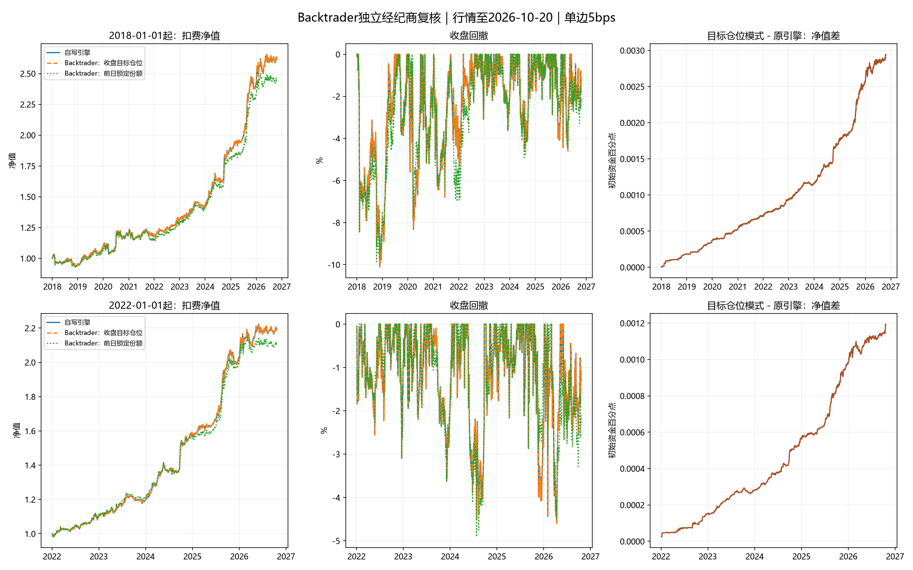

# Backtrader独立回测对照

研究日期2026-10-31；行情截止2026-10-20。当前17只核心池的复核；2026-10-23的旧16只报告单独保留。没有重新调参。

## 1. 原来使用什么引擎

原入口为 `run_backtest.py`，成交、持仓漂移、费用与净值由 `etf_rotation/backtest.py` 自写引擎计算，未使用Backtrader。本次新增 `run_backtrader.py` 和 `etf_rotation/backtrader_engine.py`，安装Backtrader 1.9.78.123，使用原生Cerebro、BackBroker、Position、订单及现金记账，没有覆盖经纪商的成交、持仓、现金或净值方法。

策略信号继续使用同一生产函数；本次独立复核的是订单、资金和收益计算，不是独立重新发现因子，也不能消除选池后视或调参过拟合。

## 2. 相同数据与执行假设

- 所有引擎读取同一份Tushare本地复权收盘价和同一份因果周信号。行情截止2026-10-20，没有自动更新至报告日期。
- 当前运行模式 `hypothetical_full_history`。默认是全历史采用当前红利规则的假设回测，非此前实际账户收益；`--from-adoption`按真实启用日期回放。
- 每个交易周最后开市日收盘形成目标，下一交易日收盘成交。2018前行情只预热因子与状态，不计入2018账户收益。
- 为隔离引擎差异，允许分数复权单位，未套用100份整数手；复权单位不是实盘可直接下单的原始ETF份额。
- 费用合并为原生按成交额比例手续费：手续费3bps＋滑点预算2bps。费用压力测试另外核对0与20bps。没有伪造开高低价后再声称验证盘口滑点。
- 最多沿用3日过去报价估值；缺真实成交报价时取消整个调仓批次；上市前占位值不允许交易，长期缺价持仓立即报错。

## 3. 为什么有两种Backtrader模式

### A. 收盘目标比例对照：保持原模型的执行理想化

原模型在成交日收盘按当时净值恢复目标权重。为了保留这一假设，每个复权收盘被表示为独立的合成收盘事件，OHLC都取该收盘；上一日已冻结的目标在下一事件提交普通Market订单。使用Backtrader `cheat_on_open` 回调在经纪商成交前计算数量，该事件的open代表收盘参考价，**不代表真实开盘**；`cheat_on_close=False`，没有把当日新信号提前成交。

这里只在执行事件按已知模型参考价确定数量，选仓和权重不读取下一日行情。精确按最终收盘价确定份额本身是原模型保留的理想化，实盘临近收盘价格、成交数量与此会有误差。不能把这种对照当作真实收盘竞价可保证实现的业绩。

经纪商实际先卖后买，按原生现金检查成交；目标市值求解 `成交后NAV＋实际成交额×费用率＝成交前NAV`，保留不超过净值1e-11的数值现金余量，避免浮点误差拒单。没有投入新资金、使用杠杆或手工修补NAV。

### B. 前日锁定份额：原生Close订单的执行敏感性

在信号日用当日已知净值和收盘价确定份额，提交原生 `Order.Close`，下一交易日收盘成交。数量不使用下一日价格。次日涨跌会使仓位偏离目标；资金不足时Backtrader会拒绝买单，默认不自动重试。因此它评估的是固定份额执行政策，与A的目标比例政策不同，不应将差异直接判断为因子失效。

- 2018-01-01起：锁定份额模式完成1781笔ETF订单，资金不足/拒单185笔。没有隐藏失败或自动补单。
- 2022-01-01起：锁定份额模式完成1046笔ETF订单，资金不足/拒单106笔。没有隐藏失败或自动补单。

Backtrader官方说明：[次日Close订单](https://www.backtrader.com/docu/order-creation-execution/order-creation-execution/)、[Cheat-On-Open回调](https://www.backtrader.com/docu/cerebro/cheat-on-open/cheat-on-open/)。官方的Close订单不会通过内置滑点机制加价，所以为匹配原研究，将2bps滑点预算作为现金成本合并扣取。[官方滑点说明](https://www.backtrader.com/docu/slippage/slippage/)

## 4. 结果

年化统一按252交易日，夏普无风险利率为零，回撤按收盘净值。研究资金为统一归一化本金，不是用户真实账户。

| 起始日 | 单边总成本bps | 引擎/执行政策 | 年化收益 | 夏普 | 最大回撤 |
| --- | --- | --- | --- | --- | --- |
| 2018-01-01 | 0 | 原自写引擎 | 13.1001% | 1.4824 | -9.3826% |
| 2018-01-01 | 0 | Backtrader：收盘目标比例 | 13.1001% | 1.4824 | -9.3826% |
| 2018-01-01 | 5 | 原自写引擎 | 12.0659% | 1.3762 | -10.1124% |
| 2018-01-01 | 5 | Backtrader：收盘目标比例 | 12.0660% | 1.3762 | -10.1122% |
| 2018-01-01 | 5 | Backtrader：前日锁定份额 | 11.1534% | 1.3805 | -9.8673% |
| 2018-01-01 | 20 | 原自写引擎 | 9.0177% | 1.0540 | -12.2687% |
| 2018-01-01 | 20 | Backtrader：收盘目标比例 | 9.0200% | 1.0542 | -12.2663% |
| 2022-01-01 | 0 | 原自写引擎 | 19.6667% | 2.2197 | -4.5113% |
| 2022-01-01 | 0 | Backtrader：收盘目标比例 | 19.6667% | 2.2197 | -4.5113% |
| 2022-01-01 | 5 | 原自写引擎 | 18.6339% | 2.1167 | -4.5993% |
| 2022-01-01 | 5 | Backtrader：收盘目标比例 | 18.6341% | 2.1167 | -4.5993% |
| 2022-01-01 | 5 | Backtrader：前日锁定份额 | 17.5640% | 2.1407 | -4.9087% |
| 2022-01-01 | 20 | 原自写引擎 | 15.5870% | 1.8028 | -5.0458% |
| 2022-01-01 | 20 | Backtrader：收盘目标比例 | 15.5892% | 1.8031 | -5.0451% |



## 5. 差异与检查

目标比例模式与原引擎的最大逐日净值绝对差为0.00037194；最大实际权重绝对差为1.03e-11。无成本场景逐日净值通过数值一致性检查；所有目标比例订单均严格在信号日之后、约定下一交易日成交，没有资金不足拒单。

有成本时不强制两条曲线完全相等：原模型用扣费前目标名义成交额估算成本，再把所有权重恢复为目标；原生经纪商按真实成交份额扣费，自洽求解可买金额。差异应由这项记账口径及数值余量解释，而非通过覆盖经纪商净值消除。

Backtrader原生TimeReturn与输出逐日收益核对，原生DrawDown与统一统计核对。完整订单、失败原因、现金、净值、实际持仓和对账误差保存于本地输出目录；已有生产文件、实盘状态及live_signal输出指纹保持一致。

8项Backtrader测试覆盖：无成本逐日对账、实际现金扣费、跨起点订单、最后交易日成交、缺价取消、上市前禁止买入、长期缺价停止、前日固定份额与未来价格扰动。完整项目测试结果见当轮策略研究报告；系统临时目录测试使用沙盒外权限完成。

锁定份额模式中的拒单会改变风险暴露，因此较高夏普不能直接归为因子改善。实际执行应根据临近成交时的资产和现金核算可买份额并预留费用；上述固定份额场景保留拒单且不补单，不能直接当作完善的实盘执行系统。

更换回测框架能帮助发现实现错误，无法验证未来持续盈利；仍保留上市可得性、历史选池、交易成本、整数手、收盘竞价、停牌及极端行情等限制。没有模拟真实OHLC路径、盘中回撤、实际现金分红到账或容量。

## 6. 本地运行

```powershell
.\.venv\Scripts\python.exe -m pip install -r requirements.txt
.\.venv\Scripts\python.exe run_backtrader.py
# 仅比较2022年以来
.\.venv\Scripts\python.exe run_backtrader.py --start 2022-01-01 --end 2026-10-20
# 按实际红利启用日期回放
.\.venv\Scripts\python.exe run_backtrader.py --from-adoption
```

可以在PyCharm直接运行 `run_backtrader.py`。默认只读 `data/audit_history` 本地缓存；需覆盖当前17只核心及红利。输出在 `output/backtrader_comparison_current/`，原自写回测仍由 `run_backtest.py` 运行。默认全历史假设同时作用于扩池和红利；`--from-adoption`按二者实际启用日回放。
