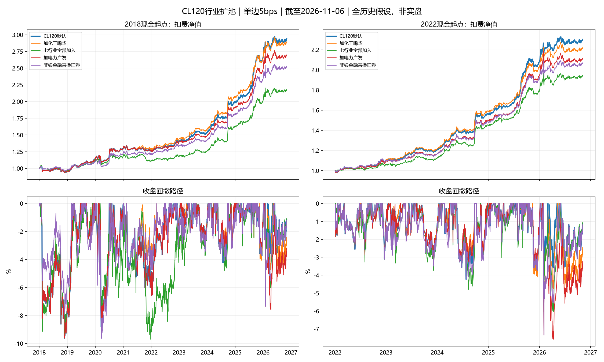
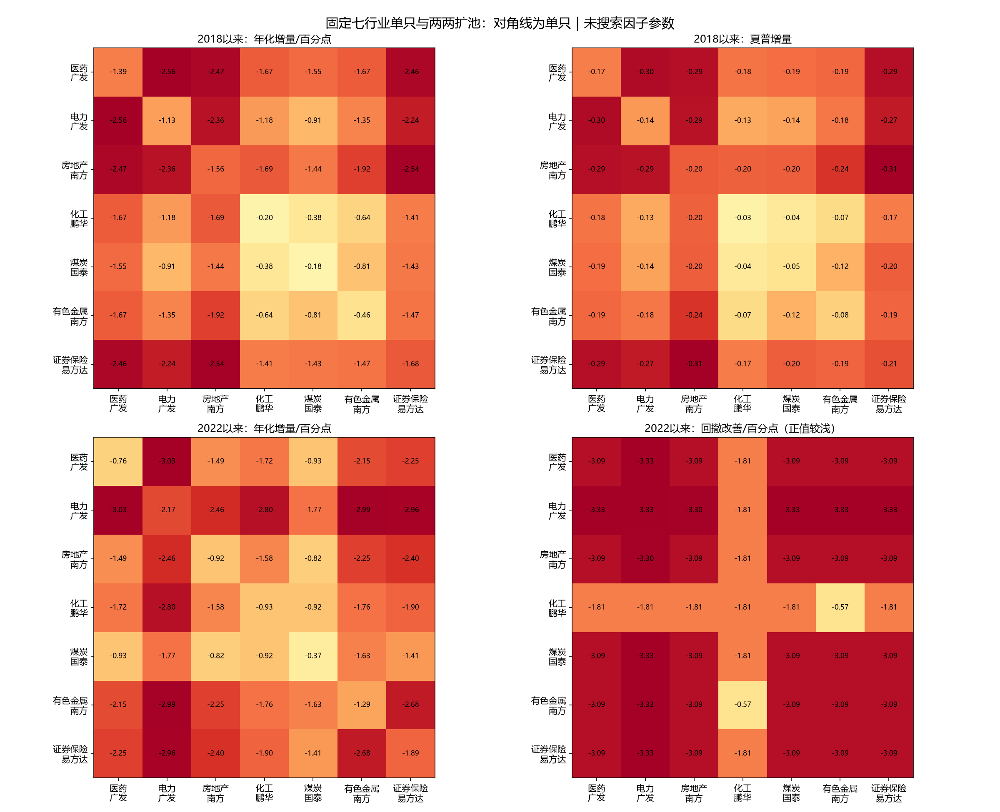

# CL120行业扩池研究：补行业缺口，保持默认不变

研究日期2026-11-09，完整行情统一截至2026-11-06。当前实盘为澄流120（CL120）；本轮只研究，未修改默认池、参数、实盘计划或真实账户。

与上轮截至10月20日的13.49%年化、1.553夏普略有差异，是因为统一追加至11月6日，未更改默认参数。本轮默认为全历史假设回放，不是11月9日才启用的实际账户记录。

## 结论与筛选结果

主层7只：医药卫生、电力公用事业、房地产、化工、煤炭、有色股票、证券保险；观察层2只：农业、基建。当前池通过沪深300、创业板、纳指、红利等已间接覆盖部分行业，“缺少独立ETF”不等于完全没有敞口。现有159980为商品期货ETF，不是有色矿业股票；159928偏主要消费，可选消费仍缺独立代表。

本轮最强非默认方案为加化工鹏华，2018现金起点年化13.30%、夏普1.531、回撤-9.62%；CL120默认为13.50%、1.556、-9.62%。主层方案按2018起点夏普排序的第一名（含默认）为CL120默认。

预设跨区间/费用筛选：2018与2022两个现金起点、5/20bps下年化和夏普均不低于默认，且两个5bps起点回撤≤10%。通过：无。通过也不等于消除过拟合，本轮不据此切换实盘。

35种主表方案（含默认）中，34种扩池/替换在两个现金起点、两档费用下，均没有年化或夏普高于CL120。历史准入后方向相同：扩大行业覆盖在本套评分与固定3个核心风险名额下没有体现稳定收益增益。建议继续使用当前池；医药、电力与有色股票可保留行业覆盖观察价值，化工是最接近默认但尚未胜出的候选，不为追求行业齐全立即实盘加入。

## 候选先筛规模，后看回测

先固定17个行业产品检查对象。主层门槛为2021年末前成立、存续、资产估计≥20亿元、近20日成交额中位数≥1000万元；10—20亿元单列观察，其余不进入回测。没有按回测挑同一行业的最佳基金，也未放宽门槛挽救汽车、家电或材料。

门槛筛选的是本轮列明的代表产品，不是宣称该行业所有ETF都不合格；原池作为既定对照保留，也不据当前门槛二次筛选。候选产品以行业覆盖与历史确定，没有在回测后改换同类代码。

规模为截至11月6日已存在的最新同日份额×单位净值估计净资产，单位亿元；成交额单位亿元。份额来自Tushare，万份乘10000；净值只用于当前筛选，未输入历史信号。NAV披露日不晚于研究日，当前规模仍带有后视选择偏差。

| 代码 | 产品 | 成立日 | 估计净资产/亿元 | 20日成交额中位数/亿元 | 层级 | 原因 |
| --- | --- | --- | --- | --- | --- | --- |
| 159938 | 医药ETF广发 | 20141201 | 45.49 | 0.38 | main | 规模和流动性合格 |
| 159611 | 电力ETF广发 | 20211229 | 84.29 | 3.11 | main | 规模和流动性合格 |
| 512200 | 房地产ETF南方 | 20170825 | 47.80 | 1.29 | main | 规模和流动性合格 |
| 159870 | 化工ETF鹏华 | 20210223 | 102.17 | 2.33 | main | 规模和流动性合格 |
| 515220 | 煤炭ETF国泰 | 20200120 | 76.10 | 6.85 | main | 规模和流动性合格 |
| 512400 | 有色金属ETF南方 | 20170803 | 188.31 | 5.00 | main | 规模和流动性合格 |
| 512070 | 证券保险ETF易方达 | 20140626 | 144.46 | 3.72 | main | 规模和流动性合格 |
| 159825 | 农业ETF富国 | 20201210 | 15.09 | 0.56 | observation | 10—20亿元观察层，单列检验 |
| 516110 | 汽车ETF国泰 | 20210407 | 2.90 | 0.27 | excluded | 规模低于10亿元观察门槛 |
| 159996 | 家电ETF国泰 | 20200227 | 6.39 | 0.41 | excluded | 规模低于10亿元观察门槛 |
| 159936 | 可选消费ETF广发 | 20140603 | 2.00 | 0.01 | excluded | 近期20日成交额中位数低于1000万元 |
| 159944 | 材料ETF广发 | 20150625 | 0.34 | 0.04 | excluded | 近期20日成交额中位数低于1000万元 |
| 515210 | 钢铁ETF国泰 | 20200122 | 8.28 | 0.52 | excluded | 规模低于10亿元观察门槛 |
| 516970 | 基建ETF广发 | 20210623 | 11.94 | 0.21 | observation | 10—20亿元观察层，单列检验 |
| 159666 | 交通运输ETF华夏 | 20230113 | 未筛规模 | — | excluded | 2021年末以后成立，本轮历史过短 |
| 561320 | 交运ETF国泰 | 20221130 | 未筛规模 | — | excluded | 2021年末以后成立，本轮历史过短 |
| 159683 | 运输ETF嘉实 | 20221229 | 未筛规模 | — | excluded | 非存续产品，不复活历史清盘ETF |

## 对照口径与IVOL范围

原17只核心加512890卫星，因子、持仓上限、仓位预算和周度节奏固定。两次独立现金启动为2018-01-02、2022-01-04，2018年前仅预热；年化252日、夏普无风险利率0。默认与扩池均为全历史假设采用当前规则，并非真实采纳日期或个人账户收益。每周最后开市日收盘出信号、下一交易日收盘成交，单边5/20bps；包含自然权重漂移及双边换手，不假设无成本每日再平衡。

新增候选都是A股股票ETF，因此同样加入120日市场IVOL比较，移除的证券ETF不再参与比较；不让新ETF自动享受IVOL豁免。门槛始终是归一化IVOL排名>75%过滤、至少3只有效资产、缺因子中性。扩大比较集合会改变原资产被过滤的名单，绝非仅增加一个可选代码。独立红利卫星不参与核心IVOL或排名；全账户仍可能超过核心8%/70%预算，最多4只风险ETF加国债。

固定35种方案：默认、全部单只、主层两两组合、预设资源篮子、全主层/含观察层、证券保险替换原证券。重复池只算一次；没有搜索新因子、仓位、窗口或过滤阈值。全部140行主结果保留。汽车和家电的行业逻辑合理，但本轮规模不足；交运产品成立较晚，未为凑齐行业而纳入。

## 2018以来：单边5bps

| 方案 | 年化 | 夏普 | 最大回撤 | 双边年换手倍数 |
| --- | --- | --- | --- | --- |
| CL120默认 | 13.50% | 1.556 | -9.62% | 17.88 |
| 加医药广发 | 12.10% | 1.387 | -9.30% | 18.15 |
| 加电力广发 | 12.37% | 1.411 | -9.62% | 17.93 |
| 加房地产南方 | 11.93% | 1.352 | -10.51% | 18.03 |
| 加化工鹏华 | 13.30% | 1.531 | -9.62% | 17.85 |
| 加煤炭国泰 | 13.32% | 1.502 | -9.62% | 18.22 |
| 加有色金属南方 | 13.03% | 1.474 | -8.81% | 18.27 |
| 加证券保险易方达 | 11.81% | 1.342 | -9.13% | 18.13 |
| 加农业富国 | 12.54% | 1.428 | -9.62% | 18.13 |
| 加基建广发 | 12.21% | 1.416 | -9.62% | 17.98 |
| 非银金融替换证券 | 11.51% | 1.327 | -9.67% | 18.36 |
| 七行业全部加入 | 9.60% | 1.124 | -9.70% | 19.21 |
| 主层＋农业/基建观察 | 9.70% | 1.145 | -9.29% | 19.39 |

## 2022以来：单边5bps

| 方案 | 年化 | 夏普 | 最大回撤 | 双边年换手倍数 |
| --- | --- | --- | --- | --- |
| CL120默认 | 19.65% | 2.235 | -4.25% | 16.91 |
| 加医药广发 | 18.89% | 2.085 | -7.35% | 17.04 |
| 加电力广发 | 17.48% | 1.943 | -7.58% | 17.00 |
| 加房地产南方 | 18.72% | 2.074 | -7.35% | 17.05 |
| 加化工鹏华 | 18.72% | 2.131 | -6.06% | 16.97 |
| 加煤炭国泰 | 19.28% | 2.111 | -7.35% | 17.34 |
| 加有色金属南方 | 18.36% | 2.027 | -7.35% | 17.48 |
| 加证券保险易方达 | 17.76% | 1.960 | -7.35% | 17.15 |
| 加农业富国 | 18.35% | 2.028 | -7.35% | 17.43 |
| 加基建广发 | 17.99% | 2.049 | -5.28% | 17.07 |
| 非银金融替换证券 | 16.94% | 1.897 | -7.35% | 17.74 |
| 七行业全部加入 | 15.40% | 1.759 | -6.06% | 18.15 |
| 主层＋农业/基建观察 | 14.97% | 1.739 | -5.06% | 18.38 |

## 2018以来：单边20bps

| 方案 | 年化 | 夏普 | 最大回撤 | 双边年换手倍数 |
| --- | --- | --- | --- | --- |
| CL120默认 | 10.49% | 1.236 | -11.83% | 17.88 |
| 加医药广发 | 9.09% | 1.066 | -10.27% | 18.15 |
| 加电力广发 | 9.38% | 1.095 | -11.83% | 17.93 |
| 加房地产南方 | 8.94% | 1.037 | -13.04% | 18.03 |
| 加化工鹏华 | 10.30% | 1.212 | -11.83% | 17.85 |
| 加煤炭国泰 | 10.26% | 1.183 | -11.83% | 18.22 |
| 加有色金属南方 | 9.98% | 1.154 | -10.94% | 18.27 |
| 加证券保险易方达 | 8.81% | 1.025 | -11.30% | 18.13 |
| 加农业富国 | 9.52% | 1.109 | -11.83% | 18.13 |
| 加基建广发 | 9.22% | 1.094 | -11.83% | 17.98 |
| 非银金融替换证券 | 8.48% | 1.001 | -10.31% | 18.36 |
| 七行业全部加入 | 6.48% | 0.785 | -13.64% | 19.21 |
| 主层＋农业/基建观察 | 6.56% | 0.800 | -11.50% | 19.39 |





## 分段与按过去选择

分段继承2018现金账本，不等同于2022独立现金启动：

| 方案 | 区间 | 年化 | 夏普 | 回撤 |
| --- | --- | --- | --- | --- |
| CL120默认 | 2018-2021 | 6.36% | 0.763 | -9.62% |
| CL120默认 | 2022-2024 | 16.82% | 2.171 | -4.24% |
| CL120默认 | 2025+ | 24.77% | 2.386 | -4.25% |
| 加化工鹏华 | 2018-2021 | 6.94% | 0.826 | -9.62% |
| 加化工鹏华 | 2022-2024 | 17.51% | 2.258 | -3.74% |
| 加化工鹏华 | 2025+ | 21.08% | 2.048 | -6.06% |
| 七行业全部加入 | 2018-2021 | 2.86% | 0.371 | -9.70% |
| 七行业全部加入 | 2022-2024 | 13.84% | 1.798 | -4.80% |
| 七行业全部加入 | 2025+ | 18.31% | 1.776 | -6.06% |

仅在主层方案中，训练截至2021/2024年底，下一年首个周信号后切换。候选各自缓冲状态只使用过去数据持续计算，将所选目标接入同一账户并支付实际换仓费用，没有拼接不同账户的收益。后段已经在项目中观察过，只能称时间顺序诊断，不能称独立盲测：

| 训练截止 | 所选 | 测试区间 | 连续切换账户年化/夏普 | 默认年化/夏普 |
| --- | --- | --- | --- | --- |
| 2021-12-31 | 加化工鹏华 | 2022-01-01至2024-12-31 | 17.51%/2.258 | 16.82%/2.171 |
| 2024-12-31 | 加化工鹏华 | 2025-01-01至2026-11-06 | 21.08%/2.048 | 24.77%/2.386 |

本轮所有方案的配对循环块抽样，每个块长1000次；20/60/120日块长家族均值收益增益p分别为0.992, 0.995, 0.996。这不是夏普差异检验，也不覆盖此前多轮因子、参数和选池搜索。

## 历史准入与份额延迟

新增候选要求真实报价至少252日、前一交易日已知的20日成交额中位数≥1000万元、前一日份额×原始价≥2亿元。份额只向前沿用最多5个交易日，不向后填充；未准入新资产也不影响评分D或IVOL比较集合。该对照只作用于新增候选，原池不另做全市场清盘池重建，因此不是完全无偏的历史选池。

| 方案 | 2018起点年化/夏普/回撤 | 2022起点年化/夏普/回撤 |
| --- | --- | --- |
| CL120默认 | 13.50%/1.556/-9.62% | 19.65%/2.235/-4.25% |
| 加医药广发 | 12.06%/1.383/-9.30% | 18.89%/2.085/-7.35% |
| 加电力广发 | 12.52%/1.429/-9.62% | 17.77%/1.976/-7.58% |
| 加房地产南方 | 12.26%/1.394/-10.51% | 18.72%/2.074/-7.35% |
| 加化工鹏华 | 13.01%/1.503/-9.62% | 18.72%/2.131/-6.06% |
| 加煤炭国泰 | 13.50%/1.521/-9.62% | 19.28%/2.111/-7.35% |
| 加有色金属南方 | 13.01%/1.472/-9.62% | 18.36%/2.027/-7.35% |
| 加证券保险易方达 | 12.17%/1.379/-9.62% | 17.76%/1.960/-7.35% |
| 加农业富国 | 12.82%/1.458/-9.62% | 18.35%/2.028/-7.35% |
| 加基建广发 | 12.71%/1.465/-9.62% | 18.13%/2.057/-5.28% |
| 非银金融替换证券 | 11.66%/1.343/-9.67% | 16.94%/1.897/-7.35% |
| 七行业全部加入 | 9.68%/1.142/-9.45% | 15.58%/1.781/-6.06% |
| 主层＋农业/基建观察 | 9.28%/1.106/-9.45% | 14.80%/1.726/-5.06% |

另将份额估计市值滞后2个交易日复验代表方案，结果留在`two_day_share_lag.csv`；不搜索滞后天数。日频历史份额仍可能修订，未拥有全部逐时发布时间，不能保证1/2日滞后覆盖所有信息延迟。

## 持有时间、相关性与增益来源

各行是仅新增该ETF时的2018账本。持有占比和平均仓位以全部交易日为分母，包括上市前；周期含末端开放周期，不把每次加减仓误算成独立完整获利回合。相关性用2022以来至少252个共同真实日收益，只作事后诊断，不进入选仓。

| 代码 | 产品 | 持有日 | 日占比 | 平均账户权重 | 周期数含开放 | 周期中位日 | 原池最相关 | 相关系数 |
| --- | --- | --- | --- | --- | --- | --- | --- | --- |
| 159938 | 医药ETF广发 | 324 | 15.1% | 2.08% | 17 | 15 | 510300 | 0.693 |
| 159611 | 电力ETF广发 | 154 | 7.2% | 0.98% | 11 | 5 | 510300 | 0.496 |
| 512200 | 房地产ETF南方 | 166 | 7.7% | 0.96% | 13 | 10 | 510300 | 0.612 |
| 159870 | 化工ETF鹏华 | 163 | 7.6% | 0.88% | 7 | 15 | 159875 | 0.778 |
| 515220 | 煤炭ETF国泰 | 49 | 2.3% | 0.24% | 4 | 10 | 561360 | 0.640 |
| 512400 | 有色金属ETF南方 | 121 | 5.6% | 0.71% | 9 | 5 | 510300 | 0.701 |
| 512070 | 证券保险ETF易方达 | 247 | 11.5% | 1.20% | 17 | 15 | 512880 | 0.935 |
| 159825 | 农业ETF富国 | 116 | 5.4% | 0.73% | 7 | 15 | 159928 | 0.716 |
| 516970 | 基建ETF广发 | 136 | 6.3% | 0.76% | 8 | 10 | 510300 | 0.686 |

扩池会通过两条路径改变旧仓：均线反转缩放D包含新增原始评分，IVOL尾部过滤的参照集合也变大。预先列明的解释对照如下；固定旧D仍使用扩展IVOL，禁止新增入选对照则只保留其横截面影响，不将这些对照另作优化冠军：

| 扩池方案 | 解释对照 | 年化 | 夏普 | 回撤 |
| --- | --- | --- | --- | --- |
| 七行业全部加入 | fixed_old_spread | 9.39% | 1.099 | -9.94% |
| 七行业全部加入 | new_assets_not_selectable | 12.83% | 1.458 | -8.81% |
| 加化工鹏华 | fixed_old_spread | 13.33% | 1.533 | -9.62% |
| 加化工鹏华 | new_assets_not_selectable | 13.09% | 1.489 | -9.62% |
| 加有色金属南方 | fixed_old_spread | 13.01% | 1.472 | -8.81% |
| 加有色金属南方 | new_assets_not_selectable | 13.22% | 1.502 | -8.81% |
| 非银金融替换证券 | fixed_old_spread | 11.49% | 1.324 | -9.67% |
| 非银金融替换证券 | new_assets_not_selectable | 12.23% | 1.441 | -9.67% |

几个有实际意义的发现：

- 化工单独加入长期年化13.30%、夏普1.531，最接近默认；2022独立现金起点回撤却由4.25%扩大到6.06%。按过去选池时，2022—2024的连续账户略优，2025以后又落后，不能仅保留有利年份。
- 有色股票将长期最深回撤由9.62%降至8.81%，但2022起点回撤由4.25%升至7.35%，没有跨时期一致的对冲改善。
- 证券保险与原证券ETF日收益相关约0.935；“包含保险、覆盖更宽”不等于提供独立风险来源。单独加入和直接替换原证券，两者都较弱。
- 电力与原核心风险ETF的最高相关仅约0.496，有分散逻辑，但单独加入年化12.37%、夏普1.411，仍弱于默认。相关性低无法补偿本轮选时和机会成本。
- 主层全扩池禁止买入新增ETF，只保留其对D和IVOL比较的影响时，年化12.83%、夏普1.458；允许新ETF入选后降至9.60%、1.124。固定旧D也没有挽回全扩池，约9.39%、1.099。因此不能只把拖累归因于D缩放，也不能忽略IVOL参照集合变化。
- 煤炭单独加入仅49个持有日、4个周期，平均账户权重约0.24%；其表现变动还涉及旧仓被重新排序，不能用较少持仓样本认定因子对煤炭有稳定选择能力。

`cross_section_changes.csv`记录在完全不买新增资产时，旧目标或IVOL名单仍改变的周数。`log_attribution.csv`将默认、最强非默认、全主层等的累计对数净增长精确拆为各ETF与交易成本；它不是ETF自身年化，也不是各资产买入持有收益相加。完整持仓和相关性矩阵均保留，便于识别增益是否依赖单一资产或仅来自重排原仓。

## 验证、限制与复现

105项研究检查全部通过：CL120默认与当前生产整合函数对账、单只及代表性扩池目标与生产函数对账、5/20bps逐日引擎复核、上市前/仓位/名额/IVOL约束、历史准入、多个真实周末截点的价格截断与未来扰动、对数归因对账、默认配置与实盘计划指纹未变。测试验证实现，不能证明策略没有任何未知问题。

现存产品和当前规模筛选仍有幸存者与后视偏差；本轮识别了终止产品但未重建全市场历史清盘ETF。此前已反复开发并观察历史，不能将默认胜出或局部冠军当作充分的可盈利证明。理想回测允许分数单位，未模拟整手、最低佣金、盘中缺流动性、真实竞价价格和分红现金到账。保持CL120默认；行业覆盖合理性与提高回测收益是两项不同目标。

```powershell
python research_cl120_pool_expansion.py --screen
python research_cl120_pool_expansion.py --download
python research_cl120_pool_expansion.py
python research_cl120_pool_expansion.py --report-only
```

缓存`data/cl120_pool_expansion_20261109/`，全部结果`output/cl120_pool_expansion_20261109/`，均Git忽略。源代码固定CL120基线与截至11月6日的数据，后续重跑不会自动扩展到今天或修改实盘。

本轮基线行情复用`data/factor_extensions_20261109/`。新克隆环境若缺少该缓存，先运行`python research_factor_extensions.py --download-only`准备完整18只基线，再按上述顺序运行；每人使用自己的Tushare权限。只运行`--report-only`需要保留已生成的本轮结果，不请求新行情。

## 公开来源

- [易方达512070官方产品页：证券、保险及非银金融范围](https://www.efunds.com.cn/fund/512070_org.shtml)
- [上交所512400产品信息](https://www.sse.com.cn/assortment/fund/list/etfinfo/basic/index.shtml?FUNDID=512400)
- [富国159825官方产品与公告](https://wap.fullgoal.com.cn/fundDetail/159825/index.html)
- [上交所516110产品概要：汽车及零部件范围与上市日期](https://www.sse.com.cn/disclosure/fund/announcement/c/new/2026-03-19/516110_20260319_22W5.pdf)
- [前轮行业扩池报告与官方医药、电力、地产、化工资料](pool_expansion_20261031.md)
- [Tushare基金份额接口：单位万份](https://tushare.pro/document/2?doc_id=207)
