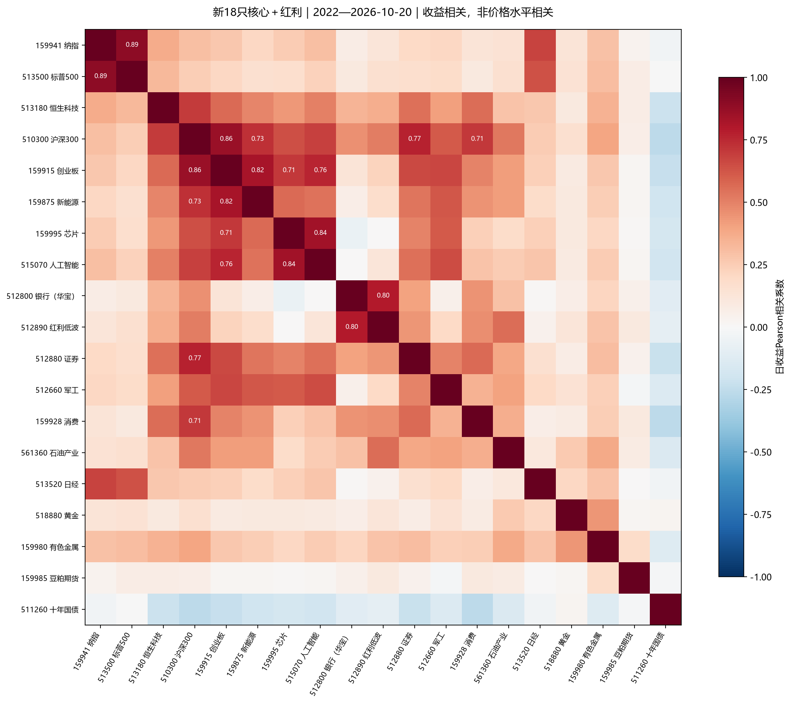
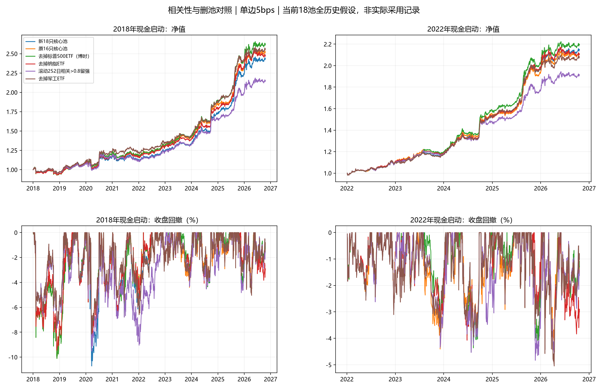

# 新18只核心池：相关性、共线性及删减研究

后续实施更新：用户在本报告完成后选择删除513500标普500，默认现为17只核心＋512890卫星，对应下文`drop_513500`。恒科仍按11月6日信号、11月9日执行启用。本报告保留原18只研究设计和全部对照结果，下文“当前配置”指研究完成时的配置。

2026-10-31研究；统一行情截止2026-10-20。用户明确选择加入恒生科技513180和标普500 513500，当前配置已更新为18只核心＋512890卫星，共19只。本轮删除方案只研究，不自动更改这份新默认。

## 实施与历史边界

核心评分、8%预算、70%核心风险上限、单只30%、最多3只核心风险ETF、前4缓冲必选第1名及红利规则均保留。新池仍可能有4只风险ETF加国债，共5只；未施加新的境外合计仓位上限。

按本地Tushare开市日历，新标的从下一次尚未形成的周信号2026-11-06起进入评分与资格池，计划2026-11-09收盘执行。10月30日形成、11月2日执行的计划不追溯改写。新增ETF价格提前预热，启用前只屏蔽评分/资格及截面离散度D的贡献，启用日即可使用完整历史因子，不再额外空等60天。旧缓冲历史自然连续，不拿研究虚拟持仓初始化实盘。

原16只定义冻结为`LEGACY_CORE_NAMES`，旧公共状态保存为`data/rotation_state_20261031.json`；既有研究显式使用旧池与冻结状态。当前状态schema4记录扩池日期。验证截至10月30日全部实际模式周目标与旧16只逐点一致，最大误差0；新两只启用前权重为0。实盘入口已联网验证到10月30日，但写入独立检查文件，没有覆盖原`output/live_signal.json`，也没有读取或更新真实账户。

普通回测默认按实际扩池及红利启用日回放。`--hypothetical-universe`才假设新18只全历史可用；红利全历史另加`--hypothetical-satellite`。下文研究同时采用这两个历史假设，不是此前实际采用的新池业绩。

## 主要结论

相关性最高的直接重叠在纳指/标普500、芯片/AI、创业板/新能源；沪深300与创业板也高度相关。银行与红利低波相关较高，卫星并非独立于股票的国债型对冲资产。没有充分证据支持一律删掉高相关ETF，滚动相关性留强反而降低历史收益。

两只新增ETF的效果不能简单相加：新18只全历史主区间年化11.09%、夏普1.286，对比原16只11.55%、1.322；2022后新18只18.06%、2.068，对比原16只17.57%、2.006。排名名额、缓冲及评分离散度随池变化，单独加入恒科或标普的增益不能直接相加。

若只研究美股组，移除标普、保留纳指与恒科的17只核心方案，主区间12.07%、夏普1.376；移除纳指、保留标普与恒科则11.32%、1.321，主区间回撤较小。按用户本轮指令仍保留两者，不在探索后自动撤销刚加入的标普。

## 相关性如何计算

使用境内ETF人民币后复权日收益，不使用价格水平相关，避免共同上涨趋势造成虚高。日Pearson、日Spearman、周收益、沪深300下跌日以及过去252日滚动相关分别保存；成对至少126个共同日收益，周收益至少26个。缺价不反向填充，也不将ETF上市前指数历史伪装为可成交ETF。

下面以2022年以来日收益排序；“最近252日”截止10月20日；滚动超过0.8比例按2018以来有足够成对报价的窗口计算，不含无历史窗口。每对有效日期可能不同，不把它们当作完全相同样本。

| 代码对 | 名称 | 2022后日相关 | 周相关 | 最近252日 | 滚动相关>0.8比例 |
| --- | --- | --- | --- | --- | --- |
| 159941 / 513500 | 纳指ETF / 标普500ETF（博时） | 0.892 | 0.880 | 0.842 | 84.7% |
| 510300 / 159915 | 沪深300ETF / 创业板ETF | 0.862 | 0.872 | 0.890 | 76.5% |
| 159995 / 515070 | 芯片ETF（半导体） / 人工智能ETF | 0.841 | 0.860 | 0.873 | 64.8% |
| 159915 / 159875 | 创业板ETF / 新能源ETF | 0.821 | 0.811 | 0.741 | 79.8% |
| 512800 / 512890 | 银行ETF（华宝） / 红利低波 | 0.796 | 0.831 | 0.879 | 40.9% |
| 510300 / 512880 | 沪深300ETF / 证券ETF | 0.768 | 0.774 | 0.665 | 37.7% |
| 159915 / 515070 | 创业板ETF / 人工智能ETF | 0.762 | 0.784 | 0.904 | 26.8% |
| 510300 / 159875 | 沪深300ETF / 新能源ETF | 0.731 | 0.713 | 0.726 | 22.5% |
| 159915 / 159995 | 创业板ETF / 芯片ETF（半导体） | 0.710 | 0.723 | 0.810 | 7.5% |
| 510300 / 159928 | 沪深300ETF / 消费ETF | 0.709 | 0.736 | 0.250 | 40.4% |



## 共线性诊断与解释

在全部19只都有真实日收益的共同区间2023-11-01—2026-10-20（718日）计算标准化收益矩阵。相关矩阵条件数176.0，第一主成分解释37.4%，熵有效维度约8.96。这些是事后数据维度诊断，不等于账户持有19只或只有9个真实独立风险。

| 代码 | ETF | VIF |
| --- | --- | --- |
| 510300 | 沪深300ETF | 17.07 |
| 159915 | 创业板ETF | 10.78 |
| 515070 | 人工智能ETF | 7.46 |
| 159995 | 芯片ETF（半导体） | 5.30 |
| 159941 | 纳指ETF | 5.14 |
| 512890 | 红利低波 | 5.08 |
| 513500 | 标普500ETF（博时） | 4.48 |
| 512800 | 银行ETF（华宝） | 3.99 |

VIF为将一只ETF标准化收益对其他全部ETF作线性解释的方差膨胀量。沪深300VIF高，部分正是因为它包含多个行业、能被行业和成长组合解释；不能据此认定应删除。我们的排名策略不是直接估计19个回归系数，VIF高不等于当前模型求逆失效或策略不能盈利。风险协方差本来就会使用实际入选最多3只核心资产的历史相关性。

低相关不是唯一目标：低相关但没有趋势收益的候选也会拖累轮动；相关性高也不代表两只在所有阶段收益、波动和估值完全相同。特别是负相关可能提供对冲，不应按绝对相关值机械删除。[欧洲央行关于跨资产相关变化和分散的研究](https://www.ecb.europa.eu/press/financial-stability-publications/fsr/focus/2022/html/ecb.fsrbox202211_02~7abb48e333.et.html)

## 删除试验设计

41种场景：17只核心风险ETF逐一删除；三组（纳指/标普、芯片/AI、创业板/新能源）各保留两只或删除其中一只的27组合，与逐一删除去重；另有原16只、移除红利卫星和滚动筛除。国债保持为防守与估值资产；删除沪深300仅取消它的投资资格，仍保留其已知价格作为市场趋势过滤基准。股票红利卫星单独作消融，不混进核心动量名额。

静态删池会从评分离散度D和资格中同时移除标的；它们参考已观察的高相关组，属于事后探索，并非历史可知的无偏ETF池，也不是独立盲测。所有差方案保留，没有因结果好看而删试验。

滚动方案只用信号日前252日日收益、至少126对报价，正相关>0.8时按当日合格评分从强到弱贪心保留，剩余入选再走原缓冲与配置。固定0.8，没有搜索最优阈值；负高相关不删除。使用独立资格掩码，不改价格、不改原始评分D、不改沪深300趋势和弱市减仓，不把全期相关矩阵输入过去信号。它还可能增加切换与机会成本，不能把“留强”视为必然改善。

## 2018年以来：全部参数不变

| 方案 | 年化 | 零利率夏普 | 最大回撤 | 年均双边名义换手/NAV |
| --- | --- | --- | --- | --- |
| 原16只核心池 | 11.55% | 1.322 | -10.11% | 18.57 |
| 新18只核心池 | 11.09% | 1.286 | -10.72% | 18.61 |
| 去掉标普500ETF（博时） | 12.07% | 1.376 | -10.11% | 18.37 |
| 去掉纳指ETF | 11.32% | 1.321 | -9.45% | 18.80 |
| 去掉芯片ETF（半导体） | 10.57% | 1.219 | -10.72% | 18.86 |
| 去掉人工智能ETF | 9.81% | 1.155 | -10.74% | 19.13 |
| 去掉创业板ETF | 11.06% | 1.261 | -9.80% | 18.81 |
| 去掉新能源ETF | 10.98% | 1.280 | -10.72% | 18.61 |
| 去掉沪深300ETF | 11.32% | 1.295 | -9.75% | 18.58 |
| 去掉银行ETF（华宝） | 10.97% | 1.252 | -10.72% | 18.51 |
| 去掉红利卫星 | 8.57% | 1.093 | -8.73% | 17.94 |
| 去掉军工ETF | 11.75% | 1.378 | -8.16% | 18.46 |
| 滚动252日相关>0.8留强 | 9.47% | 1.113 | -9.52% | 20.23 |

## 2022年以来辅助比较

| 方案 | 年化 | 零利率夏普 | 最大回撤 | 年均双边名义换手/NAV |
| --- | --- | --- | --- | --- |
| 原16只核心池 | 17.57% | 2.006 | -4.43% | 17.72 |
| 新18只核心池 | 18.06% | 2.068 | -4.60% | 17.12 |
| 去掉标普500ETF（博时） | 18.63% | 2.117 | -4.60% | 17.33 |
| 去掉纳指ETF | 17.61% | 2.031 | -4.60% | 17.74 |
| 去掉芯片ETF（半导体） | 17.98% | 2.016 | -5.90% | 17.29 |
| 去掉人工智能ETF | 16.81% | 1.957 | -4.60% | 17.75 |
| 去掉创业板ETF | 17.54% | 2.010 | -4.60% | 17.53 |
| 去掉新能源ETF | 17.86% | 2.062 | -4.43% | 17.12 |
| 去掉沪深300ETF | 17.46% | 2.014 | -4.60% | 17.22 |
| 去掉银行ETF（华宝） | 17.83% | 2.040 | -4.66% | 16.87 |
| 去掉红利卫星 | 14.56% | 1.839 | -4.35% | 16.16 |
| 去掉军工ETF | 17.25% | 2.001 | -5.05% | 17.51 |
| 滚动252日相关>0.8留强 | 15.13% | 1.788 | -4.83% | 19.61 |



## 高成本、区间稳定性与选择偏差

单边20bps、2018主区间：

| 方案 | 年化 | 零利率夏普 | 最大回撤 | 年均双边名义换手/NAV |
| --- | --- | --- | --- | --- |
| 新18只核心池 | 8.03% | 0.956 | -11.52% | 18.61 |
| 去掉标普500ETF（博时） | 9.02% | 1.054 | -12.27% | 18.37 |
| 去掉纳指ETF | 8.22% | 0.985 | -11.67% | 18.80 |
| 去掉军工ETF | 8.69% | 1.045 | -9.59% | 18.46 |
| 滚动252日相关>0.8留强 | 6.19% | 0.754 | -13.63% | 20.23 |

主区间事后最高夏普是去掉军工ETF，但军工不属于最高相关三组；其改善主要反映历史样本及选时，不应归为“成功去共线性”。它在2022后年化17.25%、夏普2.001、回撤5.05%，反而弱于新18只18.06%、2.068、4.60%。区间选择会改变答案。

纳指/标普一组值得优先跟踪，但移除标普也有代价：20bps下2018最大回撤12.27%，深于新18只11.52%，并非所有指标都改善。芯片/AI只留一个、创业板/新能源只留一个，没有显示全面稳定优势。强制降低相关性会损失可轮动的机会；不能仅因相关0.84就删除一只。

循环块抽样对核心删池/滚动家族的均值增益做探索性多场景校正（不含原16及去卫星对照），20/60/120日块各1500次，p约0.706, 0.666, 0.613；未达5%显著性，不证明删除优于新默认，也不涵盖项目所有先前搜索。

## 检查与实施状态

本轮共59项研究检查全部通过，包括新18只全历史目标与生产整合函数对账、静态删除与生产屏蔽对账、多个5/20bps逐日账本对账、41场景仓位约束、3个历史截点滚动规则前缀截断及未来扰动、研究期间默认/实盘文件指纹不变。完整117项单元测试通过，新增扩池启用、评分解释、负相关保留和资格过滤不改变市场状态等测试。实盘切换另有真实日历与旧目标逐点一致检查。

新18只完整历史另经原生Backtrader复核：2018起5bps年化11.0881%，自写引擎11.0879%；2022起18.0604%，自写18.0602%，差异来自费用与成交名义金额口径。无成本逐日净值数值一致。该复核保留收盘目标数量的理想假设，不保证实际收盘竞价可实现，也不能排除选池过拟合。[当前Backtrader报告](backtrader_comparison_current.md)

本轮不是对2018年以来未来盈利的证明。当前池经历多次开发选择，相关性分组和删除试验也已观察历史；没有完整清盘名单及历史全市场池，仍有后视/幸存者偏差。回测按下一交易日收盘理想化恢复目标，允许分数复权单位；无风险利率零，252日年化，费用默认单边3bps＋2bps滑点预算，回撤为收盘净值。红利全历史参与是历史假设。没有整数手、真实盘口容量、现金分红延迟及实盘成交保证。

执行结论：按用户选择加入恒科和标普，暂不删除任何默认ETF；删除标普、删除军工及滚动筛除仅留研究候选，未改为实盘规则。

## 本地复现

新18只完整历史假设：

```powershell
python run_backtest.py --start 2018-01-01 --end 2026-10-20 --cache-dir data/audit_history --offline --hypothetical-satellite --hypothetical-universe --output-dir output/new18_history
python research_correlation_audit.py
python research_correlation_audit.py --report-only
```

实际启用模式继续正常运行`live_signal.py`，无需添加历史假设参数。已有旧回测摘要会因策略版本不同被绘图入口拒绝，先重新运行所需模式的回测。当前Backtrader复核输出移到`output/backtrader_comparison_current/`和`docs/backtrader_comparison_current.md`，不会覆盖10月23日旧16只报告。

研究数表、完整41场景的逐日收益/目标/分段、VIF/PCA与检查在`output/correlation_research_20261031/`。此研究读取独立跨境缓存，固定截至10月20日，不把实盘缓存后来更新至10月30日的行情悄悄加入比较。
