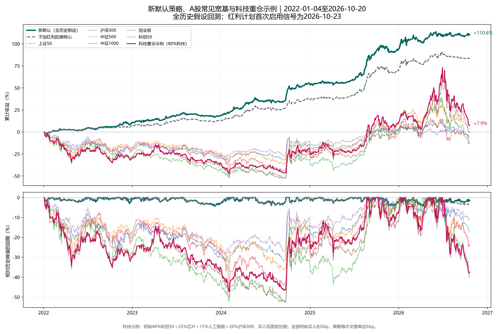
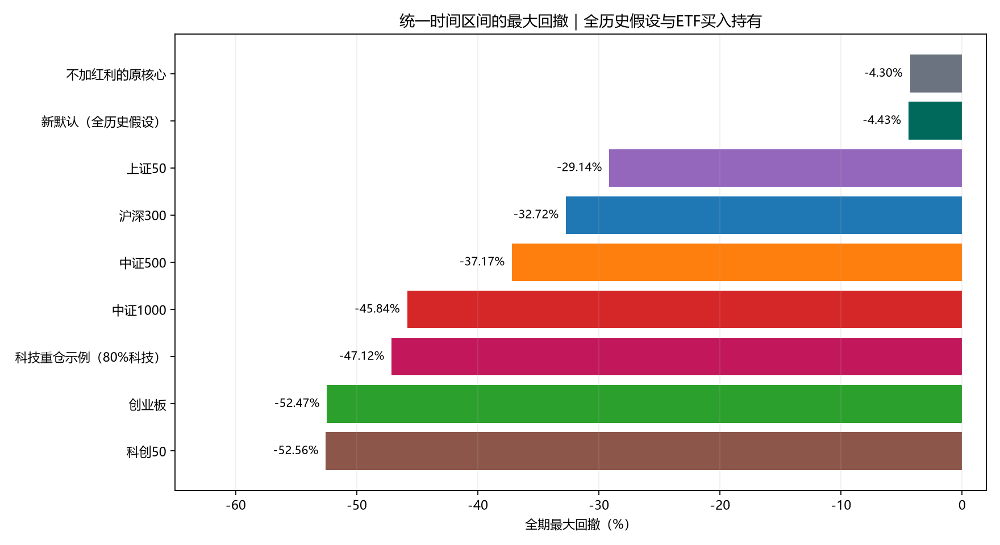
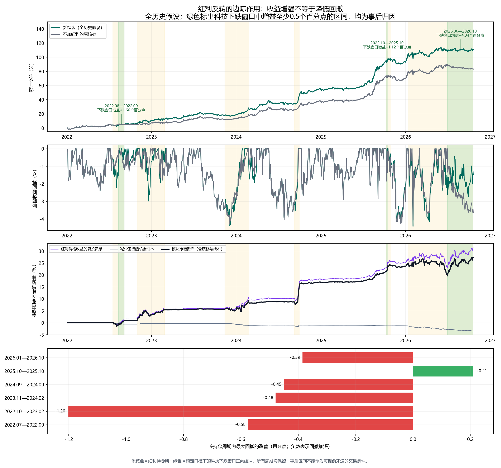

# 新默认策略、宽基与科技重仓对比及红利归因

数据区间2022-01-04至2026-10-20；研究生成于2026-10-21。

**所有新默认历史曲线是假设从2022年以来均已执行新规则；红利计划首个启用信号为2026-10-23。截至本图数据末日尚无该模块的实盘对冲记录。**

## 比较口径

宽基用代表ETF复权买入持有，上证50/沪深300/中证500/中证1000/创业板/科创50，不是官方指数总收益序列。科技重仓是预先固定的示例：40%588000科创50、25%159995芯片、15%515070人工智能、20%510300沪深300，首日买入后固定份额，不调参、不再平衡，不代表真实用户账户。所有买入持有组合初始成本5bp；新默认和原核心每次交易单边5bp，均未模拟整数手、最低佣金、期末卖出或盘中回撤。

## 收益与风险

| 方案 | 累计收益 | 年化 | 夏普 | 最大回撤 |
| --- | ---: | ---: | ---: | ---: |
| 新默认（全历史假设） | 110.56% | 17.57% | 2.006 | -4.43% |
| 不加红利的原核心 | 83.21% | 14.07% | 1.762 | -4.30% |
| 上证50 | -4.40% | -0.97% | 0.027 | -29.14% |
| 沪深300 | -6.57% | -1.47% | 0.009 | -32.72% |
| 中证500 | 0.82% | 0.18% | 0.122 | -37.17% |
| 中证1000 | -11.72% | -2.67% | 0.020 | -45.84% |
| 创业板 | -12.66% | -2.90% | 0.068 | -52.47% |
| 科创50 | -0.26% | -0.06% | 0.165 | -52.56% |
| 科技重仓示例（80%科技） | 7.93% | 1.67% | 0.204 | -47.12% |





## 红利模块与原核心的逐周期对照

入场及退出区间由既有策略信号确定，下一交易日收盘执行。每个周期计算从买入执行日至卖出执行日的组合收益和局部回撤，包含相关交易费用。回撤改善为新默认回撤减原核心回撤，正值表示缓冲、负值表示加深。

| 周期 | 新默认收益 | 原核心收益 | 新增收益 | 新默认局部回撤 | 原核心局部回撤 | 回撤改善 |
| --- | ---: | ---: | ---: | ---: | ---: | ---: |
| 2022-07-18至2022-09-05 | 1.35% | 0.40% | +0.95个百分点 | -1.66% | -1.08% | -0.58个百分点 |
| 2022-10-31至2023-02-27 | 5.70% | 1.58% | +4.11个百分点 | -2.99% | -1.78% | -1.20个百分点 |
| 2023-11-13至2024-02-26 | 6.89% | 4.96% | +1.93个百分点 | -1.69% | -1.21% | -0.48个百分点 |
| 2024-09-09至2024-09-30 | 9.59% | 4.36% | +5.23个百分点 | -0.57% | -0.12% | -0.45个百分点 |
| 2025-10-09至2025-10-27 | 3.16% | 1.71% | +1.45个百分点 | -1.64% | -1.85% | +0.21个百分点 |
| 2026-01-12至2026-10-19 | 5.11% | 4.20% | +0.92个百分点 | -4.43% | -4.05% | -0.39个百分点 |

## 科技下跌窗口中的缓冲

为了避免只挑有利日期，逐个持仓周期固定选取科技重仓示例在该周期内最大的峰谷下跌区间，六个窗口全部列出。这些峰谷只能事后知道，仅用于归因，不进入策略或参数选择。图中绿色仅标出科技跌幅至少3%、同时新默认相对原核心的窗口收益增益至少0.5个百分点的区间；它不等同于持仓全周期回撤降低或严格金融对冲。

| 科技峰日→谷日 | 科技下跌 | 新默认区间收益 | 原核心区间收益 | 红利模块净增益 |
| --- | ---: | ---: | ---: | ---: |
| 2022-08-11至2022-09-05 | -10.59% | 1.47% | -0.12% | +1.60个百分点 |
| 2022-11-15至2022-12-23 | -9.19% | -0.24% | 0.32% | -0.56个百分点 |
| 2023-11-14至2024-02-05 | -23.41% | 3.17% | 2.70% | +0.47个百分点 |
| 2024-09-06至2024-09-18 | -1.98% | 0.40% | 0.72% | -0.31个百分点 |
| 2025-10-09至2025-10-17 | -10.33% | 0.98% | -0.14% | +1.12个百分点 |
| 2026-06-30至2026-10-19 | -38.05% | 0.61% | -3.44% | +4.04个百分点 |



六个完整周期中，1个周期的局部最大回撤降低，5个加深；因此红利不能被概括为持续有效的避险资产。全期新默认回撤-4.43%、原核心-4.30%。原策略本身的国债、现金及风险控制仍是防守的重要来源。

期末相对不加红利的净资产增加27.35个初始本金百分点。精确归因包括红利收益、减少国债的机会成本、核心权重自然漂移及额外费用；按原核心收益复投后各项合计严格等于净值差。不能直接把红利ETF涨幅乘30%当作全期组合增益。

所有历史已被观察，多轮策略选择存在过拟合风险；过去完成周期胜率不保证未来，历史回撤不是未来上限。

## 复现

```powershell
.\.venv\Scripts\python.exe plot_benchmarks.py --dividend-attribution --offline --end 2026-10-20
```

完整净值、逐日回撤、截至各日最深回撤、周期归因、增量收益与资产分解、行情缺口和指纹检查保存在output/default_benchmark_20261021/。

## 产品资料

- [华夏科创50 ETF 588000](https://fund.chinaamc.com/fund/588000/)
- [华夏人工智能ETF 515070](https://www.chinaamc.com/fund_en/515070/index.shtml?source=click)
