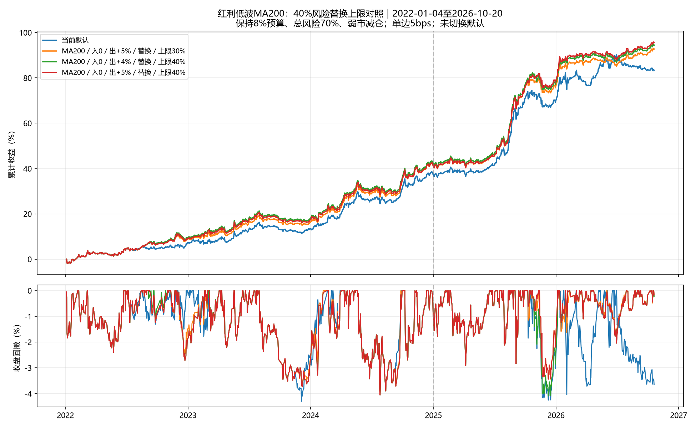

# 红利低波40%上限：4%与5%退出对照

研究日期2026-10-21；行情截止2026-10-20。收益自2022-01-04起。

用户指定两项后续检验；保持原数据、核心参数和成交时点。未重新扫描窗口、入场线、持有期或ETF。补充30%同阈值对照用于区分仓位与退出阈值的影响；未切换默认策略。

## 仓位定义

红利512890上限40%按账户总资产计算，其他风险ETF仍限30%。红利活跃时只保留核心评分最高的至多2只，从原风险仓中划出min(40%,原风险总目标)作为初始红利需求，再复核原风险总额、70%总上限、8%波动预算、弱市减半及单只上限。因此40%是上限，实际目标可显著更低；不会像50%压力版本一样绕过风险约束。目标限仓不阻止非调仓日价格引起的自然权重漂移。

以真实报价的复权价格计算200日均线；信号日收盘低于/等于均线触发，持有至超过均线4%或5%，不限日。周末信号、下一交易日收盘成交；持有期间每周依风险预算更新仓位。核心缓冲按原独立周目标重放。

## 全期结果

单边5bps；零无风险利率夏普；收盘最大回撤。

| 方案 | 年化 | 夏普 | 最大回撤 | 实际年化波动 | 全期平均红利仓 | 实际最大红利仓 |
| --- | ---: | ---: | ---: | ---: | ---: | ---: |
| 当前默认 | 14.07% | 1.762 | -4.30% | 7.64% | 0.00% | 0.00% |
| MA200／入0／出+3%／替换／上限30% | 15.46% | 2.083 | -4.26% | 7.02% | 8.09% | 31.65% |
| MA200／入0／出+4%／替换／上限30% | 15.24% | 2.065 | -4.06% | 6.99% | 9.03% | 31.65% |
| MA200／入0／出+5%／替换／上限30% | 15.33% | 2.097 | -4.06% | 6.92% | 9.54% | 31.65% |
| MA200／入0／出+4%／替换／上限40% | 15.55% | 2.106 | -4.10% | 6.98% | 10.08% | 40.94% |
| MA200／入0／出+5%／替换／上限40% | 15.70% | 2.150 | -4.06% | 6.89% | 10.72% | 40.94% |



## 成本敏感性

| 方案 | 单边10bps年化 | 10bps夏普 | 10bps回撤 | 单边20bps年化 | 20bps夏普 | 20bps回撤 |
| --- | ---: | ---: | ---: | ---: | ---: | ---: |
| 当前默认 | 13.12% | 1.653 | -4.64% | 11.24% | 1.431 | -5.30% |
| MA200／入0／出+3%／替换／上限30% | 14.52% | 1.967 | -4.46% | 12.66% | 1.732 | -4.87% |
| MA200／入0／出+4%／替换／上限30% | 14.33% | 1.951 | -4.25% | 12.52% | 1.721 | -4.70% |
| MA200／入0／出+5%／替换／上限30% | 14.44% | 1.984 | -4.21% | 12.66% | 1.756 | -4.70% |
| MA200／入0／出+4%／替换／上限40% | 14.64% | 1.993 | -4.31% | 12.84% | 1.765 | -4.75% |
| MA200／入0／出+5%／替换／上限40% | 14.82% | 2.039 | -4.21% | 13.06% | 1.813 | -4.73% |

## 时间分段

2022—2024与2025后仅作已观察历史的时间分段，不称独立样本外盲测。

| 方案 | 前段年化 | 前段夏普 | 前段回撤 | 后段年化 | 后段夏普 | 后段回撤 |
| --- | ---: | ---: | ---: | ---: | ---: | ---: |
| 当前默认 | 11.64% | 1.703 | -4.30% | 18.27% | 1.885 | -4.26% |
| MA200／入0／出+3%／替换／上限30% | 13.30% | 1.929 | -4.06% | 19.18% | 2.319 | -4.26% |
| MA200／入0／出+4%／替换／上限30% | 12.88% | 1.869 | -4.06% | 19.32% | 2.360 | -4.04% |
| MA200／入0／出+5%／替换／上限30% | 12.71% | 1.853 | -4.06% | 19.86% | 2.466 | -3.44% |
| MA200／入0／出+4%／替换／上限40% | 12.96% | 1.870 | -4.06% | 20.01% | 2.465 | -4.10% |
| MA200／入0／出+5%／替换／上限40% | 12.75% | 1.849 | -4.06% | 20.82% | 2.612 | -3.44% |

## 同规则跨ETF复核

515100与515450不重新调参；二者与512890相关，不能算独立复制。

| ETF | 方案 | 年化 | 夏普 | 回撤 |
| --- | --- | ---: | ---: | ---: |
| 515100 | MA200／入0／出+4%／替换／上限30% | 13.78% | 1.849 | -4.38% |
| 515100 | MA200／入0／出+5%／替换／上限30% | 13.75% | 1.860 | -4.38% |
| 515100 | MA200／入0／出+4%／替换／上限40% | 13.64% | 1.826 | -5.03% |
| 515100 | MA200／入0／出+5%／替换／上限40% | 13.72% | 1.852 | -5.03% |
| 515450 | MA200／入0／出+4%／替换／上限30% | 14.85% | 2.047 | -4.30% |
| 515450 | MA200／入0／出+5%／替换／上限30% | 14.67% | 2.037 | -4.30% |
| 515450 | MA200／入0／出+4%／替换／上限40% | 15.09% | 2.075 | -4.30% |
| 515450 | MA200／入0／出+5%／替换／上限40% | 15.02% | 2.083 | -4.30% |

## 当前状态与持有周期

- MA200／入0／出+4%／替换／上限40%：主样本完成6次，未结束0次；截止日信号状态空仓，相对MA200偏离4.33%。最大回撤峰日2025-10-23、谷日2025-12-09；谷日红利实际仓位0.00%。红利活跃日平均仓位29.96%，目标最大40.00%。
- MA200／入0／出+5%／替换／上限40%：主样本完成5次，未结束1次；截止日信号状态持有，相对MA200偏离4.33%。最大回撤峰日2024-05-20、谷日2024-07-26；谷日红利实际仓位0.00%。红利活跃日平均仓位30.17%，目标最大40.00%。

## 局限及验证

- 两项为在既有研究结果之后提出的后续检验；原72项的p值不涵盖新搜索，也未检验40%是最优上限。
- 不限日会保留很长的浮亏/未完成周期；均线退出线会移动，不保证盈利。未结束周期保留在净值和episodes.csv中。
- 历史最大回撤仅是样本内已实现结果，不是止损承诺。未模拟盘中回撤、最低佣金、整手、实际分红到账和容量。
- 两项共12项前缀/未来行情扰动检查全部通过，目标最大误差0；正式源代码、锚点、实盘JSON指纹未变。

## 复现

```powershell
.\.venv\Scripts\python.exe research_dividend_reversion.py --cap40 --end 2026-10-20
```

全部对照、年度表现、真实漂移权重、目标权重、逐日收益、周期与审计位于output/dividend_reversion_20261021/cap40。
