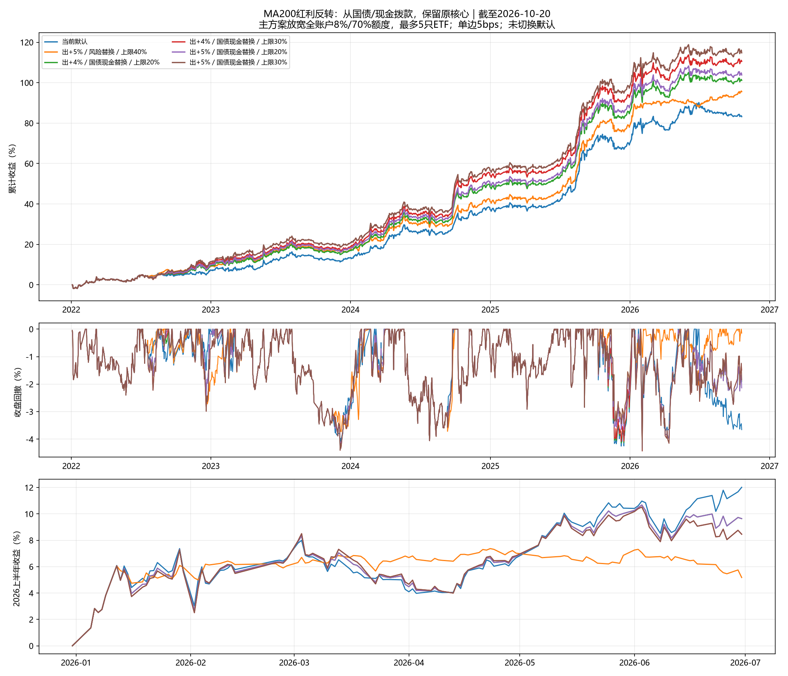

# 红利低波：以国债和现金为资金来源的反转卫星

研究日期2026-10-21；行情截止2026-10-20；主绩效2022-01-04起。

## 规则与比较口径

本轮固定MA200、入0%、出+4%/+5%、不限持有日，上限20%/30%。从原国债及现金目标中拨款，先用现金、再减国债，保持所有原风险ETF的目标权重、名单与核心缓冲路径。没有新调入金、杠杆或透支。持有期间每周恢复目标卫星额度；额度不足时使用可用防守资金。周末信号、下一交易日收盘成交。

原核心继续执行其8%预算、弱市减仓、单只30%和最多3只风险ETF；主方案叠加卫星后不再将整个账户压回8%预算或70%风险上限，因此可出现4只风险ETF加国债共5只、风险总仓位最高100%。它是用户本轮资金来源假说的研究性放宽，未切换实盘默认。另有4项匹配对照：保持核心不动，仅在原8%/70%额度（弱市4%/35%）剩余范围加卫星，额度不足则少买或不买。若核心原目标自身已超重新测算的预测波动额度，剩余额度对照不主动修复核心。

红利低波是股票ETF，国债和现金属于资金来源；换入红利后不能继续把该份额算作防守仓。

## 全期及2026上半年

单边5bps；夏普为零无风险利率；回撤按收盘净值。2026上半年使用实际区间累计收益，不年化。

| 方案 | 年化 | 夏普 | 最大回撤 | 实际年化波动 | 2026上半年收益 | 上半年回撤 | 平均红利仓 |
| --- | ---: | ---: | ---: | ---: | ---: | ---: | ---: |
| 当前默认 | 14.07% | 1.762 | -4.30% | 7.64% | 12.01% | -4.05% | 0.00% |
| 出+4%／风险替换／上限40% | 15.55% | 2.106 | -4.10% | 6.98% | 5.18% | -2.04% | 10.08% |
| 出+5%／风险替换／上限40% | 15.70% | 2.150 | -4.06% | 6.89% | 5.18% | -2.04% | 10.72% |
| 出+5%／风险替换／上限30% | 15.33% | 2.097 | -4.06% | 6.92% | 5.02% | -1.99% | 9.54% |
| 出+4%／国债现金替换／上限20% | 16.41% | 1.954 | -4.37% | 7.94% | 9.64% | -4.30% | 6.74% |
| 出+4%／国债现金替换／上限30% | 17.57% | 2.006 | -4.43% | 8.24% | 8.46% | -4.43% | 10.11% |
| 出+5%／国债现金替换／上限20% | 16.75% | 1.990 | -4.37% | 7.94% | 9.64% | -4.30% | 7.12% |
| 出+5%／国债现金替换／上限30% | 18.08% | 2.058 | -4.43% | 8.24% | 8.46% | -4.43% | 10.68% |

同期2026上半年ETF自身复权收益：510300 8.34%；159915 36.97%；511260 2.22%；512890 -9.27%。



## 交易成本敏感性

| 方案 | 单边10bps年化 | 10bps夏普 | 10bps回撤 | 单边20bps年化 | 20bps夏普 | 20bps回撤 |
| --- | ---: | ---: | ---: | ---: | ---: | ---: |
| 当前默认 | 13.12% | 1.653 | -4.64% | 11.24% | 1.431 | -5.30% |
| 出+4%／风险替换／上限40% | 14.64% | 1.993 | -4.31% | 12.84% | 1.765 | -4.75% |
| 出+5%／风险替换／上限40% | 14.82% | 2.039 | -4.21% | 13.06% | 1.813 | -4.73% |
| 出+5%／风险替换／上限30% | 14.44% | 1.984 | -4.21% | 12.66% | 1.756 | -4.70% |
| 出+4%／国债现金替换／上限20% | 15.40% | 1.845 | -4.70% | 13.41% | 1.625 | -5.37% |
| 出+4%／国债现金替换／上限30% | 16.54% | 1.900 | -4.74% | 14.49% | 1.685 | -5.40% |
| 出+5%／国债现金替换／上限20% | 15.74% | 1.883 | -4.70% | 13.76% | 1.665 | -5.37% |
| 出+5%／国债现金替换／上限30% | 17.05% | 1.953 | -4.74% | 15.01% | 1.740 | -5.40% |

## 保留原风险额度的匹配对照

以下都保持核心目标不动，仅压缩新增红利仓。

| 方案 | 年化 | 夏普 | 最大回撤 | 2026上半年收益 | 平均红利仓 |
| --- | ---: | ---: | ---: | ---: | ---: |
| 出+4%／剩余额度／上限20% | 14.38% | 1.799 | -4.30% | 11.58% | 0.23% |
| 出+4%／剩余额度／上限30% | 14.40% | 1.802 | -4.30% | 11.46% | 0.25% |
| 出+5%／剩余额度／上限20% | 14.43% | 1.805 | -4.30% | 11.58% | 0.28% |
| 出+5%／剩余额度／上限30% | 14.45% | 1.808 | -4.30% | 11.46% | 0.30% |

## 风险与持仓数量

预测使用信号日及以前60个交易日；预测波动只作诊断，不是实际或未来回撤上限。

| 方案 | 最大风险目标总仓 | 最大ETF数 | 最高预测风险仓波动 | 最高预测账户波动 | 超原波动额度信号数 | 超原总仓额度信号数 |
| --- | ---: | ---: | ---: | ---: | ---: | ---: |
| 当前默认 | 70.00% | 4 | 8.69% | 8.69% | 16 | 0 |
| 出+4%／国债现金替换／上限20% | 90.00% | 5 | 10.79% | 10.79% | 90 | 57 |
| 出+4%／国债现金替换／上限30% | 100.00% | 5 | 12.30% | 12.30% | 93 | 67 |
| 出+5%／国债现金替换／上限20% | 90.00% | 5 | 10.79% | 10.79% | 95 | 63 |
| 出+5%／国债现金替换／上限30% | 100.00% | 5 | 12.30% | 12.30% | 98 | 73 |
| 出+4%／剩余额度／上限20% | 70.00% | 5 | 8.69% | 8.69% | 16 | 0 |
| 出+4%／剩余额度／上限30% | 70.00% | 5 | 8.69% | 8.69% | 16 | 0 |
| 出+5%／剩余额度／上限20% | 70.00% | 5 | 8.69% | 8.69% | 16 | 0 |
| 出+5%／剩余额度／上限30% | 70.00% | 5 | 8.69% | 8.69% | 16 | 0 |

重新核算原默认目标有16个信号点超过8%目标预算（弱市按4%检查），最高预测风险仓波动8.69%。本轮为保持同一核心目标，未修改默认；剩余额度对照保留这些原有超额点，但未新增超额点。8%应理解为目标预算，不能当作账户波动或回撤硬上限。

## 时间分段

2022—2024及2025以后都是已经被观察的历史，不是独立盲测。

| 方案 | 前段年化 | 前段夏普 | 前段回撤 | 后段年化 | 后段夏普 | 后段回撤 |
| --- | ---: | ---: | ---: | ---: | ---: | ---: |
| 当前默认 | 11.64% | 1.703 | -4.30% | 18.27% | 1.885 | -4.26% |
| 出+4%／风险替换／上限40% | 12.96% | 1.870 | -4.06% | 20.01% | 2.465 | -4.10% |
| 出+5%／风险替换／上限40% | 12.75% | 1.849 | -4.06% | 20.82% | 2.612 | -3.44% |
| 出+5%／风险替换／上限30% | 12.71% | 1.853 | -4.06% | 19.86% | 2.466 | -3.44% |
| 出+4%／国债现金替换／上限20% | 14.70% | 1.982 | -4.37% | 19.34% | 1.957 | -4.30% |
| 出+4%／国债现金替换／上限30% | 16.23% | 2.061 | -4.41% | 19.86% | 1.965 | -4.43% |
| 出+5%／国债现金替换／上限20% | 15.12% | 2.034 | -4.37% | 19.52% | 1.974 | -4.30% |
| 出+5%／国债现金替换／上限30% | 16.87% | 2.133 | -4.41% | 20.14% | 1.990 | -4.43% |

## 同规则迁移ETF

515100与515450不重新调参，相关性高，不是独立市场样本。

| ETF | 方案 | 年化 | 夏普 | 回撤 |
| --- | --- | ---: | ---: | ---: |
| 515100 | 出+4%／国债现金替换／上限20% | 14.92% | 1.785 | -4.52% |
| 515100 | 出+4%／国债现金替换／上限30% | 15.32% | 1.762 | -5.20% |
| 515100 | 出+5%／国债现金替换／上限20% | 15.15% | 1.798 | -4.52% |
| 515100 | 出+5%／国债现金替换／上限30% | 15.66% | 1.780 | -5.20% |
| 515450 | 出+4%／国债现金替换／上限20% | 16.42% | 1.965 | -4.41% |
| 515450 | 出+4%／国债现金替换／上限30% | 17.59% | 2.024 | -4.59% |
| 515450 | 出+5%／国债现金替换／上限20% | 16.39% | 1.944 | -4.41% |
| 515450 | 出+5%／国债现金替换／上限30% | 17.55% | 1.992 | -4.59% |

## 胜率与持有期的限制

- 出+4%：主样本已完成6个周期，未完成0个；已完成ETF未扣费胜率100.00%，最深相对买入价浮亏-8.33%。这些是ETF周期统计，不是账户交易保证；开放周期保留在组合净值内。
- 出+5%：主样本已完成5个周期，未完成1个；已完成ETF未扣费胜率100.00%，最深相对买入价浮亏-8.33%。这些是ETF周期统计，不是账户交易保证；开放周期保留在组合净值内。

- 均线上方4%或5%是动态退出线，不能等同于赚4%或5%；不限日可能持续持有很久。
- 这是看过既有历史后提出的4项补充试验，未沿用旧72项研究的统计显著性结论。
- 不模拟盘中回撤、最低佣金、整数手、真实现金分红到账延迟或成交容量。历史回撤不构成未来上限。

## 审计与复现

4项主方案和4项额度对照共48项时间截断/未来行情扰动通过，目标误差0；原风险目标权重逐项一致；成本20bps由同一成交引擎复算验证。正式源代码、锚点和实盘信号指纹未变。

```powershell
.\.venv\Scripts\python.exe research_dividend_reversion.py --defensive-funding --end 2026-10-20
```

逐日净值、目标与实际权重、风险预测、年度表现、跨ETF结果、开放周期和审计均在output/dividend_reversion_20261021/defensive_funding。
