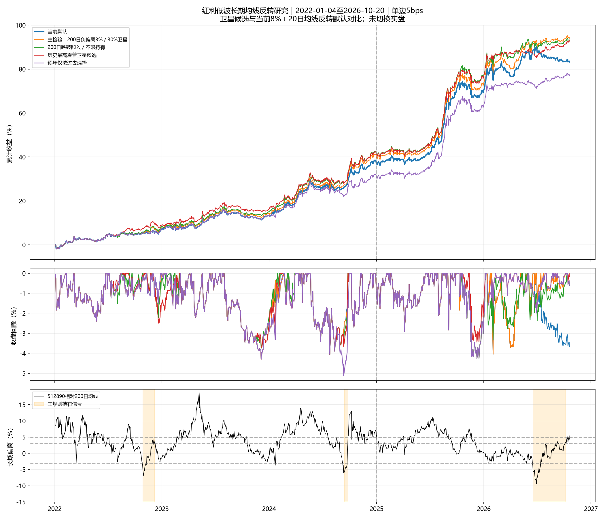

# 红利低波ETF长期均线反转研究

研究日期2026-10-21；行情截止2026-10-20。

## 结论与范围

本研究没有切换默认策略，也没有修改实盘信号或账户记录。主研究对象512890，515100与515450仅用相同规则复核，未按各自回测重新调参。

72个周度受约束组合中的最高历史夏普候选：**MA200／入0%／出+5%／不限日／替换风险仓／上限30%**，年化15.33%、夏普2.097、回撤-4.06%；同期默认为14.07%、1.762、-4.30%。

- 固定72项中，54项年化、69项夏普高于默认；这些组合高度相关，不能视为72次独立成功。
- 主检验年化15.51%、夏普1.918，相同规则迁移到另外两只红利ETF仍提高收益和夏普；但2022年以来仅3个持仓周期，证据强度有限。
- 训练期选中的候选为MA200／入0%／出+3%／不限日／替换风险仓／上限30%。若继续前瞻跟踪，可优先保留这一版本及预先指定主方案，避免直接用全样本最高夏普选定退出阈值。当前默认仍保持8%＋20日均线反转。
- 逐年仅按过去选参数的路径年化13.24%，低于默认，说明不能把事后冠军当作当时可提前选中的结果。

这是基于既有历史提出的观察。2022–2024用于设计、2025以后用于时间分段复核；这些年份与红利风格可能已被反复观察，不能称为独立盲测。早期2020年用于检查下跌尾部，不参与主参数筛选。

## 算法与资金安排

偏离d=P/MA(N)−1，使用同日复权收盘价，N取150/200个有真实报价的交易日。空仓时d≤0/−3%/−5%入场，持有时d≥+3%/+5%退出；两条线之间保持原状态。12条原始规则不限持有期；另6条固定补充为入−3%、出+3%、最长120个交易日，分别不确认、近3日已反弹、长均线20日斜率非负。超时退出后，价格须重新高于入场线，才允许下一次超跌买入，避免连续接下跌资产。

均线随时间移动：超过下降后的均线+3%，可能仍低于买入价。该退出条件不能等同于盈利3%。最长持有期只在决策日检查，周度检查可能晚数个交易日退出；均为下一交易日收盘执行。

- **替换风险仓**：在原风险仓内转移最多15%/30%账户资产至红利，不主动提高原风险总仓位。
- **统一风险预算增配**：把红利作为逆向卫星，允许绕过原40日趋势资格，但与原仓共同估计60日协方差并受8%预算约束；从防守资金调入的实际额度受风险约束限制。
- 两种受约束方式都要求风险ETF最多3只（红利占1个名额），原核心最多保留修正评分最高的2只；单只风险上限30%、总风险上限70%、弱市减半，红利另受15%/30%卫星上限。限仓后再复核组合波动。这会挤掉部分原持仓，报告收益包含该机会成本。
- 原核心的排名缓冲按其独立周目标持续重放，卫星叠加后实际执行组合由统一引擎计费；这是组合叠加规则，不把被挤出的实际持仓冒充核心模型旧目标。
- 主方案预先指定为200日、入−3%、出+3%、最长120日、增配上限30%；用户字面观察对照为200日、跌破即入、出+3%、不限持有期、增配上限30%。

## 主组合表现

2022年以来；单边手续费3bps＋滑点2bps；夏普按零无风险利率，回撤按收盘净值。

| 方案 | 年化 | 夏普 | 回撤 | 20bps年化 | 20bps回撤 | 平均红利仓 |
| --- | ---: | ---: | ---: | ---: | ---: | ---: |
| 当前默认8%＋均线20/0.5 | 14.07% | 1.762 | -4.30% | 11.24% | -5.30% | 0.00% |
| MA200／入0%／出+3%／不限日／统一风险预算增配／上限30% | 15.36% | 1.952 | -4.26% | 12.39% | -4.87% | 6.95% |
| MA200／入-3%／出+3%／120日／统一风险预算增配／上限30% | 15.51% | 1.918 | -4.30% | 12.61% | -5.30% | 2.02% |
| MA200／入0%／出+5%／不限日／替换风险仓／上限30% | 15.33% | 2.097 | -4.06% | 12.66% | -4.70% | 9.54% |
| MA200／入0%／出+3%／不限日／替换风险仓／上限30% | 15.46% | 2.083 | -4.26% | 12.66% | -4.87% | 8.09% |
| 逐年仅按过去选择 | 13.24% | 1.821 | -5.12% | 10.53% | -5.86% | 5.63% |



## 时间分段及逐年

| 方案 | 设计段年化 | 设计段夏普 | 后段年化 | 后段夏普 | 后段回撤 |
| --- | ---: | ---: | ---: | ---: | ---: |
| 当前默认8%＋均线20/0.5 | 11.64% | 1.703 | 18.27% | 1.885 | -4.26% |
| MA200／入0%／出+3%／不限日／统一风险预算增配／上限30% | 12.76% | 1.848 | 19.84% | 2.124 | -4.26% |
| MA200／入-3%／出+3%／120日／统一风险预算增配／上限30% | 12.39% | 1.783 | 20.92% | 2.134 | -4.26% |
| MA200／入0%／出+5%／不限日／替换风险仓／上限30% | 12.71% | 1.853 | 19.86% | 2.466 | -3.44% |
| MA200／入0%／出+3%／不限日／替换风险仓／上限30% | 13.30% | 1.929 | 19.18% | 2.319 | -4.26% |
| 逐年仅按过去选择 | 9.83% | 1.480 | 19.18% | 2.319 | -4.26% |

| 方案 | 2022 | 2023 | 2024 | 2025 | 2026至今 |
| --- | ---: | ---: | ---: | ---: | ---: |
| 当前默认8%＋均线20/0.5 | 7.32% | 5.58% | 21.19% | 23.63% | 7.92% |
| MA200／入0%／出+3%／不限日／统一风险预算增配／上限30% | 8.26% | 6.11% | 23.05% | 25.00% | 9.18% |
| MA200／入-3%／出+3%／120日／统一风险预算增配／上限30% | 8.20% | 5.58% | 22.57% | 23.63% | 12.11% |
| MA200／入0%／出+5%／不限日／替换风险仓／上限30% | 9.00% | 6.41% | 21.72% | 24.85% | 9.34% |
| MA200／入0%／出+3%／不限日／替换风险仓／上限30% | 9.68% | 6.41% | 22.78% | 24.45% | 8.63% |
| 逐年仅按过去选择 | 7.32% | 5.58% | 15.64% | 24.45% | 8.63% |

滚动路径2022–2023用默认，之后每年只读此前已实现收益，末端空出5个交易日。选择须回撤≤10%、年化不低于基准超过0.5个百分点、至少2/3训练年份收益不低于基准，再选最高夏普。配置对应的卫星状态按其历史价格独立跟踪，切换时使用当时已知的状态，不拼接静态回测的净收益，统一重算实际换手。

- 2024：MA150／入0%／出+5%／不限日／替换风险仓／上限30%，训练收益截至2023-12-22。
- 2025：MA200／入0%／出+3%／不限日／替换风险仓／上限30%，训练收益截至2024-12-24。
- 2026：MA200／入0%／出+3%／不限日／替换风险仓／上限30%，训练收益截至2025-12-24。

## 交易周期与‘通常会反弹’

下面逐笔以下一交易日收盘计入出价，展示完整退出和未退出周期；收益为ETF自身复权收益、未扣费，不能当作账户组合收益。未结束周期标明浮动损益，不删除亏损或长期未退出的观察。

周期统计包含2019年以来可形成完整长均线的全部观察；主组合绩效只计2022年以来。MAE表示相对买入价的最深浮亏，与净值从持有期高点回落的最大回撤口径不同。完成周期胜率不能用于保证新周期盈利。

| 规则 | 完成周期 | 完成胜率 | 完成均值 | 最差完成收益 | 最长完成持有日 | 开放周期 | 最深买入后浮亏 |
| --- | ---: | ---: | ---: | ---: | ---: | ---: | ---: |
| ma200_in0_out3_max0_none | 9 | 100.00% | 7.97% | 2.91% | 178 | 0 | -8.33% |
| ma200_in3_out3_max120_none | 4 | 100.00% | 13.30% | 8.81% | 99 | 0 | -7.35% |
| ma200_in0_out5_max0_none | 7 | 100.00% | 11.52% | 7.44% | 99 | 1 | -8.33% |

开放周期：ma200_in0_out5_max0_none，2026-01-12买入，截至截止日持有184日，浮动收益5.07%，持有期最差-8.33%。


### 单独100%运行的早期风险

收益起点2020-01-06；此处100%买ETF或持防守资产，超出默认单只30%约束，仅作尾部诊断。

| 规则 | 年化 | 夏普 | 回撤 |
| --- | ---: | ---: | ---: |
| ma200_in0_out3_max0_none | 13.38% | 1.447 | -13.04% |
| ma200_in3_out3_max120_none | 11.87% | 1.530 | -13.04% |
| ma200_in0_out5_max0_none | 14.78% | 1.522 | -13.04% |
| 买入持有512890 | 11.61% | 0.730 | -15.66% |

## 参数邻域

下列仅展示上限30%、替换风险仓、不限持有期的全部12个原始规则，完整72项含失败项见comparison.csv。

| 均线 | 入场偏离 | 退出偏离 | 年化 | 夏普 | 回撤 |
| --- | ---: | ---: | ---: | ---: | ---: |
| 150 | 0.00% | +3.00% | 12.49% | 1.807 | -5.12% |
| 150 | 0.00% | +5.00% | 13.42% | 1.945 | -5.12% |
| 150 | -3.00% | +3.00% | 14.05% | 1.920 | -4.30% |
| 150 | -3.00% | +5.00% | 14.66% | 2.002 | -4.30% |
| 150 | -5.00% | +3.00% | 14.68% | 1.880 | -4.30% |
| 150 | -5.00% | +5.00% | 15.40% | 1.966 | -4.30% |
| 200 | 0.00% | +3.00% | 15.46% | 2.083 | -4.26% |
| 200 | 0.00% | +5.00% | 15.33% | 2.097 | -4.06% |
| 200 | -3.00% | +3.00% | 16.00% | 1.983 | -4.30% |
| 200 | -3.00% | +5.00% | 16.07% | 2.008 | -4.30% |
| 200 | -5.00% | +3.00% | 15.70% | 1.951 | -4.30% |
| 200 | -5.00% | +5.00% | 15.87% | 1.970 | -4.30% |

## 跨ETF复核

参数直接迁移，不分别寻找各ETF最优。三只基金为相关股票风格，并非独立实验。

| ETF | 方案 | 年化 | 夏普 | 回撤 |
| --- | --- | ---: | ---: | ---: |
| 515100 | MA200／入-3%／出+3%／120日／统一风险预算增配／上限30% | 15.61% | 1.942 | -4.30% |
| 515100 | MA200／入0%／出+3%／不限日／统一风险预算增配／上限30% | 14.02% | 1.797 | -4.30% |
| 515100 | MA200／入0%／出+5%／不限日／替换风险仓／上限30% | 13.75% | 1.860 | -4.38% |
| 515100 | MA200／入0%／出+3%／不限日／替换风险仓／上限30% | 13.67% | 1.828 | -4.38% |
| 515450 | MA200／入-3%／出+3%／120日／统一风险预算增配／上限30% | 14.78% | 1.853 | -4.30% |
| 515450 | MA200／入0%／出+3%／不限日／统一风险预算增配／上限30% | 15.29% | 1.953 | -4.65% |
| 515450 | MA200／入0%／出+5%／不限日／替换风险仓／上限30% | 14.67% | 2.037 | -4.30% |
| 515450 | MA200／入0%／出+3%／不限日／替换风险仓／上限30% | 15.15% | 2.045 | -4.30% |

## 每日触发与50%重仓压力

每日版本只在入出场事件及原周信号日调仓，没有每天免费再平衡。50%重仓版本绕过8%预算、弱市减半和单只30%限制，属于超出默认约束的风险压力实验，不参与72项主选优。

| 方案 | 年化 | 夏普 | 回撤 | 20bps回撤 |
| --- | ---: | ---: | ---: | ---: |
| daily_ma150_in3_out3_max120_none_risk_replace_cap30 | 14.42% | 1.945 | -4.63% | -5.55% |
| daily_ma150_in3_out3_max120_none_budget_add_cap30 | 15.08% | 1.931 | -4.30% | -5.30% |
| heavy50_ma150_in3_out3_max120_none | 17.21% | 1.987 | -4.30% | -5.30% |
| daily_ma200_in3_out3_max120_none_risk_replace_cap30 | 15.97% | 2.001 | -4.30% | -5.30% |
| daily_ma200_in3_out3_max120_none_budget_add_cap30 | 15.35% | 1.910 | -4.30% | -5.30% |
| heavy50_ma200_in3_out3_max120_none | 18.30% | 2.075 | -4.30% | -5.30% |

## 资产依赖

| 场景 | 方案 | 年化 | 夏普 | 回撤 |
| --- | --- | ---: | ---: | ---: |
| without_bank | 当前默认8%＋均线20/0.5 | 13.50% | 1.712 | -4.47% |
| without_bank | MA200／入-3%／出+3%／120日／统一风险预算增配／上限30% | 14.88% | 1.865 | -4.47% |
| without_bank | MA200／入0%／出+5%／不限日／替换风险仓／上限30% | 15.21% | 2.119 | -4.05% |
| without_gold_nasdaq | 当前默认8%＋均线20/0.5 | 10.18% | 1.327 | -6.13% |
| without_gold_nasdaq | MA200／入-3%／出+3%／120日／统一风险预算增配／上限30% | 12.00% | 1.534 | -6.13% |
| without_gold_nasdaq | MA200／入0%／出+5%／不限日／替换风险仓／上限30% | 13.05% | 1.883 | -6.13% |
| bond_to_cash | 当前默认8%＋均线20/0.5 | 11.54% | 1.475 | -5.01% |
| bond_to_cash | MA200／入-3%／出+3%／120日／统一风险预算增配／上限30% | 12.96% | 1.631 | -5.01% |
| bond_to_cash | MA200／入0%／出+5%／不限日／替换风险仓／上限30% | 12.78% | 1.776 | -5.17% |

## 补充归因：直接扩池与持续配置

这3项是在看到主网格后增加的对照，不参与原72项选优及多重比较校正。用于区分新增资产、持续持有与条件性反转的贡献。持续配置也受风险预算及名额限制。

| 对照 | 年化 | 夏普 | 回撤 | 平均红利仓 |
| --- | ---: | ---: | ---: | ---: |
| plain_17_etf_rotation | 12.36% | 1.554 | -4.69% | 3.46% |
| constant_dividend30_risk_replace | 9.32% | 1.601 | -3.93% | 26.26% |
| constant_dividend30_budget_add | 12.35% | 1.704 | -5.16% | 21.96% |

### 逐周期剔除

事后把某个红利持仓周期改回原组合，其余规则不重调。这需要事后知道周期边界，仅作归因，不是可交易的择时规则。

| 方案 | 禁用周期起始信号 | 禁用周期结束信号 | 剩余年化 | 剩余夏普 |
| --- | --- | --- | ---: | ---: |
| MA200／入-3%／出+3%／120日／统一风险预算增配／上限30% | 2022-10-28 | 2022-12-08 | 15.30% | 1.896 |
| MA200／入-3%／出+3%／120日／统一风险预算增配／上限30% | 2024-09-13 | 2024-09-26 | 15.22% | 1.896 |
| MA200／入-3%／出+3%／120日／统一风险预算增配／上限30% | 2026-06-18 | 2026-10-08 | 14.55% | 1.808 |
| MA200／入0%／出+5%／不限日／替换风险仓／上限30% | 2022-07-15 | 2022-09-08 | 14.87% | 2.033 |
| MA200／入0%／出+5%／不限日／替换风险仓／上限30% | 2022-10-28 | 2023-03-02 | 15.13% | 2.053 |
| MA200／入0%／出+5%／不限日／替换风险仓／上限30% | 2023-11-10 | 2024-02-22 | 15.41% | 2.108 |
| MA200／入0%／出+5%／不限日／替换风险仓／上限30% | 2024-09-06 | 2024-09-26 | 15.23% | 2.104 |
| MA200／入0%／出+5%／不限日／替换风险仓／上限30% | 2025-09-30 | 2025-11-06 | 15.09% | 2.022 |
| MA200／入0%／出+5%／不限日／替换风险仓／上限30% | 2026-01-09 | 2026-10-20 | 15.00% | 1.906 |

## 复权、样本及统计限制

512890于2021-10-22发生份额拆分，当日无交易报价，拆分后首个报价日为2021-10-25。长均线使用过去N个真实报价，缺价当日不产生新信号，也不以估值填充价成交；主收益区间2022年以来三只红利ETF均无缺价。复权后研究连续收益，不复权曲线仅用于检查信号污染。

| 均线 | 拆分后首日报价的不复权偏离 | 复权偏离 | 是否低于均线的分类差异天数 |
| --- | ---: | ---: | ---: |
| 150 | -46.78% | 8.50% | 130 |
| 200 | -45.24% | 11.74% | 186 |

截至2026-10-20，512890相对200日均线偏离为+4.33%，当前没有新的低于均线入场条件。+5%退出版本仍显示持有，来源于年初历史买入；新账户不能使用当时价格回溯建仓。


- 共18条状态规则（相互高度相关）、72项周度组合、18个单独运行诊断，另有4项每日事件与2项50%压力比较。60日循环块、2000次成对抽样，对72项主组合最大均值收益差校正的探索性p=0.304。
- 此检验不校正以前的多轮搜索、ETF选择及事后夏普冠军；不能把较高历史点估计直接解释为稳定收益来源。
- ETF收益已包含基金内部费用及复权调整，但未模拟最低佣金、整手、盘中价差、现金分红到账延迟、税费差异和资金容量。模型用复权收盘价连续计收益，实际交易使用原始价格；日收盘回撤不等于盘中回撤。

## 验证及复现

已通过77项单元测试。时序检查见time_audit.csv；主要候选共16项截断/未来行情扰动，受约束组合全部通过最多3只风险ETF、单只30%、总风险70%检查。默认源代码、切换状态与正式信号指纹前后不变。

```powershell
.\.venv\Scripts\python.exe research_dividend_reversion.py --download-only --end 2026-10-20
.\.venv\Scripts\python.exe research_dividend_reversion.py --end 2026-10-20
.\.venv\Scripts\python.exe research_dividend_reversion.py --report-only
```

完整参数、失败项汇总、逐日收益、逐笔周期及跨ETF结果集中在output/dividend_reversion_20261021，保留一个研究入口与可复用的均线偏离状态机，不增加独立默认策略分支。

## 资料依据

- [上交所：512890份额拆分结果公告](https://www.sse.com.cn/disclosure/fund/announcement/c/new/2021-10-25/512890_20211025_1_lJ5GeyLb.pdf)
- [景顺长城：515100产品资料](https://www.igwfmc.com/main/jjcp/product/515100/detail.html)
- [南方基金：515450产品资料概要](https://www.nffund.com/main/files/2021/12/13/868077036325.pdf)
- [Bailey等：The Probability of Backtest Overfitting](https://www.davidhbailey.com/dhbpapers/backtest-prob.pdf)
