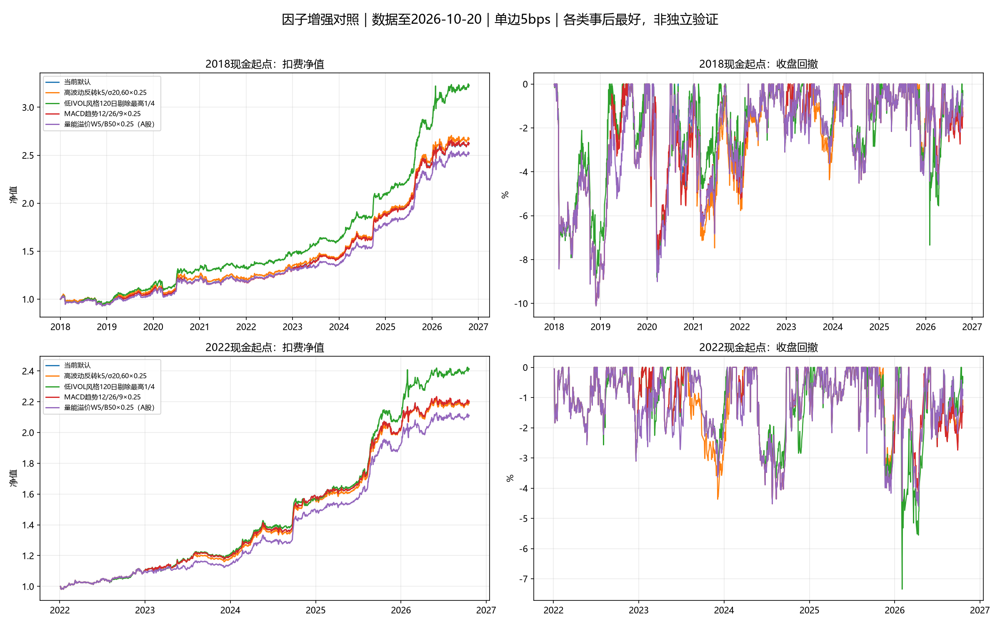
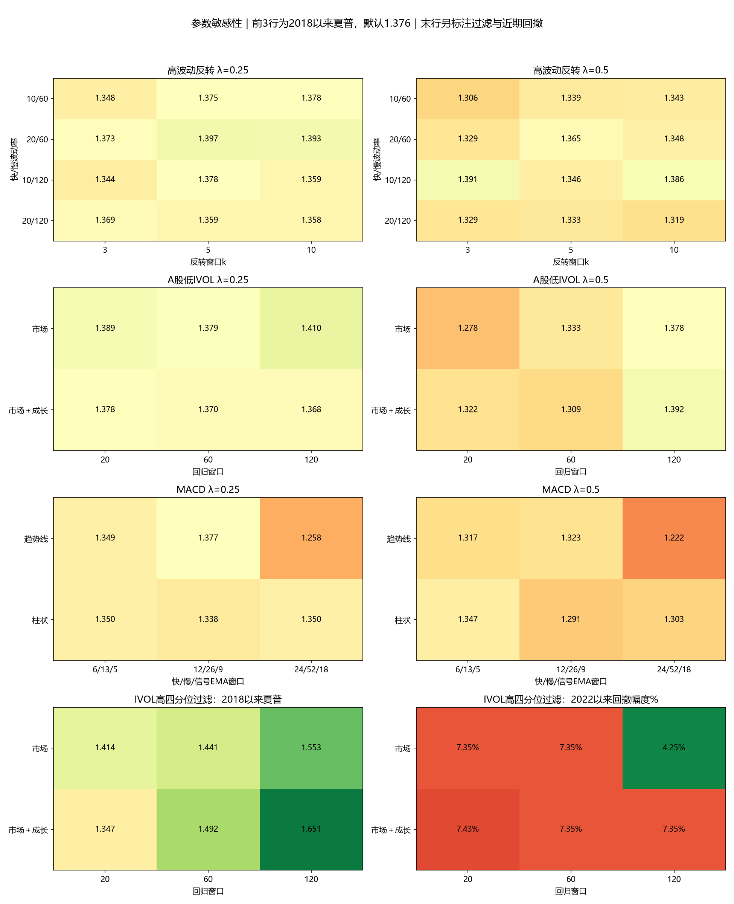

# 高波动反转、量能、IVOL代理与MACD增强研究

研究日期2026-11-09；主比较2018/2022现金起点至2026-10-20，辅助新增数据2026-10-21至2026-11-06。当前17只核心＋512890卫星，包含恒科、不包含标普。默认配置、公共切换状态、原实盘信号及个人账户均未改变。本轮不自动采用研究冠军。

## 结论概览

当前默认主区间年化12.07%、夏普1.376、回撤-10.11%。本轮非诊断候选的事后最高夏普为低IVOL风格120日剔除最高1/4：年化14.85%、夏普1.651、回撤-8.84%；2022起点21.09%/2.285，20bps主区间11.81%/1.340。

事先固定的严格筛选要求：两个起点在5/20bps下年化与夏普均不低于默认，且5bps两起点回撤均≤10%。结果：低IVOL市场120日剔除最高1/4、低IVOL风格60日剔除最高1/4、低IVOL风格120日剔除最高1/4。这只是一组必要条件，仍需结合邻近参数、分段/时序选择、持仓集中度、成本和统计不确定性；通过也不代表消除过拟合或自动切换默认。

## 文献核对及迁移边界

1. [Gervais、Kaniel、Mingelgrin（2001），The High-Volume Return Premium](https://doi.org/10.1111/0022-1082.00349)：讨论异常成交量与随后股票收益的关系，不能直接作为“高波动率反转”或“放量后必反转”的证据。本轮分别测试相对量能溢价与量能×反转；后者是新增交互假设。ETF申赎、套利和规模扩张会影响量能，机制不等同个股关注度。
2. [Ang、Hodrick、Xing、Zhang（2006），The Cross-Section of Volatility and Expected Returns](https://doi.org/10.1111/j.1540-6261.2006.00836.x)：高特质波动股票的收益偏低，IVOL是特质波动率。原文含FF3残差与波动风险分析；本轮没有FF3和VIX创新因子，不声称完整复现。仅检验ETF行情可支持的含截距市场/成长风格残差模型，并主要在A股股票ETF内比较；全池市场模型仅作错配风险诊断。
3. [Fidelity MACD说明](https://www.fidelity.com/learning-center/trading-investing/technical-analysis/technical-indicator-guide/macd)用于公式核对。MACD是EMA差及信号线的趋势/动能工具，既有原评分已经包含趋势信息，是否增加预测能力需要实测。

## 固定因子与参数

- 普通短期反转对照：k=3/5/10日，σ估计60/120日。短期冲击z=log(P_t/P_t-k)/(σ_过去、在冲击前结束×sqrt(k))，基础反转u=clip(−z/3,−1,1)。
- 高波动率反转：u×clip(σ_fast/σ_slow_冲击前−1,0,1)，fast=10/20，slow=60/120。只有近期波动超过冲击前背景波动时增强反转；仍保留原40日动量为正和MA40资格，避免绕过趋势条件。
- 量能溢价：u=clip(log(最近W日平均成交量/事件窗口之前B日平均成交量)/log(3),−1,1)，W=1/5、B=50/120。相对自身历史做比较，不按成交量绝对大小给大基金加分，也不是原论文分组实验的逐字复制。
- 量能反转：短反转u×max(异常量能u,0)，k=3/5/10、W=1/5、B=60。代表性参数另以成交额替代成交量，检查价格/份额量纲的影响。
- IVOL：过去N=20/60/120日的OLS残差样本标准差×sqrt252，包含截距。market为r_i~r_510300；style增加r_159915−r_510300成长代理。原始IVOL按本类资产当日排名转换为低波动高分的[−1,1]效用，至少3只有效资产。CSI300不回归自身；style还排除创业板自身，缺评分时中性，不人为给零残差资产优势。高IVOL剔除为排除本类最高四分位。
- MACD：DIF=EMA_fast−EMA_slow，DEA=EMA_signal(DIF)，柱=2(DIF−DEA)；参数6/13/5、12/26/9、24/52/18，分别比较趋势线与柱。趋势分DIF/(P×σ60_daily×sqrt(slow))；柱分HIST/(P×σ60_daily×sqrt(signal))，截为[−1,1]。不直接比较价格量纲不同的ETF裸MACD值，EMA仅使用历史，缺价后要求连续预热。

主叠加公式score_new=score_old+λ×D_old×u，λ=0.25/0.5；多因子组合各项固定0.25。D与原动量/均线反转评分相同，国债不进入排名；缺新因子时叠加回退原评分。MACD正值过滤必须有有效信号，并列同预热的原评分对照；IVOL剔除只针对可评分的本类资产，其余保留原资格。

40个原始因子、117个预先固定方案，共468个主区间/成本结果，另有固定量能金额代理诊断。包括6个普通反转对照、12个高波动反转、4个量能溢价、6个量能反转、6个IVOL、6个MACD原始信号；所有差方案和范围诊断保留。没有按看到的结果继续细调参数。

## 数据与执行

主区间与前次17只默认回测使用同一收盘快照；补成交量/额后逐日核对旧收盘及复权因子，未重写旧快照。新增13日仅在独立研究缓存按同日因子追加，不改生产数据。[Tushare字段](https://tushare.pro/document/2?doc_id=127)：vol为手、amount为千元，金额诊断换算为元；自身比值中固定单位抵消。

全历史假设当前池与红利规则，但上市前及预热不足保持缺值，不补未上市指数历史。2018前仅预热；两个起点各从现金开始，起点区间相互重叠，并非两组独立样本。周末最后交易日收盘信号，下一交易日收盘执行；8%核心预算、70%核心风险上限、单只30%、3只核心风险、前4缓冲必选第1名、红利MA200入0出4/先现金再国债30%全部保留。叠加后全账户可能超过8%波动目标及70%风险仓，这不是账户硬上限。

5bps=单边3bps费用＋2bps滑点预算，压力测试20bps；252日年化、无风险收益0、每日收盘最大回撤。分数复权单位、按成交参考价确定目标数量、未模拟整手/最低佣金/QDII溢价/盘口容量等原模型限制保留。与A股宽基比较的超额也可能来自国债、黄金、境外资产配置，而非新增因子的单独预测能力。

## 2018年以来：各类事后最好

| 方案 | 年化 | 夏普Rf0 | 最大回撤 | 卡玛 | 年均双边换手/NAV |
| --- | --- | --- | --- | --- | --- |
| 当前默认 | 12.07% | 1.376 | -10.11% | 1.193 | 18.37 |
| 高波动反转k5/σ20,60×0.25 | 12.31% | 1.397 | -10.11% | 1.218 | 18.34 |
| 量能溢价W5/B50×0.25（A股） | 11.54% | 1.330 | -10.11% | 1.141 | 18.55 |
| 量能反转k5/W1/B60×0.5 | 11.91% | 1.365 | -10.77% | 1.106 | 18.51 |
| 低IVOL市场120日×0.25（A股） | 12.55% | 1.410 | -10.28% | 1.221 | 18.23 |
| MACD趋势12/26/9×0.25 | 12.06% | 1.377 | -10.11% | 1.193 | 18.39 |
| 高波动反转＋MACD柱（各0.25） | 11.95% | 1.368 | -10.11% | 1.182 | 18.60 |
| MACD趋势12/26/9>0过滤 | 12.03% | 1.372 | -9.52% | 1.264 | 18.37 |
| 低IVOL风格120日剔除最高1/4 | 14.85% | 1.651 | -8.84% | 1.679 | 17.89 |

## 2022年现金起点

| 方案 | 年化 | 夏普Rf0 | 最大回撤 | 卡玛 | 年均双边换手/NAV |
| --- | --- | --- | --- | --- | --- |
| 当前默认 | 18.63% | 2.117 | -4.60% | 4.051 | 17.33 |
| 高波动反转k5/σ20,60×0.25 | 18.57% | 2.112 | -4.60% | 4.039 | 17.22 |
| 量能溢价W5/B50×0.25（A股） | 17.61% | 2.008 | -4.60% | 3.829 | 17.48 |
| 量能反转k5/W1/B60×0.5 | 17.93% | 2.060 | -4.81% | 3.725 | 17.54 |
| 低IVOL市场120日×0.25（A股） | 18.91% | 2.120 | -4.52% | 4.186 | 17.70 |
| MACD趋势12/26/9×0.25 | 18.70% | 2.129 | -4.52% | 4.140 | 17.23 |
| 高波动反转＋MACD柱（各0.25） | 17.73% | 2.051 | -4.45% | 3.986 | 17.81 |
| MACD趋势12/26/9>0过滤 | 18.66% | 2.125 | -4.60% | 4.057 | 17.52 |
| 低IVOL风格120日剔除最高1/4 | 21.09% | 2.285 | -7.35% | 2.871 | 17.12 |



## 成本压力：单边20bps、2018起点

| 方案 | 年化 | 夏普Rf0 | 最大回撤 | 卡玛 | 年均双边换手/NAV |
| --- | --- | --- | --- | --- | --- |
| 当前默认 | 9.02% | 1.054 | -12.27% | 0.735 | 18.37 |
| 高波动反转k5/σ20,60×0.25 | 9.26% | 1.076 | -12.27% | 0.755 | 18.34 |
| 量能溢价W5/B50×0.25（A股） | 8.48% | 1.002 | -12.27% | 0.691 | 18.55 |
| 量能反转k5/W1/B60×0.5 | 8.84% | 1.039 | -12.95% | 0.683 | 18.51 |
| 低IVOL市场120日×0.25（A股） | 9.51% | 1.093 | -12.50% | 0.761 | 18.23 |
| MACD趋势12/26/9×0.25 | 9.01% | 1.055 | -12.27% | 0.735 | 18.39 |
| 高波动反转＋MACD柱（各0.25） | 8.87% | 1.041 | -12.27% | 0.723 | 18.60 |
| MACD趋势12/26/9>0过滤 | 8.99% | 1.050 | -11.12% | 0.808 | 18.37 |
| 低IVOL风格120日剔除最高1/4 | 11.81% | 1.340 | -11.01% | 1.073 | 17.89 |

## 参数邻域、消融和范围

| 因子类 | 方案数 | 长期夏普提升数 | 两个起点夏普均提升数 | 长期夏普中位数 | 长期夏普最好 |
| --- | --- | --- | --- | --- | --- |
| high_vol_reversal | 26 | 6 | 0 | 1.359 | 1.397 |
| abnormal_volume | 10 | 0 | 0 | 1.179 | 1.330 |
| volume_reversal | 14 | 0 | 0 | 1.346 | 1.365 |
| ivol | 12 | 6 | 2 | 1.374 | 1.410 |
| macd | 12 | 1 | 1 | 1.331 | 1.377 |
| combination | 4 | 0 | 0 | 1.364 | 1.368 |



高波动反转与相同k、相同背景σ、同强度的普通反转对照，区分“反转本身”与“只在波动放大时反转”的增益：

| 方案 | 年化 | 夏普Rf0 | 最大回撤 | 卡玛 | 年均双边换手/NAV |
| --- | --- | --- | --- | --- | --- |
| 当前默认 | 12.07% | 1.376 | -10.11% | 1.193 | 18.37 |
| 短反转k5/σ60×0.25 | 11.26% | 1.311 | -9.10% | 1.237 | 18.67 |
| 高波动反转k5/σ20,60×0.25 | 12.31% | 1.397 | -10.11% | 1.218 | 18.34 |

MACD过滤与同样预热资格的原评分对照，避免把延迟新ETF参与误当因子能力：

| 方案 | 年化 | 夏普Rf0 | 最大回撤 | 卡玛 | 年均双边换手/NAV |
| --- | --- | --- | --- | --- | --- |
| 当前默认 | 12.07% | 1.376 | -10.11% | 1.193 | 18.37 |
| MACD趋势12/26/9同预热对照 | 12.07% | 1.376 | -10.11% | 1.193 | 18.37 |
| MACD趋势12/26/9>0过滤 | 12.03% | 1.372 | -9.52% | 1.264 | 18.37 |

IVOL主方案仅针对A股股票ETF，含石油产业、不含黄金、境外股指和商品期货ETF；全部成员在脚本A_STOCKS显式冻结。相对A股市场解释不掉的纳指/黄金涨跌不能直接称为不应持有的个股特质风险。全池IVOL诊断列于完整结果，未纳入可部署参数时序选择；也没有真实SMB/HML/Rf或ETF成分股逐日数据，因此结果只能称代理增强。

固定代表性量能方案的成交额替代对照（2018起点5bps，列年化/夏普）：

| 方案 | 成交量版本 | 成交额版本 |
| --- | --- | --- |
| 量能溢价W5/B50×0.25 | 10.91%/1.262 | 10.85%/1.254 |
| 量能反转k5/W5/B60×0.25 | 11.80%/1.345 | 11.75%/1.341 |

## IC、预测R²与信息重复

以有效因子所在风险ETF为样本，周信号至少5只有效资产；标签从t+1交易日收盘进入，到其后5/20日收盘，末端不完整不纳入。IVOL风格模型可能更晚达到足够横截面数量；表内原评分IC严格使用同一日期和ETF样本。IC不预筛选实际持仓名单或未来胜者。

预测R²为逐年扩展的一元OLS，训练仅使用标签结束日在测试年之前的样本、至少200条，以该年训练均值为基准计算合并OOS R²。用于检查预测增益，不等于价格回归拟合度，也不是新的独立盲测。20日标签重叠、ETF相关，不能按原始观察数计算独立显著性。

| 因子 | 未来日 | 有效周 | RankIC | 同样本默认IC | 预测OOS R² | 与原评分秩相关 |
| --- | --- | --- | --- | --- | --- | --- |
| hvrev_k5_v10_60 | 5 | 412 | 0.0247 | -0.0106 | 0.117% | -0.160 |
| hvrev_k5_v10_60 | 20 | 408 | -0.0049 | -0.0134 | -0.430% | -0.160 |
| volume_w5_b50 | 5 | 449 | 0.0015 | -0.0090 | -0.153% | 0.157 |
| volume_w5_b50 | 20 | 445 | -0.0046 | -0.0126 | -0.233% | 0.157 |
| volrev_k5_w5_b60 | 5 | 441 | 0.0199 | -0.0100 | -0.087% | -0.191 |
| volrev_k5_w5_b60 | 20 | 438 | 0.0085 | -0.0133 | -0.449% | -0.191 |
| ivol_market_60 | 5 | 449 | 0.0374 | -0.0008 | 0.002% | -0.121 |
| ivol_market_60 | 20 | 445 | 0.0306 | -0.0436 | -0.127% | -0.121 |
| macd_histogram_12_26_9 | 5 | 449 | -0.0010 | -0.0090 | -0.376% | 0.180 |
| macd_histogram_12_26_9 | 20 | 445 | 0.0416 | -0.0126 | -0.602% | 0.180 |
| hvrev_k5_v20_60 | 5 | 420 | 0.0404 | -0.0125 | 0.207% | -0.144 |
| hvrev_k5_v20_60 | 20 | 416 | 0.0003 | -0.0125 | -0.285% | -0.144 |
| ivol_market_120 | 5 | 446 | 0.0496 | -0.0023 | -0.029% | -0.046 |
| ivol_market_120 | 20 | 442 | 0.0465 | -0.0470 | -0.101% | -0.046 |
| macd_trend_12_26_9 | 5 | 449 | 0.0029 | -0.0090 | -0.820% | 0.914 |
| macd_trend_12_26_9 | 20 | 445 | -0.0030 | -0.0126 | -1.337% | 0.914 |

完整80组诊断、逐周IC、逐ETF时序IC和波动率相关性见本地CSV。IVOL已与逆波动权重及原评分的波动率分母存在信息重叠，MACD也与20/40动量及MA40过滤重叠；需从增量表现而非因子名字判断价值。

## IVOL改善来源：后设归因，不继续寻优

观察到IVOL高四分位过滤较强后，另外固定6项解释对照（24个区间/成本结果）：与风格模型一样保护CSI300/创业板的市场IVOL、同样保护宽基的普通波动率过滤、反向剔除低IVOL，以及仅依据2018-2021屏蔽频率在2022以后固定剔除两行业。它们没有并入原117场景挑冠军，不能拿事后对照提高原家族的显著性结论。

固定剔除代码为512660、512880，2022之前仍用默认目标，未把训练段末才知道的名单反用于训练段。普通波动率对照检验是否只是低波动倾向；同宽基保护对照检验是否只是“创业板恰好不被筛掉”的结构差异。

| 后设对照 | 2018年化/夏普 | 长期回撤 | 2022年化/夏普 | 近期回撤 |
| --- | --- | --- | --- | --- |
| 2018-21固定选出的2行业剔除 | 11.26%/1.274 | -10.11% | 17.06%/1.903 | -7.35% |
| 市场IVOL60，保护相同宽基 | 12.91%/1.449 | -9.25% | 18.62%/2.056 | -7.35% |
| 普通波动率60，保护相同宽基 | 12.73%/1.423 | -9.83% | 18.85%/2.059 | -7.35% |
| 市场IVOL120，保护相同宽基 | 13.49%/1.553 | -9.62% | 19.71%/2.233 | -4.25% |
| 普通波动率120，保护相同宽基 | 12.08%/1.384 | -9.80% | 18.27%/2.087 | -4.80% |
| 反方向：剔除最低IVOL四分位 | 11.66%/1.344 | -10.24% | 18.20%/2.116 | -4.66% |

进一步把账户总对数净增长精确分为各资产收益贡献与成本。每期资产简单收益贡献乘log(1+组合毛收益)/组合毛收益，再累加；成本使用log(1−当日成本率)。它们相加还原log(期末NAV)，不是把不同资产买入持有收益直接相加。以下比较风格IVOL120过滤与默认，所有增量均列出，避免只展示赢家：

| 代码 | 资产 | 默认对数贡献 | IVOL过滤对数贡献 | 差额 |
| --- | --- | --- | --- | --- |
| 512660 | 军工ETF | -0.0236 | 0.0306 | +0.0542 |
| 159980 | 有色金属ETF | 0.0292 | 0.0614 | +0.0322 |
| 159941 | 纳指ETF | 0.0423 | 0.0735 | +0.0312 |
| 512800 | 银行ETF（华宝） | 0.0022 | 0.0251 | +0.0228 |
| 513520 | 日经ETF | 0.0662 | 0.0843 | +0.0181 |
| 561360 | 石油产业ETF | 0.0015 | 0.0195 | +0.0180 |
| 518880 | 黄金ETF | 0.1466 | 0.1619 | +0.0153 |
| 159875 | 新能源ETF | 0.0290 | 0.0411 | +0.0120 |
| 159995 | 芯片ETF（半导体） | -0.0014 | 0.0086 | +0.0100 |
| 159928 | 消费ETF | 0.0438 | 0.0516 | +0.0078 |
| 510300 | 沪深300ETF | 0.0286 | 0.0350 | +0.0064 |
| 515070 | 人工智能ETF | 0.0754 | 0.0802 | +0.0048 |
| COST | 交易成本 | -0.0777 | -0.0757 | +0.0020 |
| 159915 | 创业板ETF | 0.1047 | 0.1066 | +0.0020 |
| 512890 | 红利卫星 | 0.2185 | 0.2185 | -0.0000 |
| 513180 | 恒生科技ETF（华夏） | 0.0325 | 0.0308 | -0.0017 |
| 511260 | 十年国债ETF | 0.1906 | 0.1883 | -0.0023 |
| 159985 | 豆粕期货ETF | 0.0542 | 0.0456 | -0.0086 |
| 512880 | 证券ETF | 0.0011 | -0.0154 | -0.0165 |

最大回撤和最差单日的日期也需对比，防止总样本回撤改善掩盖近期风险上升：

| 方案 | 起点 | 峰值日 | 谷值日 | 最大回撤 | 最差单日日期 | 单日收益 |
| --- | --- | --- | --- | --- | --- | --- |
| 当前默认 | 2018-01-01 | 2018-01-24 | 2018-11-27 | -10.11% | 2020-02-03 | -3.85% |
| 当前默认 | 2022-01-01 | 2026-03-03 | 2026-04-13 | -4.60% | 2026-02-02 | -2.94% |
| 低IVOL风格120日剔除最高1/4 | 2018-01-01 | 2018-01-24 | 2018-11-28 | -8.84% | 2026-02-02 | -4.63% |
| 低IVOL风格120日剔除最高1/4 | 2022-01-01 | 2026-01-29 | 2026-02-02 | -7.35% | 2026-02-02 | -4.63% |

## 时间顺序选择与统计不确定性

训练分别截至2021和2024，只用此前收益选择方案，下一段才使用相应周目标。各候选的缓冲状态作为虚拟子策略持续计算；使用同一账户模拟参数切换时的实际买卖及费用，不拼接不同账户收益。下一段已在项目中被观察，只称时间顺序诊断：

| 训练截止 | 测试段 | 训练选中 | 后段年化/夏普 | 默认年化/夏普 |
| --- | --- | --- | --- | --- |
| 2021 | 2022—2024 | 低IVOL风格120日剔除最高1/4 | 16.92%/2.182 | 17.35%/2.207 |
| 2024 | 2025—2026-10-20 | 低IVOL风格120日剔除最高1/4 | 28.79%/2.510 | 21.19%/2.068 |

除6个预热控制外的111个方案做配对循环块抽样，每个块长1000次；20/60/120日块长的本轮家族平均日收益增益校正p分别为0.136, 0.100, 0.090。这个检验不是夏普差异检验，也不覆盖此前反复选池、因子及仓位试验。全样本事后冠军存在选择偏差；区间、费用或邻近参数不一致时不能仅凭一项最好指标推广。

## 新增13交易日：10月21日至11月6日

仅对事先指定或主区间已选出的代表性方案核对，未用于继续筛参或重新命名冠军。资产价格截至11月6日，当日信号只会在11月9日执行，未把未来成交收益放进该窗口。该段较短，且部分日期曾用于实盘查询，不能称严格独立盲测，不年化也不据此判断有效性：

| 方案 | 交易日 | 区间净收益 | 区间最大回撤 |
| --- | --- | --- | --- |
| 当前默认 | 13 | 0.69% | -0.81% |
| 高波动反转k5/σ20,60×0.25 | 13 | 0.69% | -0.81% |
| 量能溢价W5/B50×0.25（A股） | 13 | 0.69% | -0.81% |
| 量能反转k5/W1/B60×0.5 | 13 | 0.69% | -0.81% |
| 低IVOL市场120日×0.25（A股） | 13 | 0.69% | -0.81% |
| MACD趋势12/26/9×0.25 | 13 | 0.69% | -0.81% |
| 高波动反转＋MACD柱（各0.25） | 13 | 0.69% | -0.81% |
| MACD趋势12/26/9>0过滤 | 13 | 0.69% | -0.81% |
| 低IVOL风格120日剔除最高1/4 | 13 | 0.69% | -0.81% |

## 集中度观察

默认和事后最高夏普方案，列平均权重最高的5只风险资产（均包含红利卫星，不列国债）；均值按全部交易日计算。换成新评分后若收益主要依赖少数资产，需要结合此前选池偏差继续观察：

| 方案 | 代码 | ETF | 平均权重 | 持有日占比 |
| --- | --- | --- | --- | --- |
| 当前默认 | 512890 | 红利低波卫星 | 7.2% | 24.1% |
| 当前默认 | 518880 | 黄金ETF | 7.1% | 34.4% |
| 当前默认 | 159941 | 纳指ETF | 5.6% | 37.5% |
| 当前默认 | 512800 | 银行ETF（华宝） | 3.8% | 22.2% |
| 当前默认 | 513520 | 日经ETF | 3.0% | 20.7% |
| 低IVOL风格120日剔除最高1/4 | 518880 | 黄金ETF | 8.1% | 38.9% |
| 低IVOL风格120日剔除最高1/4 | 512890 | 红利低波卫星 | 7.2% | 24.1% |
| 低IVOL风格120日剔除最高1/4 | 159941 | 纳指ETF | 5.9% | 39.4% |
| 低IVOL风格120日剔除最高1/4 | 512800 | 银行ETF（华宝） | 4.1% | 24.1% |
| 低IVOL风格120日剔除最高1/4 | 159980 | 有色金属ETF | 3.3% | 20.2% |

## 验证与复现

200项研究检查全部通过：仓位约束、默认与此前17只目标/当前生产组合对账、代表性目标与生产选仓对账、5/20bps逐日净值对账、多截点原始价格与量能截断/未来扰动，以及新增数据不改变过去可执行目标和已实现净值。主区间截止10月20日为周二，截断价格日历末尾可能保留一个尚无下一成交日的研究占位目标；延长日历时仅核对已有下一成交日的历史目标，并逐日核对整个旧区间的收益，未将该占位目标当作已交易信号。IVOL另与直接含截距OLS核对，MACD/量能做价格和份额单位不变性与缓存失效测试。所有实盘配置/状态/原信号指纹未变；个人账户数据库未读写。

```powershell
python research_factor_extensions.py --download-only
python research_factor_extensions.py
python research_factor_extensions.py --report-only
```

研究高低量/价格缓存`data/factor_extensions_20261109/`，完整结果`output/factor_extensions_20261109/`，均Git忽略。因子定义`etf_rotation/extended_factors.py`，`FactorStore.get_extended(prices,spec,activity)`可直接缓存复用，不必改实盘选仓。默认保持当前17只核心＋红利，RSRS仍观察，未自动增加上述任何增强。
