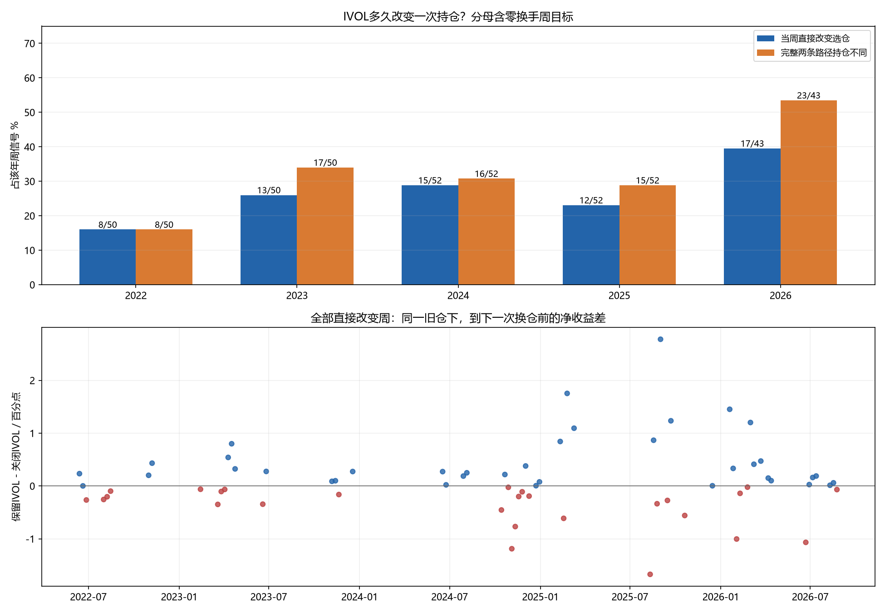
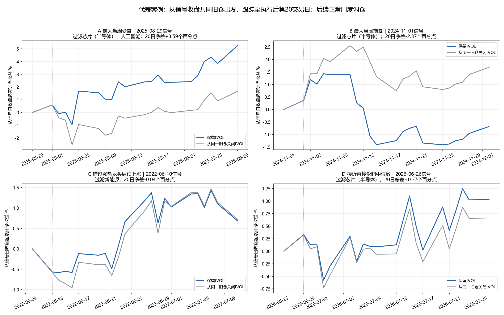
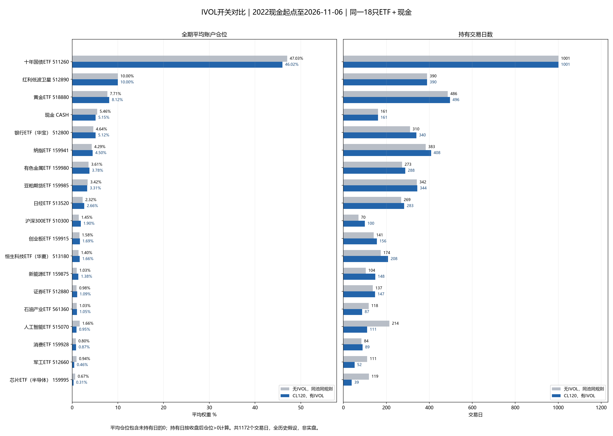
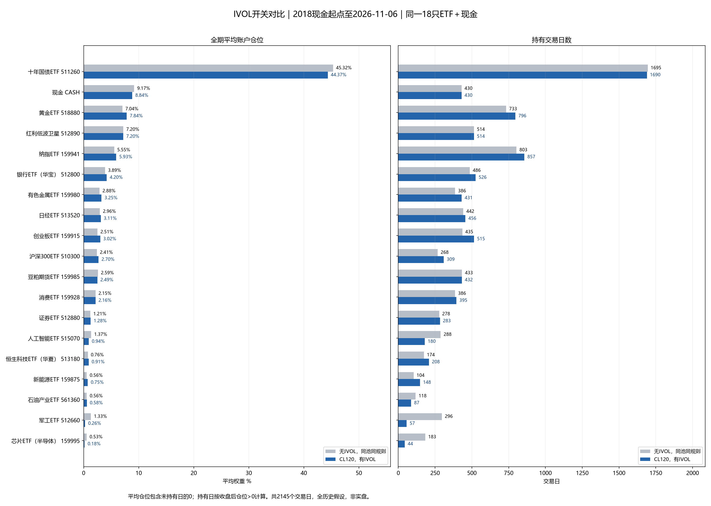

# CL120的IVOL有多大实际影响：频率、换仓案例及全池持仓

研究日期2026-11-10；价格固定截至2026-11-06，沿用前轮相同快照。对比同一17只核心＋512890卫星，仅开关IVOL。两者均为全历史假设回放、独立现金账本，不是历史真实采用记录；CL120规则于2026-11-09启用，首次计划该日收盘执行，不代表已确认券商成交。未修改默认策略、实盘计划或真实账户数据库。

## 改变持仓的频率

2022起点共有247次可执行周目标，IVOL当周直接改变选仓65次（26.3%），约每4次信号影响一次。若两套规则各自沿历史连续运行，持仓名单不同79周（32.0%）；逐日持仓不同387/1172日（33.0%）。

| 现金起点 | 周目标数 | 原趋势合格但被过滤 | 原评分第1名被过滤 | 当周直接改变 | 完整路径名单不同 | 仅历史缓冲延续差异 |
| --- | --- | --- | --- | --- | --- | --- |
| 2018 | 453 | 221/453（48.8%） | 47/453（10.4%） | 111/453（24.5%） | 141/453（31.1%） | 31/453（6.8%） |
| 2022 | 247 | 119/247（48.2%） | 23/247（9.3%） | 65/247（26.3%） | 79/247（32.0%） | 15/247（6.1%） |

“直接影响”让两条决策使用CL120当时完全相同的前次选择，再仅切换当前过滤器；“完整路径差异”让两条策略从历史分别运行，因此还包含旧仓缓冲的连锁影响。两项不能相加：15周属于当周没有直接影响、但前期选择不同造成的延续；另有极少数周当前直接作用被不同历史状态抵消。

每周名义上过滤一个IVOL尾部，未必会改变原本实际选中的ETF。119周至少挡住一只原趋势合格标的，真正改变当次选择仅65周。当前原评分冠军被滤23周；“第1名必选”适用于过滤后的合格池。

名单不同的周，两套方案含现金的目标权重距离平均为14.97%：定义为两套目标绝对差之和的一半，表示约多少账户权重要重新分配，不是额外换手率或收益。信号日与执行日分开统计；按分析期内的下一交易日执行日期取样，11月6日尚无样本内执行的末尾信号不计。

影响频率随年份变化：2026截至本轮快照，43次周目标中直接改变17次（39.5%），完整路径名单不同23次（53.5%），高于全期均值。不能把“约四周一次”当作固定间隔；策略仍按原周度日历交易。

| 执行年份 | 周目标数 | 直接改变次数/占比 | 完整路径不同次数/占比 |
| --- | --- | --- | --- |
| 2022 | 50 | 8/50（16.0%） | 8/50（16.0%） |
| 2023 | 50 | 13/50（26.0%） | 17/50（34.0%） |
| 2024 | 52 | 15/52（28.8%） | 16/52（30.8%） |
| 2025 | 52 | 12/52（23.1%） | 15/52（28.8%） |
| 2026 | 43 | 17/43（39.5%） | 23/43（53.5%） |



## 影响并非每次都有利

在65个完整且直接改变的周期中，以同一执行收盘前旧仓为起点、仅比较当次决策到下次换仓前：有利38次，不利27次，正向比例58.5%。净差中位数+0.026个百分点，均值+0.111个百分点。多数单次影响较小，少数尾部事件会明显拉动平均值；这不是完整ETF交易回合胜率。

全部周期结果保留在`all_weekly_events.csv`，没有只保留盈利案例。局部收益含本次费用，不含下一次调仓费用；该指标不能直接逐次相加解释全历史收益差，因为后续缓冲状态与仓位会相互影响。完整两条策略的绩效如下：

| 起点 | 方案 | 单边成本bps | 年化 | 零利率夏普 | 最大收盘回撤 |
| --- | --- | --- | --- | --- | --- |
| 2018 | CL120 | 5 | 13.50% | 1.556 | -9.62% |
| 2018 | CL120 | 20 | 10.49% | 1.236 | -11.83% |
| 2018 | 同池无IVOL | 5 | 12.08% | 1.380 | -10.11% |
| 2018 | 同池无IVOL | 20 | 9.04% | 1.058 | -12.27% |
| 2022 | CL120 | 5 | 19.65% | 2.235 | -4.25% |
| 2022 | CL120 | 20 | 16.65% | 1.927 | -4.67% |
| 2022 | 同池无IVOL | 5 | 18.58% | 2.119 | -4.60% |
| 2022 | 同池无IVOL | 20 | 15.55% | 1.805 | -5.05% |

## 四次代表性变化与后续发展

按公开保留在脚本中的事后解释规则，选2022起点内最大当周受益、最大当周拖累、原评分第1名被滤后仍上涨、接近中位影响四类。优先让案例间隔至少20个交易日，避免全是同一轮行情。使用后续收益挑解释样本，是事后案例选择，没有输入交易信号；这些极端案例不能冒充典型胜率。



### A．最大当周受益：2025-08-29信号

计划于2025-09-01收盘执行，下一次调仓为2025-09-08。以下是历史假设交易，不是券商记录。

- 有IVOL目标：沪深300ETF(510300) 24.4%、创业板ETF(159915) 13.0%、新能源ETF(159875) 13.4%、现金(CASH) 49.2%。
- 同一旧仓、当次无IVOL目标：创业板ETF(159915) 13.1%、芯片ETF（半导体）(159995) 9.3%、人工智能ETF(515070) 9.7%、现金(CASH) 67.9%。
- 本次执行收盘前相同财富和旧仓，到下一次调仓前，含本次单边5bps综合成本：有IVOL 0.94%，无IVOL -1.84%，净差+2.777个百分点。
- 从同一信号收盘旧仓起，跟踪至首次执行收盘后第20个交易日，两条路径各自继续正常周调仓：有IVOL 5.25%，无IVOL 1.66%，净差+3.588个百分点。窗口还包含首次执行当日相同旧仓的收益，合计21个日收益区间。
- 被滤ETF实际再次持有日期：159995:20日内未重入,515070:20日内未重入。该日期来自模拟账户的收盘后持仓，而非尚未执行的信号。

| 被过滤ETF | 当时原评分名次 | 当时年化IVOL | 执行收盘后5日收益 | 执行收盘后20日收益 |
| --- | --- | --- | --- | --- |
| 芯片ETF（半导体） 159995 | 3 | 21.81% | -9.10% | 10.53% |
| 人工智能ETF 515070 | 1 | 22.38% | -9.15% | 2.63% |
### B．最大当周拖累：2024-11-01信号

计划于2024-11-04收盘执行，下一次调仓为2024-11-11。以下是历史假设交易，不是券商记录。

- 有IVOL目标：黄金ETF(518880) 30.0%、十年国债ETF(511260) 49.9%、证券ETF(512880) 9.4%、恒生科技ETF（华夏）(513180) 10.7%。
- 同一旧仓、当次无IVOL目标：黄金ETF(518880) 30.0%、十年国债ETF(511260) 50.4%、芯片ETF（半导体）(159995) 8.9%、证券ETF(512880) 10.7%。
- 本次执行收盘前相同财富和旧仓，到下一次调仓前，含本次单边5bps综合成本：有IVOL 0.99%，无IVOL 2.18%，净差-1.189个百分点。
- 从同一信号收盘旧仓起，跟踪至首次执行收盘后第20个交易日，两条路径各自继续正常周调仓：有IVOL -0.68%，无IVOL 1.68%，净差-2.365个百分点。窗口还包含首次执行当日相同旧仓的收益，合计21个日收益区间。
- 被滤ETF实际再次持有日期：159995:20日内未重入。该日期来自模拟账户的收盘后持仓，而非尚未执行的信号。

| 被过滤ETF | 当时原评分名次 | 当时年化IVOL | 执行收盘后5日收益 | 执行收盘后20日收益 |
| --- | --- | --- | --- | --- |
| 芯片ETF（半导体） 159995 | 1 | 37.73% | 16.61% | 4.91% |
### C．错过强势龙头后续上涨：2022-06-10信号

计划于2022-06-13收盘执行，下一次调仓为2022-06-20。以下是历史假设交易，不是券商记录。

- 有IVOL目标：十年国债ETF(511260) 67.7%、消费ETF(159928) 13.0%、豆粕期货ETF(159985) 13.5%、恒生科技ETF（华夏）(513180) 5.8%。
- 同一旧仓、当次无IVOL目标：十年国债ETF(511260) 71.2%、新能源ETF(159875) 8.6%、豆粕期货ETF(159985) 14.1%、恒生科技ETF（华夏）(513180) 6.1%。
- 本次执行收盘前相同财富和旧仓，到下一次调仓前，含本次单边5bps综合成本：有IVOL 0.42%，无IVOL 0.19%，净差+0.233个百分点。
- 从同一信号收盘旧仓起，跟踪至首次执行收盘后第20个交易日，两条路径各自继续正常周调仓：有IVOL 0.69%，无IVOL 0.72%，净差-0.036个百分点。窗口还包含首次执行当日相同旧仓的收益，合计21个日收益区间。
- 被滤ETF实际再次持有日期：159875:2022-07-04。该日期来自模拟账户的收盘后持仓，而非尚未执行的信号。

| 被过滤ETF | 当时原评分名次 | 当时年化IVOL | 执行收盘后5日收益 | 执行收盘后20日收益 |
| --- | --- | --- | --- | --- |
| 新能源ETF 159875 | 1 | 25.61% | 5.23% | 8.71% |
### D．接近直接影响中位数：2026-06-26信号

计划于2026-06-29收盘执行，下一次调仓为2026-07-06。以下是历史假设交易，不是券商记录。

- 有IVOL目标：创业板ETF(159915) 8.4%、纳指ETF(159941) 9.2%、十年国债ETF(511260) 45.1%、日经ETF(513520) 7.3%、红利低波卫星(512890) 30.0%。
- 同一旧仓、当次无IVOL目标：纳指ETF(159941) 9.7%、十年国债ETF(511260) 46.4%、芯片ETF（半导体）(159995) 6.1%、日经ETF(513520) 7.8%、红利低波卫星(512890) 30.0%。
- 本次执行收盘前相同财富和旧仓，到下一次调仓前，含本次单边5bps综合成本：有IVOL -0.01%，无IVOL -0.04%，净差+0.026个百分点。
- 从同一信号收盘旧仓起，跟踪至首次执行收盘后第20个交易日，两条路径各自继续正常周调仓：有IVOL 1.03%，无IVOL 0.66%，净差+0.369个百分点。窗口还包含首次执行当日相同旧仓的收益，合计21个日收益区间。
- 被滤ETF实际再次持有日期：159995:20日内未重入。该日期来自模拟账户的收盘后持仓，而非尚未执行的信号。

| 被过滤ETF | 当时原评分名次 | 当时年化IVOL | 执行收盘后5日收益 | 执行收盘后20日收益 |
| --- | --- | --- | --- | --- |
| 芯片ETF（半导体） 159995 | 1 | 32.90% | -8.76% | -22.53% |


A例说明过滤可以避开短期追涨风险，但芯片后20日又上涨，不能只展示第一周下跌。B例展示明确踏空：芯片随后5日上涨约16.6%，这一周过滤有代价。C例新能源随后上涨，但完整组合有替代收益且7月4日重新入选，20日净差接近零，不能将标的涨幅全部算成账户损失。D例接近单次影响中位数，虽然被滤芯片20日大跌，账户增益受原权重和替代资产表现共同决定。

## 各ETF平均仓位与持有时间

平均仓位是全部交易日收盘后权重的算术均值，未持有日记0；不是持有期间平均仓位，也不是期末建议仓位。持有日指收盘后仓位>1e-8，执行日收盘后开始计持有，实际新仓收益从下一交易日起计。周期数按连续持有区间，包含期末开放周期；未将每次加减仓算成一次新交易回合。现金单列为非ETF。

### 2022独立现金起点：1172个交易日



| 代码 | 资产 | 无IVOL平均仓位 | CL120平均仓位 | 无IVOL持有日 | CL120持有日 | CL120日占比 | CL120周期中位日 |
| --- | --- | --- | --- | --- | --- | --- | --- |
| 511260 | 十年国债ETF | 47.03% | 46.02% | 1001 | 1001 | 85.41% | 65.0 |
| 512890 | 红利低波卫星 | 10.00% | 10.00% | 390 | 390 | 33.28% | 51.5 |
| 518880 | 黄金ETF | 7.71% | 8.12% | 486 | 496 | 42.32% | 20.0 |
| CASH | 现金 | 5.46% | 5.15% | 161 | 161 | 13.74% | 10.0 |
| 512800 | 银行ETF（华宝） | 4.64% | 5.12% | 310 | 340 | 29.01% | 15.0 |
| 159941 | 纳指ETF | 4.29% | 4.50% | 383 | 408 | 34.81% | 25.0 |
| 159980 | 有色金属ETF | 3.61% | 3.78% | 273 | 288 | 24.57% | 19.5 |
| 159985 | 豆粕期货ETF | 3.42% | 3.31% | 342 | 344 | 29.35% | 10.0 |
| 513520 | 日经ETF | 2.32% | 2.66% | 269 | 283 | 24.15% | 18.0 |
| 510300 | 沪深300ETF | 1.45% | 1.90% | 70 | 100 | 8.53% | 22.5 |
| 159915 | 创业板ETF | 1.58% | 1.69% | 141 | 156 | 13.31% | 27.0 |
| 513180 | 恒生科技ETF（华夏） | 1.40% | 1.66% | 174 | 208 | 17.75% | 34.0 |
| 159875 | 新能源ETF | 1.03% | 1.38% | 104 | 148 | 12.63% | 25.0 |
| 512880 | 证券ETF | 0.98% | 1.09% | 137 | 147 | 12.54% | 10.0 |
| 561360 | 石油产业ETF | 1.03% | 1.05% | 118 | 87 | 7.42% | 10.0 |
| 515070 | 人工智能ETF | 1.66% | 0.95% | 214 | 111 | 9.47% | 12.5 |
| 159928 | 消费ETF | 0.80% | 0.87% | 84 | 89 | 7.59% | 15.0 |
| 512660 | 军工ETF | 0.94% | 0.46% | 111 | 52 | 4.44% | 10.0 |
| 159995 | 芯片ETF（半导体） | 0.67% | 0.31% | 119 | 39 | 3.33% | 10.0 |

最明显的改变是减少芯片、AI、军工，部分转向银行、宽基、新能源、黄金和境外资产。此处是本样本的结果，不是规则写死行业偏好。国债平均仓位从约47.03%降至46.02%，现金约5.46%降至5.15%；全账户风险资产平均仓位从约47.51%升至48.83%，因此IVOL并非简单增加防守仓。

红利卫星的周目标规则独立，目标启停一致，持有日同为390；平均仓位的极小差异来自其他资产收益导致的自然权重漂移。芯片39日、AI111日、军工52日说明本样本的直接股票科技敞口不高，但纳指、创业板、恒生科技仍有间接科技敞口；不能把科技行业标签简单相加。低平均仓位既可能来自短周期，也可能来自ETF上市较晚，不能单凭这一列删除资产来继续优化历史。

### 2018独立现金起点：2145个交易日



| 代码 | 资产 | 无IVOL平均仓位 | CL120平均仓位 | 无IVOL持有日 | CL120持有日 | CL120日占比 | CL120周期中位日 |
| --- | --- | --- | --- | --- | --- | --- | --- |
| 511260 | 十年国债ETF | 45.32% | 44.37% | 1695 | 1690 | 78.79% | 58.0 |
| CASH | 现金 | 9.17% | 8.84% | 430 | 430 | 20.05% | 10.0 |
| 518880 | 黄金ETF | 7.04% | 7.84% | 733 | 796 | 37.11% | 15.0 |
| 512890 | 红利低波卫星 | 7.20% | 7.20% | 514 | 514 | 23.96% | 51.5 |
| 159941 | 纳指ETF | 5.55% | 5.93% | 803 | 857 | 39.95% | 25.0 |
| 512800 | 银行ETF（华宝） | 3.89% | 4.20% | 486 | 526 | 24.52% | 15.0 |
| 159980 | 有色金属ETF | 2.88% | 3.25% | 386 | 431 | 20.09% | 19.5 |
| 513520 | 日经ETF | 2.96% | 3.11% | 442 | 456 | 21.26% | 18.0 |
| 159915 | 创业板ETF | 2.51% | 3.02% | 435 | 515 | 24.01% | 25.0 |
| 510300 | 沪深300ETF | 2.41% | 2.70% | 268 | 309 | 14.41% | 12.5 |
| 159985 | 豆粕期货ETF | 2.59% | 2.49% | 433 | 432 | 20.14% | 10.0 |
| 159928 | 消费ETF | 2.15% | 2.16% | 386 | 395 | 18.41% | 19.5 |
| 512880 | 证券ETF | 1.21% | 1.28% | 278 | 283 | 13.19% | 12.0 |
| 515070 | 人工智能ETF | 1.37% | 0.94% | 288 | 180 | 8.39% | 29.0 |
| 513180 | 恒生科技ETF（华夏） | 0.76% | 0.91% | 174 | 208 | 9.70% | 34.0 |
| 159875 | 新能源ETF | 0.56% | 0.75% | 104 | 148 | 6.90% | 25.0 |
| 561360 | 石油产业ETF | 0.56% | 0.58% | 118 | 87 | 4.06% | 10.0 |
| 512660 | 军工ETF | 1.33% | 0.26% | 296 | 57 | 2.66% | 7.5 |
| 159995 | 芯片ETF（半导体） | 0.53% | 0.18% | 183 | 44 | 2.05% | 10.0 |

两次起点分别从现金开始，不把2018账户的既有持仓或收益直接截到2022。上市前不会买入，2018年前价格仅作因子预热；当前池与卫星全历史回放仍有后视和存续选择偏差。

## 核对与复现

707项数值/时序核对通过，包括用相同决策前状态重建CL120目标、每个完整周期局部收益与正式引擎对账、代表案例的条件回放与正式逐日净值一致、默认文件指纹未变。事件解释窗口从已知信号收盘旧仓出发，跟踪至首次执行收盘后第20个交易日，包含共同的执行日旧仓收益（合计21个日收益区间）。两条路径继续正常周度调仓并支付各自费用，没有固定持仓20日或虚构更早的建仓信号。单只ETF未来5/20日收益只用于事后解释，未输入选仓。

```powershell
python research_ivol_impact.py
python research_ivol_impact.py --report-only
```

读取`data/factor_extensions_20261109/`的18只独立行情缓存，不联网也不需要Token；新环境先运行`research_factor_extensions.py --download-only`。全部信号、逐日权重、完整周事件、被滤ETF后续收益、代表案例、条件回放与检查放在`output/ivol_impact_20261110/`，均Git忽略。报告和图保留在`docs/`。
