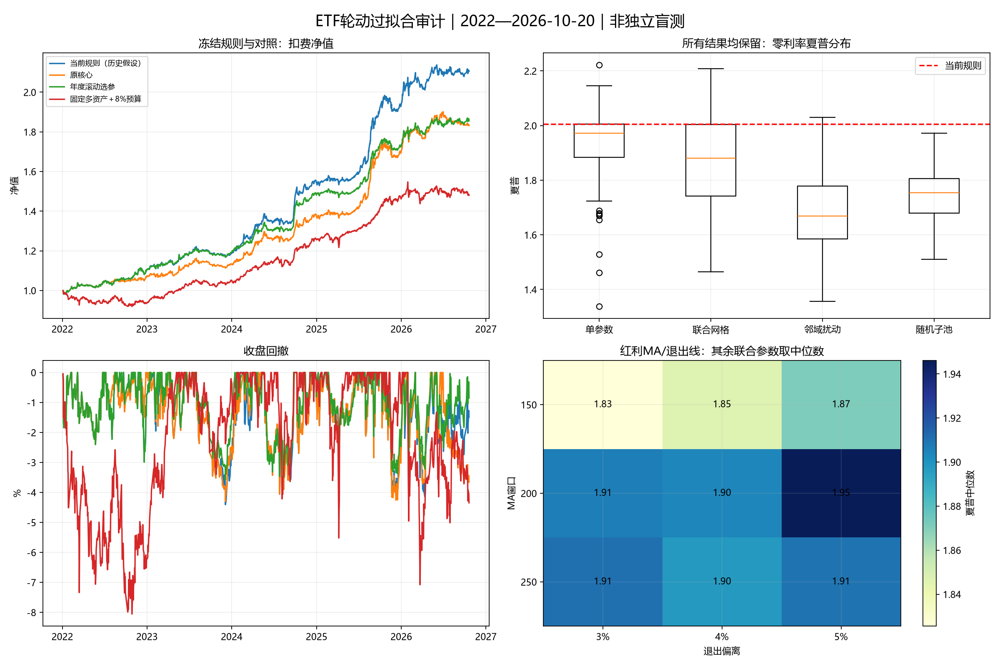
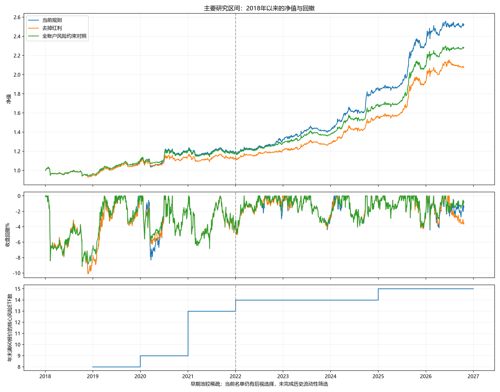
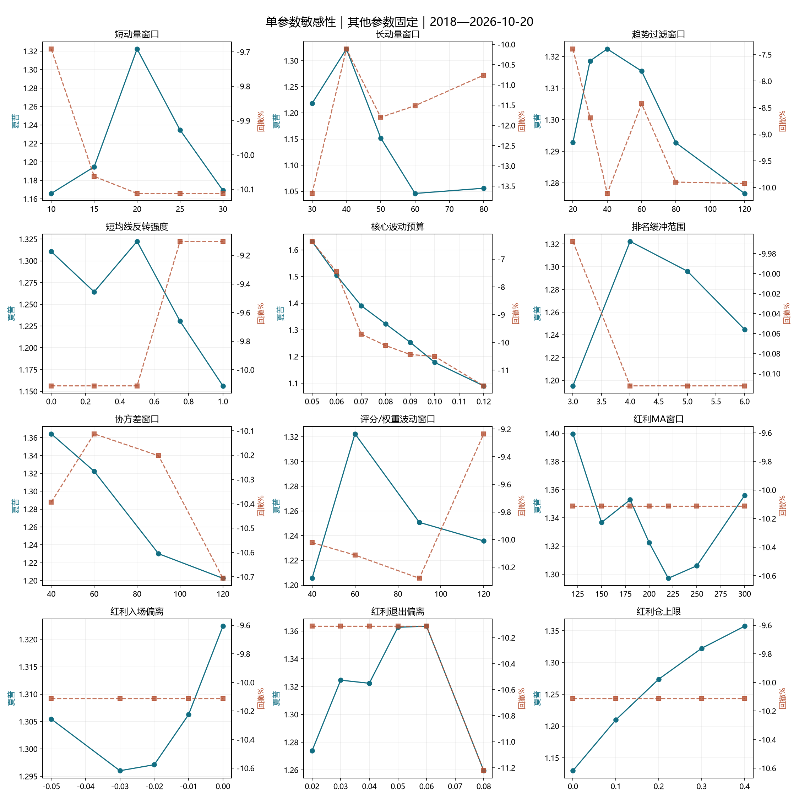

# ETF轮动策略：2018年以来的过拟合与参数审计

研究日期：2026-10-21；行情截止：2026-10-20。完整结果保存在 `output/overfitting_audit_20261021/`。

## 1. 审计结论

**当前策略有继续验证的价值，但证据不足以把夏普2、年化17.57%、回撤4.43%视为可持续实盘水平。**

- 主评估区间固定为2018年至今：年化11.55%、夏普1.322、最大回撤-10.11%。2018—2021的固定规则表现弱于近年；2018年前的表现不再作为主要判断依据。
- 近年开发期的参数附近多数方案仍盈利，表明并非只有一条盈利曲线；当前20/40日动量组合、40日趋势与0.5反转强度又处于多个2022后单参数扫描的局部高点，存在开发期择优痕迹。
- 当前方案相对原核心的增益，在本轮162组合及更宽家族的多重比较校正后未达到5%显著性；不能据此认定红利无效，也不能声称其增益已经被统计确认。更宽519情景的PBO约39%—41%，比窄参数家族明显更高。
- 因子预测证据较弱，组合收益不能全部归因于稳定的截面选强能力；仓位控制、跨资产配置和具体历史行情均有贡献。
- 全账户8%/70%约束是一个值得保留的风险对照；本轮不更改默认策略、实盘切换状态和信号文件。

## 2. 研究设计与复现

冻结核心：20/40日动量各50%、60日波动、40日趋势、8%核心波动目标、弱市减半、风险总仓70%、核心单只30%、最多3只风险ETF、前4缓冲且必选第1、20日均线反转强度0.5。红利：512890，MA200、入0%、出+4%、不限日、国债现金拨款上限30%。

主评估区间为2018-01-02—2026-10-20，2132个交易日；年化按252交易日，夏普以零无风险利率计算；成本默认单边5bps，信号后下一交易日收盘成交。不是实盘业绩，红利全历史参与属于明确的历史假设。起点由用户按应用范围固定，不依据本轮哪个起点收益最高继续筛选。

2018主区间完成7个配置对照与26组共125个单参数点复验，并拆分2018—2021、2022—2024及2025年至今。此前保存的 **554个案例** 包括2022后26组单参数、162联合组合、64邻域扰动、64删除子池、64等数量换池及旧历史参考，按原区间保留，不把它们全部改称2018以来的结果。重复默认点也保留，案例数不等于独立试验数。主区间元数据在 `focus_2018_manifest.json`，原始计划在 `manifest.json`，全部较差结果均保留。

生产与审计引擎逐日收益/实际权重对账、4项不同参数对账、20bps费用对账、6个历史截断及未来扰动、价格单位变换和实盘文件指纹检查共15项通过；现有及新增审计测试共93项通过。这些检查验证覆盖范围内的实现，不能证明没有选池或统计过拟合。

本轮计划及补充诊断均留档，但本项目历史已被观察过；同数量换池、全账户风险对照和早期复验等补充项不构成独立预注册实验。

原2022开发期口径提醒：自然年跨度4.791年，按自然日计算CAGR为 **16.81%**，按252交易日为 **17.57%**。若仅作演示固定无风险利率2%，该2022起始序列夏普约1.764；尚未接入真实同期无风险利率。

## 3. 2018年至今：基准、模块与上市观察期对照

| 方案 | 年化 | 实际年化波动 | 零利率夏普 | 最大回撤 |
| --- | --- | --- | --- | --- |
| 当前默认（全历史假设） | 11.55% | 8.54% | 1.322 | -10.11% |
| 原核心，去掉红利 | 9.01% | 7.91% | 1.130 | -10.11% |
| 全账户8%/70%风险约束对照 | 10.22% | 7.71% | 1.301 | -9.17% |
| 上市报价满120日准入 | 11.49% | 8.56% | 1.314 | -9.98% |
| 上市报价满252日准入 | 11.52% | 8.57% | 1.315 | -9.74% |
| 固定多资产，每周再平衡 | 9.98% | 8.21% | 1.200 | -9.34% |
| 十年国债ETF买入持有 | 4.37% | 2.54% | 1.695 | -4.62% |

固定多资产为20%沪深300、20%纳指、20%黄金、40%十年国债，每周再平衡；单一固定权重是对照，不代表全部被动配置的最优基准。全账户约束使用信号日前60日协方差，未用全期实现波动事后配平。国债有利率风险，不能当作无风险资产。

下图仍是2022年以来开发期的比较，与本节2018主表区间不同。



## 4. 主区间分段与ETF逐步扩充

主研究起点固定为2018年，不再以2012年起的收益作为主评分或选参依据。2018年前的历史仅用于预热滚动因子和因果状态；评估账户从2018年首个交易日现金启动，没有计入此前账户收益。旧研究数据留存为附录参考。

| 同一2018账本的区间 | 累计收益 | 年化 | 夏普 | 最大回撤 |
| --- | --- | --- | --- | --- |
| 2018—2021 | 19.07% | 4.62% | 0.554 | -10.11% |
| 2022—2024 | 55.05% | 16.44% | 2.084 | -4.41% |
| 2025年至今 | 36.51% | 19.86% | 1.965 | -4.43% |

**2018—2021年化4.62%、夏普0.554、最大回撤-10.11%。** 分段都来自同一2018起始账本，2022以后继承前段持仓，和2022现金启动的开发期结果略有差异；这些年份均已被观察，不是独立盲测。

2018年末具备60个真实报价的核心风险ETF为8只，2020年末13只，2024年末15只；国债2018年已有实际报价，红利2019年才开始有实际报价。2018起点更接近本策略的应用环境，仍需处理池扩充及幸存者偏差。上市观察期只处理历史长度，不能代替历史流动性和规模筛选。

最大回撤仍发生在2018年1月24日高点至11月27日低点；把主区间起点改为2018年不会消除这段风险。




## 5. 2018年至今的参数敏感性：完整扫描摘要

每次只改变一项，其他参数冻结；评分/权重波动窗口与协方差窗口分开扫描。持仓数变小时，已有缓冲种子按记录顺序截取至新上限。以下范围是本轮实际扫描值，不能外推到任意取值。

| 参数 | 扫描值 | 年化范围 | 夏普范围 | 最差回撤 |
| --- | --- | --- | --- | --- |
| 核心波动预算 | 0.05, 0.06, 0.07, 0.08, 0.09, 0.1, 0.12 | 10.23%—11.77% | 1.090—1.632 | -11.56% |
| 核心风险总仓上限 | 0.5, 0.6, 0.7, 0.8, 0.9 | 10.14%—12.09% | 1.299—1.330 | -11.61% |
| 弱市缩仓比例 | 0, 0.25, 0.5, 0.75, 1.0 | 8.84%—14.11% | 1.115—1.363 | -10.89% |
| 短动量窗口 | 10, 15, 20, 25, 30 | 9.81%—11.55% | 1.166—1.322 | -10.11% |
| 长动量窗口 | 30, 40, 50, 60, 80 | 8.75%—11.55% | 1.046—1.322 | -13.68% |
| 动量跳过日数 | 0, 1, 3, 5, 10 | 8.55%—11.55% | 1.082—1.322 | -13.84% |
| 趋势过滤窗口 | 20, 30, 40, 60, 80, 120 | 10.78%—11.81% | 1.277—1.322 | -10.11% |
| 核心单只上限 | 0.2, 0.25, 0.3, 0.35, 0.4, 0.5 | 11.36%—11.69% | 1.313—1.343 | -10.11% |
| 逆波动权重指数 | 0, 0.25, 0.5, 0.75, 1.0 | 11.54%—11.62% | 1.322—1.359 | -10.11% |
| 核心风险持仓数 | 1, 2, 3 | 7.22%—11.55% | 0.967—1.322 | -10.11% |
| 排名缓冲范围 | 3, 4, 5, 6 | 10.40%—11.55% | 1.195—1.322 | -10.11% |
| 必选名次数 | 0, 1, 2, 3 | 10.40%—11.55% | 1.195—1.322 | -10.57% |
| 短均线反转窗口 | 10, 15, 20, 30, 40 | 11.05%—11.55% | 1.269—1.322 | -10.11% |
| 短均线反转强度 | 0, 0.25, 0.5, 0.75, 1.0 | 9.68%—11.55% | 1.156—1.322 | -10.11% |
| 评分/权重波动窗口 | 40, 60, 90, 120 | 10.32%—11.55% | 1.205—1.322 | -10.28% |
| 协方差窗口 | 40, 60, 90, 120 | 10.27%—11.76% | 1.203—1.364 | -10.71% |
| 国债动量窗口 | 20, 40, 60, 90, 120 | 11.15%—11.56% | 1.280—1.331 | -11.38% |
| 短动量评分占比 | 0, 0.25, 0.5, 0.75, 1.0 | 9.18%—11.80% | 1.109—1.346 | -10.11% |
| 评分波动率下限 | 0.025, 0.05, 0.075, 0.1 | 11.55%—11.71% | 1.322—1.339 | -10.11% |
| 反转Z截断尺度 | 2.0, 3.0, 4.0 | 10.85%—11.55% | 1.258—1.322 | -10.11% |
| 红利MA窗口 | 120, 150, 180, 200, 220, 250, 300 | 11.22%—12.65% | 1.297—1.400 | -10.11% |
| 红利入场偏离 | -0.05, -0.03, -0.02, -0.01, 0.0 | 10.96%—11.55% | 1.296—1.322 | -10.11% |
| 红利退出偏离 | 0.02, 0.03, 0.04, 0.05, 0.06, 0.08 | 10.65%—11.99% | 1.259—1.363 | -11.22% |
| 红利仓上限 | 0, 0.1, 0.2, 0.3, 0.4 | 9.01%—12.34% | 1.130—1.357 | -10.11% |
| 红利最长持有日 | 60, 120, 252, None | 10.73%—11.59% | 1.266—1.329 | -10.11% |
| 红利入场确认 | none, bounce3, slope20 | 11.02%—11.55% | 1.275—1.322 | -10.11% |

2022开发期的局部敏感性示例（主区间完整范围见上表）：

- 短动量20改15日，年化从17.57%降至约13.95%、夏普降至1.656；长动量40改50日，年化约15.18%、夏普1.748。并未失效，但局部敏感性值得重视。
- 核心预算5%—12%表现为风险收益有序变化：预算越高收益总体增加、夏普总体下降；当前8%不是夏普最大点。不能在审计后直接把最高夏普点再选为“新最优”。
- 红利MA120—300、退出偏离2%—8%的主样本结果相对平缓，支持进一步验证这个机制；独立周期数少及历史选择偏差仍然存在。
- MA反转强度0时，当前组合仍有约16.82%年化、1.959夏普；0.5的历史增益比较有限，不足以仅凭最高点确认为必要参数。

| 家族 | 案例数 | 中位年化 | 中位夏普 | 最小夏普 | 最大夏普 | 最差回撤 | 夏普不低于当前的个数 |
| --- | --- | --- | --- | --- | --- | --- | --- |
| 162组联合网格 | 162 | 15.14% | 1.881 | 1.465 | 2.209 | -6.41% | 40 |
| 64组邻域扰动 | 64 | 14.39% | 1.670 | 1.356 | 2.030 | -8.02% | 1 |
| 64组删除4只子池 | 64 | 14.53% | 1.755 | 1.510 | 1.972 | -8.41% | 0 |
| 64组等数量换池 | 64 | 14.78% | 1.787 | 1.432 | 2.100 | -7.85% | 5 |

邻域扰动同时更改动量、趋势、反转、仓位及红利参数，因此比单参数扫描严格。它们仍使用同一份已观察历史，不能被当作64次独立验证。

### 同一参数网格在2018—2021及2022后的表现

全部125个参数点从2018年现金启动，未根据分段表现修改默认；2018年前行情只用于指标和状态预热。完整结果在 `focus_2018_sensitivity.csv`。以下跨期排序相关只比较有限扫描点，点数少、相互依赖，不提供显著性保证；低或负相关说明“近年最优”未必能迁移。后段继承此前模拟持仓，和2022年现金启动口径略有差异。

| 同一参数网格 | 2018—2021夏普范围 | 2022后夏普范围（继承持仓） | 跨期排序相关 |
| --- | --- | --- | --- |
| 短动量窗口 | 0.554—0.682 | 1.670—2.020 | -0.600 |
| 长动量窗口 | 0.461—0.750 | 1.338—2.020 | -0.500 |
| 趋势过滤窗口 | 0.554—0.763 | 1.765—2.020 | -0.829 |
| 短均线反转强度 | 0.438—0.598 | 1.799—2.020 | 0.700 |
| 核心波动预算 | 0.384—0.961 | 1.734—2.237 | 1.000 |
| 排名缓冲范围 | 0.462—0.554 | 1.854—2.020 | 1.000 |
| 红利MA窗口 | 0.526—0.756 | 1.944—2.052 | -0.306 |
| 红利退出偏离 | 0.441—0.586 | 2.005—2.071 | 0.812 |
| 红利仓上限 | 0.416—0.586 | 1.777—2.053 | 1.000 |



## 6. 2022开发期：标的池依赖与持仓贡献

| 冻结参数的删除/简化 | 年化 | 夏普 | 最大回撤 |
| --- | --- | --- | --- |
| 移除沪深300ETF | 17.51% | 2.000 | -4.60% |
| 移除创业板ETF | 16.91% | 1.920 | -4.60% |
| 移除纳指ETF | 15.65% | 1.827 | -4.81% |
| 移除黄金ETF | 15.54% | 1.831 | -5.58% |
| 移除芯片ETF（半导体） | 17.37% | 1.949 | -5.90% |
| 移除新能源ETF | 17.04% | 1.961 | -4.43% |
| 移除消费ETF | 17.35% | 1.978 | -4.60% |
| 移除军工ETF | 16.63% | 1.918 | -5.05% |
| 移除人工智能ETF | 16.36% | 1.912 | -4.60% |
| 移除证券ETF | 16.33% | 1.913 | -4.46% |
| 移除银行ETF（华宝） | 16.99% | 1.975 | -4.66% |
| 移除日经ETF | 16.17% | 1.889 | -4.66% |
| 移除石油产业ETF | 16.71% | 1.937 | -5.03% |
| 移除豆粕期货ETF | 15.80% | 1.828 | -4.97% |
| 移除有色金属ETF | 16.64% | 1.914 | -5.90% |
| without_gold_nasdaq | 13.57% | 1.610 | -6.13% |
| without_commodities | 12.40% | 1.580 | -4.75% |
| without_overseas | 13.70% | 1.624 | -5.72% |
| without_tech | 16.18% | 1.932 | -4.59% |
| without_bank_and_gold | 14.69% | 1.746 | -5.48% |
| bond_to_cash | 15.41% | 1.780 | -5.01% |
| no_core_ma_reversion | 16.82% | 1.959 | -4.92% |
| no_buffer | 16.15% | 1.841 | -5.91% |
| no_satellite | 14.07% | 1.762 | -4.30% |

移除单只核心风险ETF后均未变为负年化，但不代表加入该ETF就是样本外有效。黄金+纳指、商品、海外组合的删除影响更大，说明收益来源和市场结构重要。删除子池同时减少候选数量，结果下降也可能来自分散机会变少；等数量换池从已有21只风险候选中随机选15只，减少了这个混淆，但仍局限于今天留下的有限候选集。

扩池和等数量换池统一截止2026-09-30，因为部分候选缓存没有更新至10月20日；只与同截止日原策略比较。扩池增加588000、510500、512100、159992、513180、513500，并非穷尽全市场或历史退市样本。

| 代码 | 名称 | 持有日数 | 平均实际权重 | 累计财富贡献/初始资金 |
| --- | --- | --- | --- | --- |
| 512890 | 红利低波 | 390 | 10.11% | 22.46% |
| 518880 | 黄金ETF | 494 | 8.03% | 16.20% |
| 159915 | 创业板ETF | 151 | 1.66% | 13.58% |
| 511260 | 十年国债ETF | 988 | 46.29% | 13.32% |
| 515070 | 人工智能ETF | 239 | 1.93% | 12.39% |
| 159941 | 纳指ETF | 385 | 4.44% | 8.48% |
| 159980 | 有色金属ETF | 308 | 4.19% | 5.32% |
| 512800 | 银行ETF（华宝） | 307 | 4.63% | 5.22% |
| 159985 | 豆粕期货ETF | 342 | 3.56% | 4.85% |
| 159875 | 新能源ETF | 109 | 1.07% | 3.84% |
| 510300 | 沪深300ETF | 75 | 1.48% | 3.61% |
| 512880 | 证券ETF | 137 | 0.96% | 3.10% |
| 513520 | 日经ETF | 277 | 2.45% | 1.60% |
| 512660 | 军工ETF | 121 | 1.06% | 1.55% |
| 159928 | 消费ETF | 93 | 0.93% | 1.33% |
| 561360 | 石油产业ETF | 123 | 1.11% | 1.26% |
| 159995 | 芯片ETF（半导体） | 134 | 0.76% | -1.75% |

贡献采用前日实际权重乘当日ETF收益，再乘前日账户净值；交易费用单列，合计与组合累计收益精确对账。贡献高不等于删掉它后的收益变化，后者会改变选仓路径。

## 7. 2022开发期：执行时点、成本和风险预算

| 对照 | 年化 | 夏普 | 回撤 |
| --- | --- | --- | --- |
| fixed_pre2022_252_quotes | 16.62% | 1.942 | -4.67% |
| expanded_pool_common_end | 16.14% | 1.904 | -4.58% |
| default_common_end | 17.55% | 2.004 | -4.43% |
| satellite_swap_515100 | 15.32% | 1.762 | -5.20% |
| satellite_swap_515450 | 17.59% | 2.024 | -4.59% |
| week_ending_0 | 15.47% | 1.822 | -5.08% |
| week_ending_1 | 16.23% | 1.805 | -7.19% |
| week_ending_2 | 20.42% | 2.087 | -7.09% |
| week_ending_3 | 13.79% | 1.578 | -6.26% |
| week_ending_4 | 17.57% | 2.006 | -4.43% |
| execution_extra_delay_1 | 16.43% | 1.907 | -5.38% |
| execution_extra_delay_2 | 15.39% | 1.819 | -6.19% |
| execution_extra_delay_4 | 14.45% | 1.684 | -5.30% |

`week_ending_0…4`分别为周一至周五收盘生成信号、下一交易日收盘执行；`execution_extra_delay_1/2/4`为在默认下一交易日基础上再延迟相应交易日。调仓星期改变会影响红利状态和缓冲路径；这些是诊断，不能据此再挑最好星期。

| 单边总成本bps | 年化 | 夏普 | 回撤 |
| --- | --- | --- | --- |
| 0.000 | 18.62% | 2.112 | -4.42% |
| 5.000 | 17.57% | 2.006 | -4.43% |
| 10.000 | 16.54% | 1.900 | -4.74% |
| 20.000 | 14.49% | 1.685 | -5.40% |
| 30.000 | 12.47% | 1.467 | -6.06% |
| 50.000 | 8.55% | 1.030 | -7.36% |

当前最大风险目标总仓100%、最多5只ETF，最高60日协方差预测账户波动12.30%；134/245个信号点超过原核心8%或弱市4%的账户诊断线。该诊断包括国债，和原核心仅对风险袖套预算的计数口径不同。

红利是股票风险仓；从国债/现金转入后，原8%核心预算不能约束整个账户。全账户风险对照先限制风险仓70%/弱市35%，再按同样过去60日估计把账户缩至8%/弱市4%；没有优化新的阈值，也不保证未来回撤。未模拟盘中回撤、最低佣金、整数手、真实成交价差、涨跌停成交限制、容量及分红资金实际到账。

## 8. 2022开发期：因子IC与时间外线性预测诊断

未来标签从信号后下一交易日收盘开始，持有1/5/20交易日；不把信号日至成交日的不可获得收益计入标签。风险池不含国债及独立红利模块，每期至少5只可比较ETF。区间用12个周观察的循环块抽样，未校正本表所有因子的多重比较。

| 截面 | 因子 | 周观察数 | 5日平均Rank IC | 条件95%下界 | 条件95%上界 |
| --- | --- | --- | --- | --- | --- |
| all_risk | final_score | 243 | 0.037 | -0.012 | 0.088 |
| all_risk | ma_reversion | 243 | -0.043 | -0.084 | -0.002 |
| all_risk | momentum20 | 243 | 0.028 | -0.025 | 0.084 |
| all_risk | momentum40 | 243 | 0.014 | -0.036 | 0.065 |
| all_risk | risk_adjusted_momentum | 243 | 0.044 | -0.003 | 0.097 |
| eligible | final_score | 149 | 0.016 | -0.066 | 0.096 |
| eligible | ma_reversion | 149 | -0.063 | -0.129 | -0.003 |
| eligible | momentum20 | 149 | 0.021 | -0.061 | 0.102 |
| eligible | momentum40 | 149 | -0.027 | -0.099 | 0.048 |
| eligible | risk_adjusted_momentum | 149 | 0.023 | -0.056 | 0.098 |

`eligible`仅含通过40日动量和趋势资格的候选。最终评分的平均IC区间跨零；20日均线反转单因子在5/20日标签上平均IC为负，不能将其历史组合增益解读为普适短期反转规律。这与单只红利MA200状态机是不同假说，不能直接互相否定。

另外用上一年末已成熟的5日标签拟合线性模型，预测下一年截面相对收益；所有特征按当时截面标准化，标签截面去均值，零相对收益预测为R²基准。它仅检验选强弱预测性，不是另一个交易策略，也不证明非线性择时无效。

| 测试年 | 模型 | 最晚训练标签结束日 | 时间外R² |
| --- | --- | --- | --- |
| 2023 | final_score_only | 2022-12-26 | 0.00722 |
| 2023 | momentum_and_reversion | 2022-12-26 | 0.01179 |
| 2024 | final_score_only | 2023-12-25 | -0.00606 |
| 2024 | momentum_and_reversion | 2023-12-25 | -0.00928 |
| 2025 | final_score_only | 2024-12-30 | 0.00049 |
| 2025 | momentum_and_reversion | 2024-12-30 | 0.00114 |
| 2026 | final_score_only | 2025-12-29 | 0.00078 |
| 2026 | momentum_and_reversion | 2025-12-29 | 0.00082 |

## 9. 2022开发期：多重试验、重抽样和滚动选参

162组合仅覆盖本次声明的核心预算、反转强度、红利窗口、退出线及仓位上限，不覆盖此前所有因子/选池研究。

相对原核心的平均日收益增益，循环块20/60/120日、各2000次，使用家族最大中心化均值作校正：当前规则对应p值依次 **0.188 / 0.147 / 0.109**，均未达到5%。这是对本次增量家族的条件检验，不是整体策略盈利概率。

再把本轮参数、换池、执行时点与简化规则一起纳入更宽的519个比较，统一到2026-09-30，当前增量的校正p值为 **0.684 / 0.660 / 0.585**。这仍未覆盖全部既往研究和人为选择，不能称为全项目校正。

CSCV将历史分成10个连续区块，252种半数训练/半数检验组合：家族PBO为2.38%；训练/检验边界各去20个交易日后为9.13%。低PBO提供局部参数排序稳定的支持，但候选回报高度相关，且该划分不是时间向前的实盘；不能解释成当前策略只有这些概率会失败。[PBO原论文](https://www.davidhbailey.com/dhbpapers/backtest-prob.pdf)

**更宽519情景的PBO分别升至39.29%和41.27%。** 因此不能只报告窄家族较低的PBO。这里衡量的是该候选家族中“训练选出的最佳者在检验段落至家族中位数以下”的频率，不是当前默认策略有约41%概率亏损。20日边界剔除也不足以完全隔离200日均线或不限期持仓状态的影响，仍属于条件诊断。

年度滚动选择仅用截至上一年末的收益选162组中训练夏普最高者，下一年按该候选的因果影子状态交易并扣费；2022年仅用于训练，正式比较从2023年起。未做内层交叉验证，不称为完整嵌套验证。所有这些年已经被观察，因此仍是历史流程诊断。

| 2023年至今，同区间 | 年化 | 夏普 | 回撤 |
| --- | --- | --- | --- |
| 固定当前规则 | 19.37% | 2.087 | -4.43% |
| 原核心 | 15.83% | 1.856 | -4.30% |
| 每年仅用过去数据选参 | 15.30% | 2.079 | -3.58% |

60日循环块对固定当前曲线抽样的条件95%夏普区间约 **1.17—2.86**。这些样本来自已有市场路径，未计入事先选池/选参，不覆盖未出现的危机，不能作为未来收益或回撤置信保证。

HAC长期方差口径的夏普，滞后5/20/60日分别为2.040/1.921/1.821。IID假设下有效试验数1/10/100/1000/10000的DSR式情景另存 `sharpe_inference.json`；试验数不明，未把情景值包装成已完成的全项目DSR或盈利概率。[Lo夏普统计研究](https://rpc.cfainstitute.org/research/financial-analysts-journal/2002/the-statistics-of-sharpe-ratios)、[DSR原论文](https://www.davidhbailey.com/dhbpapers/deflated-sharpe.pdf)

## 10. 建议与尚未完成的验证

1. **固定2018研究范围，保留前瞻验证。** 2018年至今夏普1.322、最大回撤-10.11%；近年表现更好，仍不能把5%回撤当作上限。不要在看过结果后不断将研究起点向后移动，或根据本轮最高点再次升级参数。
2. **优先统一全账户风险约束。** 当前红利替换防守资金后，账户风险目标与最初8%预算已不同。全账户约束对照用于下一步决策，本轮未切换默认。
3. **将20/40窗口和0.5反转强度视为待验证设置。** 可保留简化动量、当前模型、全账户约束三个固定影子组合，记录同期开盘后实际可得信号及成交成本；避免不断增加候选模型。
4. **建立客观历史候选池。** 上市观察期、滞后成交额、历史规模和按指数/资产类别选代表ETF应提前固定。当前数据只足以检验报价可得性，尚未排除幸存者偏差和人工分类偏差。
5. **保留试验台账。** 历史被反复使用后无法恢复盲测；保留成功与失败结果、规则版本、启用日期，未来修改重新建立前瞻记录。实盘收益按外部现金流调整，新增资金不算收益。

用户确认暂时没有额外历史选池资料。本轮已自行取得早期ETF日线及复权因子；仍需的优先数据：

| 优先级 | 数据 | 用途/限制 |
| --- | --- | --- |
| 高 | 覆盖已清盘ETF的完整产品名单、上市/退市日、历史跟踪指数/分类 | 重建当时全市场候选集，避免只看今日存续产品 |
| 高 | 各ETF逐日成交额/成交量，最好上市以来 | 滞后流动性准入和容量评估，不能用今日成交额回填 |
| 高 | 历史份额/规模及实际披露日期 | 使用当时已公布规模，避免规模筛选未来函数 |
| 中 | 历史买卖价差、收盘竞价/临近收盘行情、停牌/涨跌停记录 | 检验真实成交和滑点，不把收盘价假定为必然可成交 |
| 中 | 逐日可得的无风险利率、行情历史版本 | 超额收益夏普与数据修订审计 |

Tushare当前基金列表快照含上市/退市等字段，但当前快照不等于历史规模或分类快照。[Tushare官方说明](https://tushare.pro/document/2?doc_id=19)

## 11. 旧研究附录与复现

2018年前的旧研究结果保留在 `extended_cases.csv`、`extended_sensitivity.csv` 与 `extended_*_returns.csv` 中，仅作历史附录参考，不再用于本轮主要评分和选参。重新运行默认审计会生成2018主区间研究及2022开发期诊断，不再新增2018年前收益扫描。

```powershell
.\.venv\Scripts\python.exe research_overfitting_audit.py --end 2026-10-20
# 只重算2018主区间与125个参数点，然后更新报告
.\.venv\Scripts\python.exe research_overfitting_audit.py --focus-2018 --end 2026-10-20
# 可选：独立缓存下载更早历史；首次需要网络权限
.\.venv\Scripts\python.exe research_overfitting_audit.py --download-history --end 2026-10-20
# 只从已完成结果重新生成报告与图
.\.venv\Scripts\python.exe research_overfitting_audit.py --report-only
```

入口 `research_overfitting_audit.py`；本报告和三张图在 `docs/`；所有逐日收益、完整扫描、指标及验证记录在 `output/overfitting_audit_20261021/`。市场缓存、API凭证和账户数据库未加入研究报告，实盘保护文件指纹保持一致。
