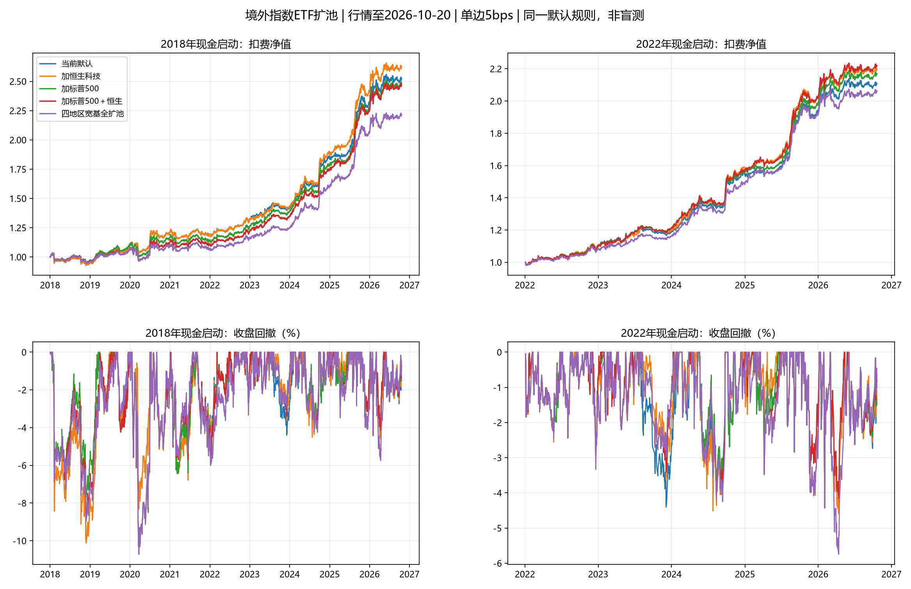

# 境外指数ETF扩池验证

研究日期2026-10-31，行情固定截至2026-10-20，与此前审计使用同一截止日。用户要求暂不改变策略；本轮默认池、参数、初始化状态、实盘信号及个人账户数据库均未调整。

## 结论与候选定位

本轮最值得观察的是513180恒生科技：2018主区间年化12.07%、夏普1.376，略高于默认11.55%、1.322；2022以来为18.63%、2.117，回撤4.60%略深于默认4.43%。历史准入及高成本对照仍有增益，但配对抽样区间包含零、家族校正不显著，暂不能认定具有稳定优势。

513500标普500与159920恒生补充较宽的市场覆盖，合加后2022年以来年化18.90%、夏普2.154，但2018主区间11.27%、1.300，低于默认。其优势依赖观察区间，不能只选近年结果。德国/法国没有显示稳定组合改善。用标普替换纳指可降低主区间最大回撤至9.45%，同时收益降至11.16%；东证替换日经未改善。所有方案仅为研究，不上线。

## 候选、规模与市场范围

研究对象仍是沪深交易所上市、人民币交易的跨境ETF，不要求使用境外券商账户。香港属于境外市场，不称为外国市场。4个地区/大盘宽基全部16个子集（含原池）＋2个风格单独新增＋2个指数替换，共20个事先固定场景。没有因子窗口、风险预算或调仓频率搜索，也没有临时加入此前行业候选。

| 代码 | 候选 | 成立日 | 首个真实报价 | 估算规模/亿元 | 规模净值归属日 | 规模层级 |
| --- | --- | --- | --- | --- | --- | --- |
| 513500 | 标普500ETF博时 | 2013-12-05 | 2014-01-15 | 260.92 | 2026-10-19 | 较大规模 |
| 159920 | 恒生ETF华夏 | 2012-08-09 | 2012-10-22 | 79.79 | 2026-10-20 | 较大规模 |
| 513030 | 德国DAXETF华安 | 2014-08-08 | 2014-09-05 | 18.16 | 2026-10-19 | 观察（不足20亿） |
| 513080 | 法国CAC40ETF华安 | 2020-05-29 | 2020-06-12 | 11.15 | 2026-10-19 | 观察（不足20亿） |
| 513180 | 恒生科技ETF华夏 | 2021-05-18 | 2021-05-25 | 368.24 | 2026-10-20 | 较大规模 |
| 513050 | 中概互联网ETF易方达 | 2017-01-04 | 2017-01-18 | 354.93 | 2026-10-19 | 较大规模 |
| 513800 | 日本东证指数ETF南方 | 2019-06-12 | 2019-06-25 | 19.88 | 2026-10-20 | 观察（不足20亿） |

规模来自Tushare份额×单位净值估算，仅使用研究截止日已经公告的NAV，并配对该净值日已知的份额；不是以未公布的同日境外净值估算。全部在2021年末前成立。优先20亿元以上；德国、法国、TOPIX体量较小，事先明确放在10—20亿元观察层，不沿用上一轮行业扩池的20亿元上线偏好。并未因回测结果更换代表。

- 513500标普500：美股大盘行业覆盖比现有纳指更广，但与纳指仍高度重叠，新增代码不等于新增独立风险。
- 159920恒生：补充香港市场的大盘综合指数，包含科技和金融等；仍受中国经济、政策及全球流动性影响。
- 513030德国DAX、513080法国CAC40：补充欧元区国家股票；二者也有共同欧洲/汇率风险，不代表整个欧洲或全球市场。
- 513180恒生科技、513050中概互联：风格/行业补充，不是两个新国家宽基。分别单独添加，没有同时塞入它们来增加相似资产的排名票数。
- 513800东证：仅测试替换现有日经，比较更宽日本股票指数；不重复增加同一国家的仓位名额。

沙特159329、道琼斯513400等2024年成立、东南亚科技513730于2023年成立，本轮因历史短不进入回测。标普的其他较新代表不重复测试；现有纳指和日经也不换多个相同指数代码去挑历史赢家。

## 方法与跨时区处理

2018主账户从首个交易日现金启动；2018前价格只预热。2022辅助账户另从现金启动，不能与2018账本分段混用。核心仍为20/40日风险调整动量＋20日均线反转0.5、40日趋势、8%核心波动预算、70%核心风险仓、单只30%、最多3只核心风险ETF、前4缓冲且必选第1名。周末端开市日收盘出目标，下一交易日收盘成交。

卫星仍为512890 MA200／入0%／出+4%／先现金后国债／最高30%，明确采用全历史假设，与之前审计一致，不是实际历史收益。全账户风险仓可能100%、最多4只风险ETF加国债。单边5bps（3费＋2滑点预算），另测20bps；年化按252交易日，夏普无风险利率为零，回撤按收盘净值。

全部收益和动量来自境内ETF真实交易日的人民币复权收盘价，未使用当日晚间才形成的美国/欧洲指数收盘。人民币价格已包含汇率及ETF市场溢折价影响，不额外重复叠加汇率。没有把境外指数历史回填到ETF上市前。估值最多沿用3个过去交易日，实际成交必须当日有报价；缺价取消整批调仓，长期缺价报错。

QDII净值的归属日期不等于发布时间，`known_nav`按`ann_date`限制可得性。NAV不输入选仓、风险或收益，也没有拿同日期境内收盘与稍后形成的境外NAV计算“实时溢价”。公告只有日期、没有时刻，不能把本次规模估算当作盘中可用净值。报价仍有价差、限额、停牌和溢折价风险；5/20bps压力对照不是完整盘口模型。未模拟整数手、成交容量或实际现金分红到账。

## 2018年以来主结果

| 方案 | 年化收益 | 零利率夏普 | 最大回撤 |
| --- | --- | --- | --- |
| 当前默认 | 11.55% | 1.322 | -10.11% |
| 仅加标普500 | 11.35% | 1.315 | -10.72% |
| 仅加恒生 | 11.31% | 1.299 | -11.45% |
| 仅加德国DAX | 10.07% | 1.182 | -11.47% |
| 仅加法国CAC40 | 11.23% | 1.285 | -10.11% |
| 仅加恒生科技 | 12.07% | 1.376 | -10.11% |
| 仅加中概互联 | 10.81% | 1.265 | -10.78% |
| 标普500替换纳指 | 11.16% | 1.306 | -9.45% |
| 东证替换日经 | 10.92% | 1.250 | -10.11% |
| 加标普500＋恒生 | 11.27% | 1.300 | -10.72% |
| 四地区宽基全扩池 | 9.85% | 1.160 | -10.72% |

## 2022年以来辅助结果

| 方案 | 年化收益 | 零利率夏普 | 最大回撤 |
| --- | --- | --- | --- |
| 当前默认 | 17.57% | 2.006 | -4.43% |
| 仅加标普500 | 18.30% | 2.092 | -4.43% |
| 仅加恒生 | 18.18% | 2.070 | -4.43% |
| 仅加德国DAX | 16.73% | 1.911 | -4.92% |
| 仅加法国CAC40 | 16.87% | 1.926 | -4.84% |
| 仅加恒生科技 | 18.63% | 2.117 | -4.60% |
| 仅加中概互联 | 17.81% | 2.041 | -4.60% |
| 标普500替换纳指 | 17.10% | 1.981 | -4.43% |
| 东证替换日经 | 16.52% | 1.896 | -4.91% |
| 加标普500＋恒生 | 18.90% | 2.154 | -4.43% |
| 四地区宽基全扩池 | 17.01% | 1.947 | -5.75% |



## 分段与稳定性

以下全部继承同一2018账本仓位，不是重新选择最有利现金启动日。

| 方案 | 区间 | 年化 | 夏普 | 最大回撤 |
| --- | --- | --- | --- | --- |
| 当前默认 | 2018-2021 | 4.62% | 0.554 | -10.11% |
| 当前默认 | 2022-2024 | 16.44% | 2.084 | -4.41% |
| 当前默认 | 2025+ | 19.86% | 1.965 | -4.43% |
| 加标普500＋恒生 | 2018-2021 | 2.68% | 0.344 | -10.72% |
| 加标普500＋恒生 | 2022-2024 | 16.90% | 2.180 | -4.21% |
| 加标普500＋恒生 | 2025+ | 22.69% | 2.194 | -4.43% |
| 仅加恒生科技 | 2018-2021 | 4.57% | 0.548 | -10.11% |
| 仅加恒生科技 | 2022-2024 | 17.35% | 2.207 | -4.52% |
| 仅加恒生科技 | 2025+ | 21.19% | 2.068 | -4.60% |

恒科主区间最大回撤与默认相同，主要因为全期最深峰谷位于2018年，当时恒科ETF尚未上市，不能据此推断加入恒科完全不增加熊市风险。2022后回撤4.60%对比4.43%，显示实际仍可能加深。

2018—2021选出法国ETF后，2022—2024夏普2.046，低于默认2.084；2022—2024选出恒科后，2025以后夏普2.068，高于默认1.965。时间顺序结果有好有坏。所有年份已被研究者观察，不能称为独立盲测。

## 费用、历史准入与境外集中度

单边20bps，2018以来：

| 方案 | 年化收益 | 零利率夏普 | 最大回撤 |
| --- | --- | --- | --- |
| 当前默认 | 8.48% | 0.996 | -12.27% |
| 仅加恒生科技 | 9.02% | 1.054 | -12.27% |
| 仅加标普500 | 8.27% | 0.983 | -11.52% |
| 加标普500＋恒生 | 8.11% | 0.960 | -13.07% |

新候选固定准入：真实报价满252日、前1交易日20日成交额中位数至少1000万元、前1交易日份额×原始价估计市值至少2亿元、当天有真实报价。份额最多只向前沿用5日，不向后填充。对新增候选收紧准入，不改原池既有准入，也不保证完全解决历史份额发布/修订问题。

| 方案 | 年化收益 | 零利率夏普 | 最大回撤 |
| --- | --- | --- | --- |
| 当前默认 | 11.55% | 1.322 | -10.11% |
| 仅加恒生科技 | 12.08% | 1.378 | -10.11% |
| 仅加标普500 | 11.12% | 1.282 | -10.72% |
| 加标普500＋恒生 | 11.00% | 1.270 | -10.72% |

境外核心目标合计30%对照同时限制原纳指、日经及新境外ETF。削减部分在原本有国债时补回国债，否则留现金，不增加总风险或名额。必须与同样受限的默认作比较，而非只与不受限默认比较：

| 方案 | 年化收益 | 零利率夏普 | 最大回撤 |
| --- | --- | --- | --- |
| 当前默认 | 11.58% | 1.333 | -10.11% |
| 仅加恒生科技 | 12.07% | 1.385 | -10.11% |
| 仅加标普500 | 11.49% | 1.358 | -10.72% |
| 加标普500＋恒生 | 11.54% | 1.372 | -10.72% |

该合计限制是事先固定的风险对照，不是本轮新默认；卫星红利及国内资产不计入境外额度。

## 持仓、相关与缩放诊断

恒科扩池方案实际持有恒科174个交易日，占全期8.16%、上市后交易日13.28%；全期平均账户权重0.77%、最大漂移权重15.68%，共8段连续持有，周期中位24.5天。不是长期重仓恒科获取的收益。

| 进入执行日 | 退出执行日 | 持有天数 | ETF价格毛回报 |
| --- | --- | --- | --- |
| 2022-05-16 | 2022-06-27 | 29 | 22.86% |
| 2022-12-12 | 2023-01-16 | 24 | 1.97% |
| 2023-06-19 | 2023-06-26 | 3 | -5.54% |
| 2023-07-10 | 2023-08-21 | 30 | 1.12% |
| 2023-11-27 | 2023-12-04 | 5 | -6.78% |
| 2024-05-13 | 2024-06-11 | 20 | -5.71% |
| 2024-09-23 | 2024-11-04 | 25 | 23.64% |
| 2025-02-05 | 2025-03-31 | 38 | 9.94% |

周期回报是ETF自身复权价格变化，未扣费用、不含账户权重再平衡，不冒充实际交易胜率或相对默认的精确贡献。存在单周期约5%—7%的价格下跌；较大上涨集中在2022年反弹、2024年9月后及2025年初，8个周期样本仍小。

2022以来境内交易价格日收益的成对相关（仅事后诊断，不输入信号）：

| 候选 | 名称 | 与现有纳指 | 与现有日经 | 与沪深300 |
| --- | --- | --- | --- | --- |
| 513500 | 标普500ETF博时 | 0.892 | 0.638 | 0.247 |
| 159920 | 恒生ETF华夏 | 0.393 | 0.290 | 0.692 |
| 513030 | 德国DAXETF华安 | 0.664 | 0.588 | 0.308 |
| 513080 | 法国CAC40ETF华安 | 0.645 | 0.598 | 0.300 |
| 513180 | 恒生科技ETF华夏 | 0.372 | 0.270 | 0.697 |
| 513050 | 中概互联网ETF易方达 | 0.341 | 0.231 | 0.623 |
| 513800 | 日本东证指数ETF南方 | 0.613 | 0.750 | 0.291 |

现有均线反转项受池内原始评分离散度D缩放。主试验后另做固定原15只风险ETF的D，以及“保留扩池D但禁止买新增ETF”解释对照，共7种×2起点×2费用，单独保存28个结果。恒科固定原D仍为年化12.00%、夏普1.372；保留扩池D却禁止买恒科时为11.38%、1.305。增益未完全由缩放解释，但不能据此证明因果稳定优势。

## 统计证据与实现检查

20个主场景×2起点×2费用＝80个结果；历史准入另80个；境外30%上限另80个。全部保留，不删除失败候选。主场景的家族内均值增益循环块抽样20/60/120日、各1500次，探索性p约0.765, 0.716, 0.702，未达到5%显著性。检验不涵盖项目之前所有选池/因子搜索，不能作为全项目过拟合概率。

恒科相对默认的配对60日块抽样、2000次，年化增益95%条件区间约[-0.27, +1.49]个百分点；夏普增益约[-0.031, +0.156]。区间包含零，而且条件于已开发策略与当前样本，未校正事后挑选恒科的全部偏差，不是未来收益范围。

全部43项研究检查通过：生产整合默认对账；默认、全宽基、标普新增及两个替换的生产信号对账；5/20bps逐日账本对账；20池上市前及仓位名额检查；多个历史截点前缀截断和未来价格扰动；实盘文件指纹不变。新增NAV公告日、替换初始化和境外总仓约束测试，完整110项测试通过。仍保留当前大规模存续ETF选择、交易流动性、时区、报价、幸存者及多轮调参偏差。

建议保持现有默认，恒科列为首要观察候选，标普500/恒生列为较宽市场覆盖候选；欧洲和TOPIX暂无收益证据支持纳入。下一步若继续研究，应预先固定候选和验收标准，在后续新样本验证，不能将本轮最好的区间或场景当作已知可实现收益。

## 复现

```powershell
python research_overseas_expansion.py --download
python research_overseas_expansion.py
python research_overseas_expansion.py --diagnostics
python research_overseas_expansion.py --report-only
```

独立行情在`data/overseas_expansion_20261031/`；全部数表、每日收益、目标、持仓、时间顺序诊断、条件区间与指纹在`output/overseas_expansion_20261031/`。研究代码复用此前已验证的账本与历史准入函数，不改生产配置。研究数据不会自动更新到当前日期。

## 公开资料

- [博时标普500产品概要：2013年成立、2014年上市](https://www.sse.com.cn/disclosure/fund/announcement/c/new/2026-06-26/513500_20260626_PDT5.pdf)
- [华夏恒生官方介绍](https://fund.chinaamc.com/portal/cn/hxxc/2013/ETF-cxyx/index4.html)
- [华安德国DAX官方产品](https://wap.huaan.com.cn/funds/513030/index.shtml)
- [华安法国CAC40官方产品](https://www.huaan.com.cn/funds/513080/index.shtml)
- [华夏恒生科技产品概要](https://www.sse.com.cn/disclosure/fund/announcement/c/new/2026-03-23/513180_20260323_XSB4.pdf)
- [易方达中概互联年度报告：指数与成立日](https://www.sse.com.cn/disclosure/fund/announcement/c/2018-03-30/513050_2017_n.pdf)
- [南方TOPIX官方产品](https://www.southernfund.com/main/jjcp/fundproduct/513800.shtml)
