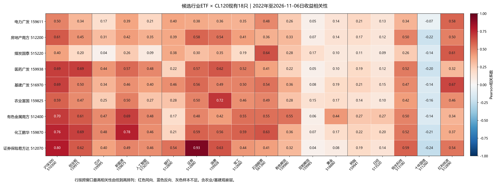
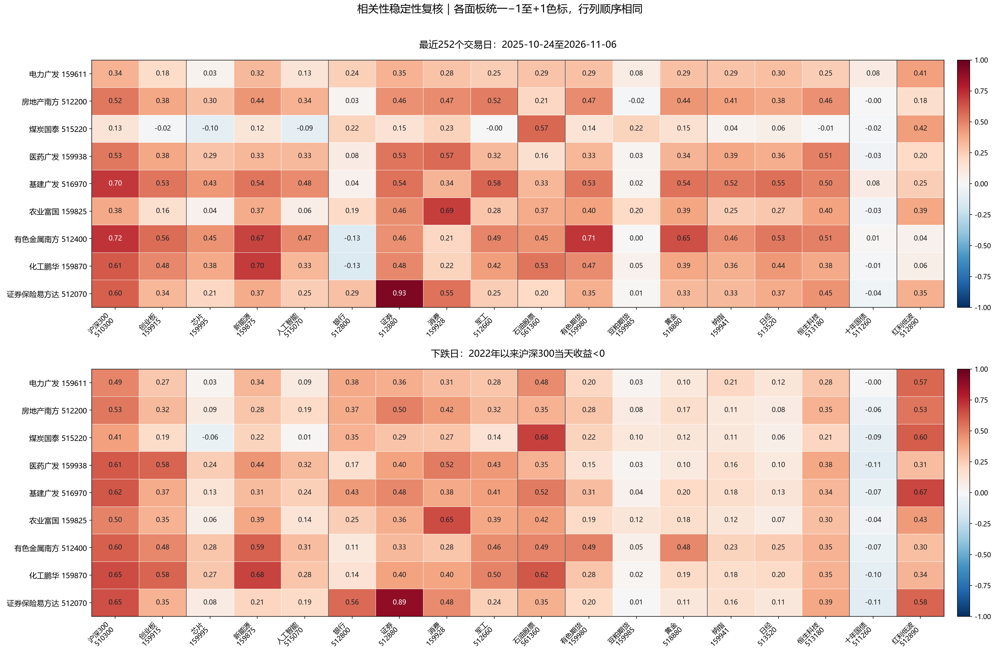

# 候选ETF与CL120现有池的相关性热力图

日期2026-11-09；沿用[行业扩池研究](cl120_pool_expansion_20261109.md)截至2026-11-06的同一行情快照。9只候选对比当前配置的18只ETF，包括独立红利卫星，不是仅看本周3只目标持仓。默认策略、标的池、参数和实盘JSON均未修改。

## 结果与排序

从同向重复风险看，相对低相关的主层候选优先为电力ETF广发159611、房地产ETF南方512200。这是对已观察历史的分散价值排序，并不意味着已找到能提高CL120收益的扩池方案。相关性低、波动率低、下跌保护和具有正预期收益是不同属性。



| 候选 | 层级 | 长期最高ρ | 最相关现有ETF | 最近252日最高ρ | 下跌日最高ρ | 三窗口最差 | 126日滚动最高ρ的90%分位 |
| --- | --- | --- | --- | --- | --- | --- | --- |
| 电力ETF广发 159611 | 主层 | 0.582 | 红利低波 512890 | 0.411 | 0.571 | 0.582 | 0.766 |
| 房地产ETF南方 512200 | 主层 | 0.612 | 沪深300 510300 | 0.524 | 0.532 | 0.612 | 0.833 |
| 煤炭ETF国泰 515220 | 主层 | 0.640 | 石油股票 561360 | 0.572 | 0.680 | 0.680 | 0.836 |
| 医药ETF广发 159938 | 主层 | 0.693 | 沪深300 510300 | 0.567 | 0.612 | 0.693 | 0.915 |
| 基建ETF广发 516970 | 观察 | 0.685 | 沪深300 510300 | 0.703 | 0.665 | 0.703 | 0.832 |
| 农业ETF富国 159825 | 观察 | 0.716 | 消费 159928 | 0.694 | 0.649 | 0.716 | 0.876 |
| 有色金属ETF南方 512400 | 主层 | 0.701 | 沪深300 510300 | 0.723 | 0.597 | 0.723 | 0.821 |
| 化工ETF鹏华 159870 | 主层 | 0.778 | 新能源 159875 | 0.697 | 0.678 | 0.778 | 0.902 |
| 证券保险ETF易方达 512070 | 主层 | 0.935 | 证券 512880 | 0.930 | 0.889 | 0.935 | 0.960 |

最高ρ及前3高相关的均值均只针对17只现有风险ETF（含红利），国债仍在图内展示但不参与该排序；不能因为多数股票与国债相关较低，就把存在高度行业重叠的ETF误判为有分散价值。主排序取长期、最近一年、下跌日三个最高ρ中的最大值；没有把负相关取绝对值后当作重复多头风险。强负相关仍是紧密关系，只是潜在用途更接近对冲。

本轮把红利卫星512890也作为现有成员：电力与原核心ETF的最高ρ约0.496，但与红利低波约0.581，后者才是完整现有池中的最高值。因此和上轮只看核心池的数值存在差别。其他微小差异来自先计算完整日收益再截取2022区间，保留首个交易日相对上一年末的收益。

## 最近一年与下跌环境



| 候选 | 沪深300≤−1%日最高ρ | 对应共同样本数 | 与CL120净收益ρ |
| --- | --- | --- | --- |
| 159611 | 0.658 | 153 | 0.357 |
| 512200 | 0.615 | 154 | 0.329 |
| 515220 | 0.785 | 86 | 0.339 |
| 159938 | 0.718 | 154 | 0.304 |
| 516970 | 0.724 | 154 | 0.423 |
| 159825 | 0.650 | 154 | 0.362 |
| 512400 | 0.607 | 154 | 0.471 |
| 159870 | 0.740 | 154 | 0.383 |
| 512070 | 0.883 | 154 | 0.438 |

下跌日定义为沪深300当天收益<0，大跌日为≤−1%；条件只用于事后风险诊断，不是提前预测市场状态。条件相关衡量在该类日期中两种收益变化是否同向，不能据较低数值断言候选在这些日期不亏损，也不是对组合最大回撤的保证。滚动126日最高相关90%分位反映历史上较高的重复风险，近期126日值、完整时序及每对有效样本数量另存CSV。

## 与已有扩池回测衔接

按上述分散排序挑出的两只主层候选为电力ETF广发159611、房地产ETF南方512200，对应之前已经测试的`add_159611_512200`。原35场景中的该组合，2018现金起点、单边5bps，年化11.14%、夏普1.270、回撤-10.51%；CL120默认为13.50%、1.556、9.62%。2022起点该组合为17.19%、1.919、-7.55%，默认19.65%、2.235、4.25%。

这里仅引用已有回测，没有根据本次全样本相关性重新构造一条回测并冒充样本外结果。选择候选参考整个历史，属于事后观察；若未来将低相关条件变成交易规则，应在每个当时的信号日，仅使用此前的滚动数据，重新核对费用、持仓挤出和IVOL比较集合变化。

电力、地产可以作为相对低相关观察方向；煤炭补充能源周期但与石油股票有关；医药的近期重复度下降但长期仍受A股市场影响。证券保险与现有券商高度相关，新增它主要是扩展金融行业内部覆盖，不能算新增一个独立风险来源。有色股票与现有有色期货不是同一产品，不过仍有显著的权益市场相关。

## 方法、样本与限制

- 输入为同日基金复权因子计算的收盘价，相关性用简单日收益，不用价格水平。
- 不向前/向后填补缺价；某日或其前一日无报价，则该日收益缺失。每对资产仅使用共同有效收益，缺少样本的相关性留空，绝不填成0。
- 长期为2022年至11月6日，至少252个共同收益；最近252个交易日至少200个共同收益；下跌日至少120个共同收益；大跌日至少60个共同收益。新ETF、停牌和短样本会使每格数量不同，已另存样本数矩阵，图中灰格表示不足。
- 本轮长期每格实际共同样本为731—1172日，最近一年所有格均为252日，后者可在完全相同日期上直接横向比较；下跌日353—596日、大跌日86—154日，短条件样本须谨慎解释。
- 所有信号和收益都来自境内ETF价格，没有拼接在A股收盘后才形成的同日境外指数收盘。
- 与CL120的相关系数使用同区间的历史假设净收益，不是个人账户记录。它只反映历史动态持仓；和配置池的最高相关性用途不同。
- 当前规模筛选仍有后视与存续偏差；样本已经观察，相关性随市场状态变化。低ρ可帮助分散，最终组合风险仍取决于权重、波动率和协方差，不能替代收益与风险预算验证。

6项分析核对通过，包括矩阵与逐对Pearson对账、样本数、已有回测引用、输入快照及默认文件指纹。没有启用相关性交易门槛或修改CL120。

## 复现与输出

```powershell
python analyze_pool_correlations.py
```

依赖刚才扩池研究的独立行情缓存与主结果；无需联网或Token。输出在`output/pool_correlations_20261109/`：四组相关性及样本数矩阵、排序、126日滚动最高相关、分散优先两只的已有回测引用、检查及输入指纹。两张图保存在`docs/assets/`。

组合分散思想的原始文献参考：[Markowitz（1952），Portfolio Selection](https://doi.org/10.1111/j.1540-6261.1952.tb01525.x)。本轮数值是本地ETF行情计算结果，论文没有验证本项目候选或CL120。
