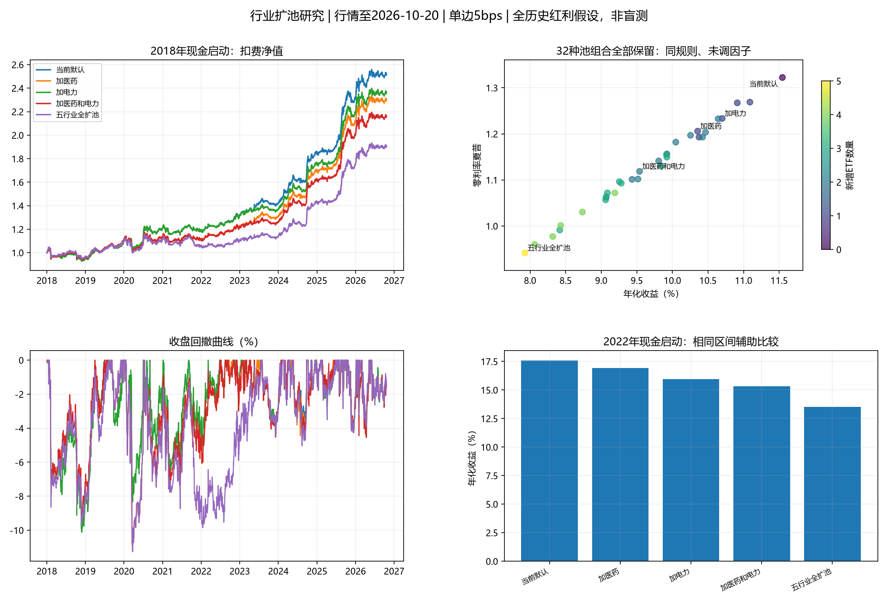

# 行业ETF扩池研究：覆盖面与历史表现

研究日期2026-10-31；行情固定截至2026-10-20，与此前审计使用同一数据截点。当前默认及实盘状态保持不变。

## 结论

当前17只ETF跨资产覆盖较广，行业轮动覆盖并不完整。医药卫生、公用事业电力、地产和基础化工值得作为独立行业候选；煤炭补充能源子行业，但与石油及红利有一定周期/风格重叠。沪深300、创业板、纳指和红利本来就间接包含一些行业，不能将“没有独立行业ETF”说成“完全没有风险敞口”。

固定因子、参数、持仓名额与执行规则后，五个候选全部32个子集（含空集默认）中，2018主区间有0个、2022辅助区间有0个方案夏普高于默认。单只新增也均未改善。成立满一年及历史流动性/规模准入对照未扭转主要结论。建议保留候选及数据，继续使用当前默认，不因“行业越齐越好”立即扩池；也不能因本轮默认更好就宣布原池无过拟合。

## 当前池

| 类型 | 当前ETF |
| --- | --- |
| A股宽基 | 510300沪深300、159915创业板 |
| 海外指数 | 159941纳指、513520日经 |
| 科技与成长行业 | 159995芯片、515070人工智能、159875新能源 |
| 消费 | 159928消费 |
| 金融 | 512800银行、512880证券 |
| 军工 | 512660军工 |
| 能源股票 | 561360石油产业 |
| 商品 | 518880黄金、159985豆粕期货、159980有色金属期货 |
| 防守 | 511260十年国债 |
| 独立卫星 | 512890红利低波，单独MA200反转，不参加核心排名 |

合计16只核心＋1只卫星。159980是商品期货ETF，并非有色矿业股票；518880也不是黄金矿业股票ETF。扩大行业直接覆盖与增加独立风险来源不是同一件事。

## 候选筛选与规模

回测前冻结5个候选：2021年末前成立、目前估计净资产至少20亿元、补充较少直接覆盖的行业；未按回测结果更换同类代表。医药选择较宽的全指医药卫生，而非只覆盖创新药；电力覆盖发电/公用事业，与新能源设备制造不同。化工虽为主题指数，覆盖多种化工子行业，不是单一产品。

| 代码 | 候选 | 成立日 | 首个真实交易报价 | 规模估算/亿元 | 近20日成交额中位数/亿元 |
| --- | --- | --- | --- | --- | --- |
| 159938 | 医药ETF广发 | 2014-12-01 | 2015-01-08 | 46.16 | 0.34 |
| 512200 | 房地产ETF南方 | 2017-08-25 | 2017-09-25 | 50.21 | 2.12 |
| 515220 | 煤炭ETF国泰 | 2020-01-20 | 2020-03-02 | 107.88 | 6.25 |
| 159611 | 电力ETF广发 | 2021-12-29 | 2022-01-07 | 84.68 | 3.20 |
| 159870 | 化工ETF鹏华 | 2021-02-23 | 2021-03-03 | 105.97 | 2.52 |

规模估算统一为2026-10-20同日Tushare基金份额×单位净值，不是份额数，也不冒充最新季度审计净资产；历史准入使用份额×原始交易价格估计市值。两者口径不同。成立日早于上市报价日，回测只允许真实报价出现且因子充分预热后交易。电力虽2021年成立，2022-01-07才上市，不能放回2018年买入。

钢铁515210约11亿元、广发基建516970约12亿元、银华基建516950约1亿元，在本轮资料时点未达到20亿元门槛，未进入回测候选。通信、软件、机器人、光伏等与已有科技/新能源重叠较多，不为增加代码数量重复覆盖。保险、交通运输、可选消费、建筑材料仍是可能的直接覆盖缺口；本轮没有为凑齐行业而降低规模门槛，也没有完成全市场同类代表逐一穷举。

## 回测口径

主账户2018-01-02现金启动，2018年前行情只预热；另列2022-01-04现金启动，不能混用起始账本。核心仍是20/40日风险调整动量＋20日均线反转0.5、40日趋势、8%核心波动预算、70%核心风险总上限、单只30%、最多3只核心风险ETF、前4缓冲且必选第1名。每周最后开市日收盘出信号，下一交易日收盘成交。未改因子参数、名额或红利规则。

512890仍为全历史假设MA200／入0%／出+4%／先现金后国债／上限30%，与此前审计基线一致，并非真实采用日期回放或实盘收益；全账户风险仓可能达到100%、最多4只风险ETF加国债。单边5bps为3bps费用＋2bps滑点预算，另测20bps。252交易日年化，夏普无风险利率为零，回撤按收盘净值。允许分数复权单位，没有整数手、盘口、竞价容量和真实现金分红到账的执行模型。

## 同规则扩池结果：2018年以来

| 方案 | 年化 | 零利率夏普 | 最大回撤 |
| --- | --- | --- | --- |
| 当前默认 | 11.55% | 1.322 | -10.11% |
| 仅加医药ETF广发 | 10.35% | 1.206 | -11.26% |
| 仅加房地产ETF南方 | 10.37% | 1.193 | -10.66% |
| 仅加煤炭ETF国泰 | 11.09% | 1.269 | -10.11% |
| 仅加电力ETF广发 | 10.70% | 1.233 | -10.11% |
| 仅加化工ETF鹏华 | 10.91% | 1.267 | -10.11% |
| 加医药和电力 | 9.54% | 1.119 | -11.26% |
| 五行业全扩池 | 7.93% | 0.941 | -11.26% |

## 2022年以来辅助比较

| 方案 | 年化 | 零利率夏普 | 最大回撤 |
| --- | --- | --- | --- |
| 当前默认 | 17.57% | 2.006 | -4.43% |
| 仅加医药ETF广发 | 16.92% | 1.933 | -4.53% |
| 仅加房地产ETF南方 | 16.79% | 1.942 | -4.56% |
| 仅加煤炭ETF国泰 | 16.91% | 1.928 | -4.77% |
| 仅加电力ETF广发 | 15.94% | 1.836 | -4.55% |
| 仅加化工ETF鹏华 | 16.66% | 1.949 | -4.71% |
| 加医药和电力 | 15.33% | 1.768 | -4.55% |
| 五行业全扩池 | 13.52% | 1.610 | -5.04% |



## 分段、费用与历史准入

以下分段继承2018账本持仓，和2022独立现金启动略有差异。

| 方案 | 区间 | 年化 | 夏普 | 最大回撤 |
| --- | --- | --- | --- | --- |
| 当前默认 | 2018-2021 | 4.62% | 0.554 | -10.11% |
| 当前默认 | 2022-2024 | 16.44% | 2.084 | -4.41% |
| 当前默认 | 2025+ | 19.86% | 1.965 | -4.43% |
| 五行业全扩池 | 2018-2021 | 1.49% | 0.210 | -11.26% |
| 五行业全扩池 | 2022-2024 | 10.92% | 1.459 | -5.04% |
| 五行业全扩池 | 2025+ | 18.37% | 1.868 | -4.26% |

单边20bps的2018主区间：

| 方案 | 年化 | 夏普 | 最大回撤 |
| --- | --- | --- | --- |
| 当前默认 | 8.48% | 0.996 | -12.27% |
| 五行业全扩池 | 4.81% | 0.596 | -14.87% |

固定历史准入只作用于新增候选：真实报价至少252日、前一交易日已知的20日成交额中位数至少1000万元、前一交易日份额估计市值至少2亿元。当日缺价也不得新选入；份额只向前沿用最多5个交易日，完全不向后填充。门槛没有搜索寻优。这是将新候选变得更保守的敏感性，不等同于对全市场历史池进行统一筛选，也不能保证资料发布延迟已被完全模拟。

| 准入后方案 | 年化 | 夏普 | 最大回撤 |
| --- | --- | --- | --- |
| 当前默认 | 11.55% | 1.322 | -10.11% |
| 仅加医药ETF广发 | 10.35% | 1.205 | -11.26% |
| 仅加房地产ETF南方 | 10.58% | 1.224 | -10.11% |
| 仅加煤炭ETF国泰 | 11.12% | 1.275 | -10.11% |
| 仅加电力ETF广发 | 10.75% | 1.239 | -10.11% |
| 仅加化工ETF鹏华 | 11.08% | 1.287 | -10.11% |
| 加医药和电力 | 9.58% | 1.124 | -11.26% |
| 五行业全扩池 | 8.10% | 0.970 | -11.26% |

按2018—2021夏普选池后检验2022—2024，以及按2022—2024夏普选池后检验2025以后，均选中原默认。这里已观察所有历史，只是时间顺序诊断，不是新的盲测，也没有证明未来必选原池。

## 为何行业更广没有带来更好回测

排名轮动最多仍选3只核心风险ETF，新增标的会挤出原资产，并非在原组合外免费叠加分散。行业具备长期经济价值，不意味着它在本策略短动量、周收盘执行下具有正的边际选时收益。五行业全扩池的实际新增持仓如下，周期可能包含样本末尚未退出的周期；天数占比的分母是全部2018以来交易日，包括部分ETF上市前日期。

| 代码 | 候选 | 持有日 | 全期持有天数占比 | 全期平均账户权重 | 连续持有周期数 | 周期中位天数 |
| --- | --- | --- | --- | --- | --- | --- |
| 159938 | 医药ETF广发 | 351 | 16.46% | 2.02% | 19 | 10.0 |
| 512200 | 房地产ETF南方 | 191 | 8.96% | 0.98% | 15 | 10.0 |
| 515220 | 煤炭ETF国泰 | 266 | 12.48% | 1.03% | 16 | 16.5 |
| 159611 | 电力ETF广发 | 125 | 5.86% | 0.81% | 6 | 17.5 |
| 159870 | 化工ETF鹏华 | 117 | 5.49% | 0.72% | 5 | 15.0 |

前日实际权重×当日复权收益计算的算术年率毛贡献为：159938：+0.054个百分点/年, 512200：-0.648个百分点/年, 515220：-0.178个百分点/年, 159611：-0.073个百分点/年, 159870：+0.202个百分点/年。这是组合账户的加权毛贡献，不是ETF自身年化，未扣单项交易成本，也不是相对于原资产的精确机会成本；正贡献同样可能低于被挤出资产。

2022年以来日收益与原核心风险ETF的最高成对相关系数如下。使用各自共同真实报价日；全期相关仅作事后诊断，未输入交易信号；低于1不代表危机中独立。

| 候选 | 名称 | 原池最相关代码 | 名称 | 相关系数 |
| --- | --- | --- | --- | --- |
| 159938 | 医药ETF广发 | 510300 | 沪深300ETF | 0.691 |
| 512200 | 房地产ETF南方 | 510300 | 沪深300ETF | 0.611 |
| 515220 | 煤炭ETF国泰 | 561360 | 石油产业ETF | 0.640 |
| 159611 | 电力ETF广发 | 510300 | 沪深300ETF | 0.499 |
| 159870 | 化工ETF鹏华 | 159875 | 新能源ETF | 0.776 |

另发现现有均线反转项由池内原评分离散度D缩放，扩池即使未买入新ETF也可能改变旧ETF评分。首轮后单独补充“D固定为原15只风险ETF”的解释对照，未并入事先32池统计、不切换默认。其五行业全扩池2018年化8.32%，夏普0.987；较原扩池改善，但仍低于默认。2022辅助区间年化14.00%、夏普1.664。因此不能只用评分缩放变化解释扩池变差。

## 审计与证据边界

全部46项研究检查通过：默认整合函数对账；默认/全池信号与生产函数对账；5/20bps逐日账本对账；3个历史周截点的截断和未来价格扰动；32个池的上市前、核心限仓及名额检查；生产及实盘文件指纹不变。新增3项历史准入单元测试，完整107项测试通过。有限测试不构成没有任何未来函数的数学证明。

32个池共有128个主表区间/费用结果，全部保留，未删掉差方案。7个准入对照加默认共8种、2个起点和2个成本共32个结果；另有7种固定旧D的后设解释对照、28个结果，分别存放，不合并冒充事先试验。配对循环块抽样20/60/120日、各1500次的家族内均值增益探索性p值为0.999, 1.000, 0.999；本轮连观察到的正均值增益都没有，不应将高p值解读为“已证明候选永远无效”。这也不涵盖项目此前所有筛选和搜索。

按当前大规模存续ETF选择历史候选仍然有幸存者及选池后视，规模越大也可能正是此前涨得好/吸金多的结果。历史成交额和份额准入只能缓解其中一部分。没有清盘ETF完整名单、可靠的逐日历史分类及全部份额发布时间；不具备全市场无偏历史池。原策略本身经多轮开发选择，默认获胜不能当作排除其过拟合的证据。

建议继续冻结默认；五只候选进入观察库而非实盘默认。后续若要推进扩池，可预先指定统一的大行业候选、历史年龄/规模/流动性门槛，并以新累积的真实样本验证，而不是从这32组中继续追逐局部赢家。产业覆盖目标和收益目标应分别评估。

## 复现与文件

```powershell
python research_pool_expansion.py --download
python research_pool_expansion.py
python research_pool_expansion.py --diagnose-spread
python research_pool_expansion.py --report-only
```

首次下载使用自己的Tushare权限；研究只使用独立的`data/pool_expansion_20261031/`。主结果、逐日收益、持仓统计、准入对照、时间顺序选择、相关、检查和数据指纹位于`output/pool_expansion_20261031/`。报告重建不重新选参。没有自动修改`config.py`、默认策略、实盘计划或真实账户数据库。

## 公开资料

- [广发医药ETF官方季度报告：成立与跟踪范围](https://www.gffunds.com.cn/jjgg/dqgg/202604/P020260422306671905861.pdf)
- [南方地产ETF官方2026三季报](https://www.nffund.com/main/files/2026/10/26/167233623652.pdf)
- [电力ETF官方产品概要：成立与上市日](https://www.gffunds.com.cn/jjgg/flwj/202603/P020260325366808318318.pdf)
- [鹏华化工ETF2026三季报，巨潮资讯披露](https://static.cninfo.com.cn/finalpage/2026-10-26/1225621767.PDF)
- [上交所煤炭ETF资料入口](https://www.sse.com.cn/assortment/fund/list/etfinfo/basic/index.shtml?FUNDID=515220)
- [Tushare基金份额接口：fd_share单位为万份，2000积分起](https://tushare.pro/document/2?doc_id=207)
- 未纳入候选的规模筛查：[钢铁515210](https://fund.eastmoney.com/515210.html)、[基建516970](https://fundf10.eastmoney.com/jbgk_516970.html)、[基建516950](https://finance.sina.com.cn/fund/quotes/516950/bc.shtml)。规模资料日期不完全相同，仅作研究日候选筛选，不输入历史排名。
