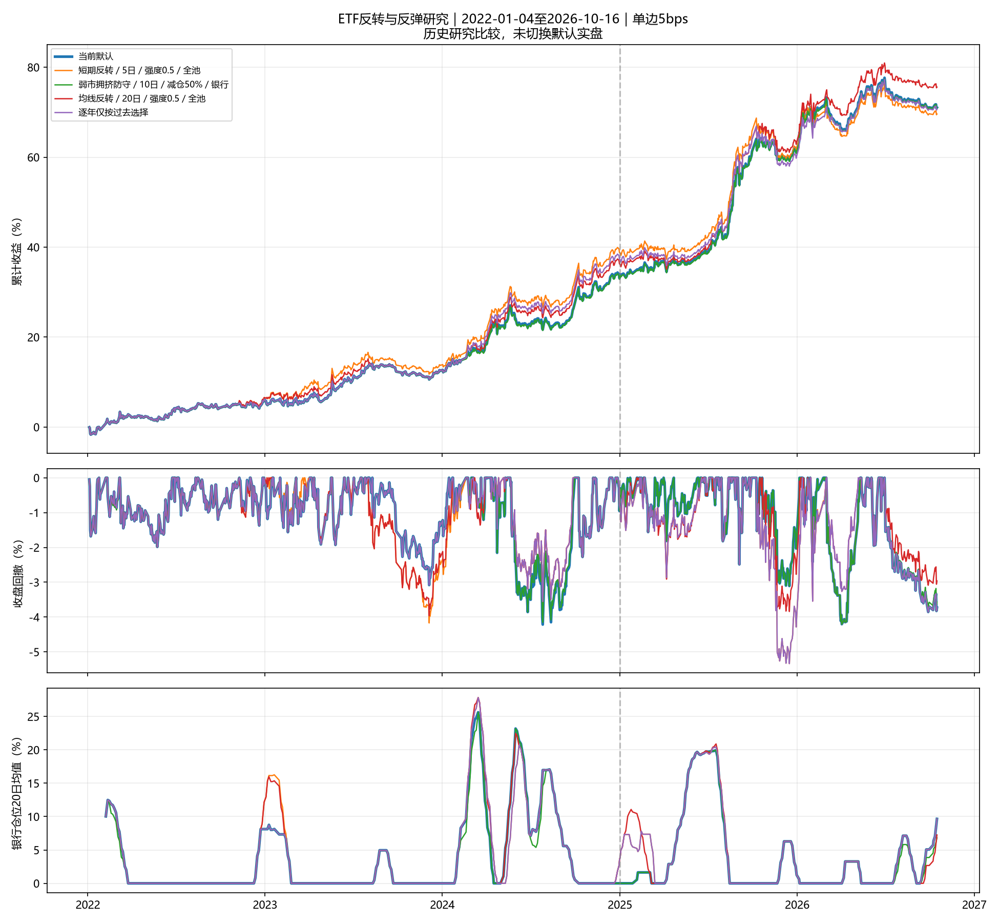

# ETF反转与反弹因子研究报告

> 历史研究快照：本报告中的默认为当时7%版本；2026-10-18已选择8%＋20日均线反转0.5，现行参数见[README](../README.md)。

研究日期：2026-10-17；行情截止：2026-10-16。

## 结论与适用范围

研究已完成；保留当前7%预算＋前4名缓冲＋必选第1名的默认实盘。下面的最优项属于历史候选，未改写live_signal或10月19日计划。
固定比较50个方案（含默认），时间2022-01-04至2026-10-16，16只ETF；标准单边5bps，高成本20bps。夏普为零无风险利率，回撤为日收盘净值。所有这些年份已参与此前研究；2025以后仅为按时间分段的复核，不能称为独立盲测。

首轮50项全样本夏普最高：**均线反转／20日／强度0.5／全池**；仅按2022–2024选择：**短期反转／5日／强度0.5／全池**。请同时查看两者的后段与逐年表现，不能用全样本冠军替换训练期选择后再称样本外收益。

- 银行普遍在此后下跌的假说没有得到稳定支持：最贴近观察的33次事件，随后5日银行均值0.12%、亏损比例39.39%；随后大盘上涨的16次，银行均值仍为1.04%。
- 历史冠军年化比默认增加0.65个百分点、夏普增加0.064；2025以后年化仅增加0.17个百分点，夏普变化-0.034。
- 真正按设计段选择的方案，2025以后年化12.42%、夏普1.529，同期默认为15.80%、1.920；滚动选择路径全期夏普1.735。
- 首轮49个非默认尝试校正后均值收益差探索性p值0.790；冠军的收益差和夏普差成对区间均包含零。收益点估计值得继续跟踪，证据不足以替换默认策略。

## 一、银行短期高点假说

先把观察写成固定事件：大盘至少连跌3日；在此基础上要求银行近5日上涨；另比较大盘近5日走弱且银行位于短均线之上。信号日之后下一交易日收盘才计入，再持有5个交易日。每组事件间隔至少7个交易日，组内持有窗口不重叠。后续大盘上涨/未上涨的分组只用于事后归因，绝不作为交易输入；事件少时不据概率点估计下结论。

| 条件 | 分组 | 事件数 | 银行均值 | 银行中位数 | 银行亏损比例 | 大盘均值 |
| --- | --- | ---: | ---: | ---: | ---: | ---: |
| 大盘连跌至少3日 | 全部 | 68 | 0.39% | 0.28% | 41.18% | 0.19% |
| 大盘连跌至少3日 | 2022–2024 | 50 | 0.31% | 0.28% | 42.00% | 0.18% |
| 大盘连跌至少3日 | 2025以后 | 18 | 0.63% | 0.31% | 38.89% | 0.22% |
| 大盘连跌至少3日 | 随后大盘上涨（仅事后归因） | 37 | 1.32% | 0.70% | 29.73% | 1.65% |
| 大盘连跌至少3日 | 随后大盘未上涨（仅事后归因） | 31 | -0.71% | -0.77% | 54.84% | -1.56% |
| 大盘连跌3日且银行近5日上涨 | 全部 | 33 | 0.12% | 0.25% | 39.39% | -0.05% |
| 大盘连跌3日且银行近5日上涨 | 2022–2024 | 24 | 0.06% | 0.31% | 41.67% | -0.04% |
| 大盘连跌3日且银行近5日上涨 | 2025以后 | 9 | 0.29% | 0.25% | 33.33% | -0.05% |
| 大盘连跌3日且银行近5日上涨 | 随后大盘上涨（仅事后归因） | 16 | 1.04% | 0.84% | 31.25% | 1.65% |
| 大盘连跌3日且银行近5日上涨 | 随后大盘未上涨（仅事后归因） | 17 | -0.74% | 0.00% | 47.06% | -1.64% |
| 大盘弱5日且银行短期偏热 | 全部 | 59 | 0.35% | 0.61% | 42.37% | 0.33% |
| 大盘弱5日且银行短期偏热 | 2022–2024 | 35 | 0.33% | 0.48% | 48.57% | 0.06% |
| 大盘弱5日且银行短期偏热 | 2025以后 | 24 | 0.38% | 0.82% | 33.33% | 0.72% |
| 大盘弱5日且银行短期偏热 | 随后大盘上涨（仅事后归因） | 34 | 0.85% | 0.97% | 32.35% | 1.80% |
| 大盘弱5日且银行短期偏热 | 随后大盘未上涨（仅事后归因） | 25 | -0.33% | -0.38% | 56.00% | -1.68% |

‘大盘连跌3日且银行近5日上涨’组的事件均值重抽样探索性95%区间为[-0.68%, 0.91%]，包含零；事件间隔虽去掉组内持有期重叠，仍可能存在市场状态相关性，区间未作多重比较修正。

值得关注的是相对表现：随后大盘上涨的16次，大盘均值1.65%，银行为1.04%。这提示反弹时持有防御资产可能有机会成本；低β及有限样本也可能解释差异，尚不能证明可交易择时优势。如果其他ETF仍未通过40日资格，单纯调整评分也无法让它们入选。

这些条件无法直接确认‘总处于高点’。收益条件、观察窗口与样本年份都会影响结论；不使用未来回调来反向定义入场日。

## 二、因子与策略定义

1. **短期反转**：过去k日对数收益取负，再除以60日历史日波动×√k。窗口3/5/10日，叠加强度0.25/0.5/1。
2. **均线反转**：价格相对10/20/40日均线的标准偏离取负；强度0.25/0.5。
3. **RSI反转**：(50−RSI)/50，RSI采用7/14日简单移动平均涨跌幅，平盘为50；非Wilder版本。
4. **残差反转**：短期对数收益剔除β×同期沪深300对数收益后取负。β与残差波动只用冲击开始前60日；窗口3/5/10日。
5. **反弹确认**：t−3之前10/20/40日窗口回撤深度，乘最近3日已发生的正对数收益，分别按60日波动缩放。
6. **弱市拥挤防守**：沪深300k日下跌、窗口至少60%交易日下跌且低于40日均线；风险ETF同期上涨且高于k日均线。比较仅银行和全部10只国内股票ETF，窗口5/10/20日。
7. **反弹切换防守**：前k日市场下跌且银行相对跑赢；最近3日市场已反弹而银行已转弱。比较窗口5/10/20日。

前五类保留40日动量与趋势资格，把有界因子乘**当日**原评分截面标准差后小幅叠加，避免对不同量纲直接相加。短期/残差因子先除3再截断到[−1,1]，均线偏离同样处理；反弹因子只做正向奖励。国债不参与评分。因此超跌但尚未通过40日资格的ETF不会因本研究被买入。

因子库另保留标准化相对大盘强弱 `relative_strength`：k日自身对数收益减沪深300同期对数收益，再除以60日自身波动×√k。它是可复用描述因子，不作为本次新增第51个调参方案。

两类防守分别测试半仓防守和禁选重排：半仓将受影响资产的周目标减半，释放至正60日动量国债，否则现金；禁选在排名之前执行并按原规则重排。它们不是同一连续参数的两点。半仓目标仍为正，缓冲历史一致；禁选通过核心资格筛选更新历史，不保留已归零目标。

## 三、组合表现

| 方案 | 年化 | 夏普 | 最大回撤 | 20bps年化 | 20bps回撤 |
| --- | ---: | ---: | ---: | ---: | ---: |
| 当前默认 | 12.40% | 1.760 | -4.22% | 9.78% | -4.85% |
| 短期反转／5日／强度0.5／全池 | 12.19% | 1.736 | -5.34% | 9.56% | -6.01% |
| 弱市拥挤防守／10日／减仓50%／银行 | 12.40% | 1.762 | -4.20% | 9.76% | -4.75% |
| 均线反转／20日／强度0.5／全池 | 13.05% | 1.824 | -3.96% | 10.39% | -4.91% |
| 逐年仅按过去选择 | 12.34% | 1.735 | -5.34% | 9.68% | -6.01% |

冠军的全期平均银行仓位4.20%，默认为3.79%。因此其改善不能简单归因为少持银行。反转评分只在合格池内改变排名，合格标的不超过3只时，纯排名叠加无法改变入选集合。

| 家族的全样本最优项（事后描述） | 年化 | 夏普 | 回撤 |
| --- | ---: | ---: | ---: |
| 当前默认 | 12.40% | 1.760 | -4.22% |
| 短期反转／5日／强度0.25／全池 | 12.76% | 1.790 | -4.45% |
| 均线反转／20日／强度0.5／全池 | 13.05% | 1.824 | -3.96% |
| RSI反转／14日／强度0.5／全池 | 13.02% | 1.815 | -3.95% |
| 残差反转／5日／强度0.5／全池 | 12.04% | 1.733 | -4.75% |
| 反弹确认／40日／强度0.25／全池 | 12.36% | 1.735 | -4.22% |
| 弱市拥挤防守／5日／禁选重排／国内股票 | 12.80% | 1.813 | -4.20% |
| 反弹切换防守／5日／禁选重排／银行 | 12.46% | 1.771 | -4.22% |



## 四、时间分段与逐年复核

2022–2024作为事先指定设计段。设计段候选须满足年化不低于默认超过0.5个百分点、最大回撤不超过10%、至少2/3年份收益差非负，再按夏普选择；没有合格项就保留默认。

| 方案 | 设计段年化 | 设计段夏普 | 2025以后年化 | 2025以后夏普 | 2025以后回撤 |
| --- | ---: | ---: | ---: | ---: | ---: |
| 当前默认 | 10.43% | 1.661 | 15.80% | 1.920 | -4.20% |
| 短期反转／5日／强度0.5／全池 | 12.06% | 1.922 | 12.42% | 1.529 | -5.34% |
| 弱市拥挤防守／10日／减仓50%／银行 | 10.36% | 1.654 | 15.92% | 1.933 | -4.20% |
| 均线反转／20日／强度0.5／全池 | 11.35% | 1.808 | 15.97% | 1.885 | -3.84% |
| 逐年仅按过去选择 | 11.65% | 1.865 | 13.53% | 1.613 | -5.34% |

| 方案 | 2022 | 2023 | 2024 | 2025 | 2026 |
| --- | ---: | ---: | ---: | ---: | ---: |
| 当前默认 | 6.14% | 6.04% | 18.23% | 21.40% | 5.87% |
| 短期反转／5日／强度0.5／全池 | 6.56% | 6.74% | 22.04% | 16.67% | 4.72% |
| 弱市拥挤防守／10日／减仓50%／银行 | 6.08% | 6.04% | 18.10% | 21.40% | 6.04% |
| 均线反转／20日／强度0.5／全池 | 6.56% | 5.64% | 21.06% | 19.86% | 7.49% |
| 逐年仅按过去选择 | 6.14% | 6.04% | 22.04% | 16.67% | 6.49% |

2026年尚未结束，逐年表列实际累计收益；分段年化采用252交易日口径。滚动路径2022–2023沿用默认，2024/2025/2026每年仅看当时已经实现的收益选择；训练末端留5个交易日间隔。路径在同一核心引擎中重放并支付真实切换成本，不拼接不同历史仓位的假想收益。它仍是已观察历史上的复核，不是前瞻实盘。

逐年选择：2024→短期反转／5日／强度0.5／全池；2025→短期反转／5日／强度0.5／全池；2026→RSI反转／14日／强度0.5／全池。

## 五、参数敏感性与完整尝试记录

下表保留与全样本冠军同一家族、同一作用范围的全部固定参数。全部方案的汇总在本地 `comparison.csv`，包含失败项；未保留逐项独立策略脚本。

| 方案 | 年化 | 夏普 | 回撤 | 后段年化 | 后段夏普 |
| --- | ---: | ---: | ---: | ---: | ---: |
| 均线反转／10日／强度0.25／全池 | 12.14% | 1.703 | -4.20% | 14.71% | 1.750 |
| 均线反转／10日／强度0.5／全池 | 12.70% | 1.787 | -4.58% | 15.56% | 1.842 |
| 均线反转／20日／强度0.25／全池 | 12.17% | 1.697 | -4.45% | 14.40% | 1.707 |
| 均线反转／20日／强度0.5／全池 | 13.05% | 1.824 | -3.96% | 15.97% | 1.885 |
| 均线反转／40日／强度0.25／全池 | 12.60% | 1.751 | -4.45% | 15.61% | 1.837 |
| 均线反转／40日／强度0.5／全池 | 12.60% | 1.757 | -4.45% | 16.42% | 1.922 |

### 分类补充：仅调整银行或国内股票ETF

在看过首轮结果后增加10项分类检验：银行专用5日反转、20日均线反转、14日RSI、5日残差反转，强度各0.25/0.5；另测国内10只股票ETF的20日均线反转。这些是后续探索，不能称为预先固定或独立盲测。全轮共60个静态参数配置，另有1条滚动选择路径。按年滚动选择仅针对首轮50项，不能拿分类补充的事后最优替换它。

| 分类方案 | 年化 | 夏普 | 回撤 | 后段年化 | 后段夏普 |
| --- | ---: | ---: | ---: | ---: | ---: |
| 短期反转／5日／强度0.25／银行 | 12.21% | 1.744 | -4.87% | 15.80% | 1.920 |
| 短期反转／5日／强度0.5／银行 | 12.26% | 1.753 | -4.87% | 15.80% | 1.920 |
| 均线反转／20日／强度0.25／银行 | 12.04% | 1.728 | -5.02% | 15.64% | 1.902 |
| 均线反转／20日／强度0.5／银行 | 12.08% | 1.736 | -5.02% | 15.64% | 1.902 |
| RSI反转／14日／强度0.25／银行 | 12.21% | 1.744 | -4.87% | 15.80% | 1.920 |
| RSI反转／14日／强度0.5／银行 | 12.09% | 1.735 | -5.02% | 15.80% | 1.920 |
| 残差反转／5日／强度0.25／银行 | 12.26% | 1.753 | -4.87% | 15.80% | 1.920 |
| 残差反转／5日／强度0.5／银行 | 12.26% | 1.753 | -4.87% | 15.80% | 1.920 |
| 均线反转／20日／强度0.25／国内股票 | 11.84% | 1.661 | -4.51% | 14.36% | 1.706 |
| 均线反转／20日／强度0.5／国内股票 | 11.47% | 1.579 | -5.63% | 13.47% | 1.533 |

分类10项内部的居中最大均值差探索性p值1.000；不包含其在首轮结果之后才设定的自适应选择偏差，不能与前面的首轮49项校正混为一谈。分类冠军的历史截断及未来扰动最大权重差为0。

分类补充的最高夏普1.753，默认为1.760；本次没有发现只针对银行或只针对国内股票反转更优的稳定证据。

## 六、预测性与统计不确定性

因子IC只在至少5只合格风险ETF、因子有截面差异的周计算，标签为下一次收盘执行到再下次收盘执行的真实可持有区间，非信号当日收益。R²是过去2年滚动线性预测，至少52个已结束标签周，所有训练标签在预测日已结束；对照为当时已知训练标签均值。标签未扣个股交易费用。

| 因子 | 平均IC | IC周数 | 前段IC | 后段IC | 滚动R² |
| --- | ---: | ---: | ---: | ---: | ---: |
| 当前默认 | 0.0340 | 148 | 0.0074 | 0.0661 | -0.0059 |
| 短期反转／5日／强度0.5／全池 | -0.0671 | 148 | -0.0449 | -0.0940 | -0.0128 |
| 均线反转／20日／强度0.5／全池 | -0.0759 | 148 | -0.0875 | -0.0619 | -0.0100 |
| RSI反转／14日／强度0.5／全池 | -0.0463 | 148 | -0.0392 | -0.0549 | -0.0025 |
| 残差反转／5日／强度0.5／全池 | -0.0581 | 148 | -0.0276 | -0.0950 | -0.0106 |
| 反弹确认／20日／强度0.5／全池 | 0.0102 | 140 | -0.0104 | 0.0346 | -0.0027 |

短期反转、均线反转和残差反转的IC在本样本为负，滚动线性R²也未提供稳定预测增益。个别组合净值改善可能来自少数周的换仓路径、风险结构与缓冲交互，不能据净值点估计声称反转因子已具有独立预测能力。周度信号及下一交易日收盘执行也可能错过更快的反转；本轮没有为追求更好回测而改成当天收盘成交。

20日成对循环块抽样2000次，对本轮49个非默认尝试的最大均值收益差进行居中最大值校正，探索性p值 **0.790**。这项检验针对日均收益差，不等同于冠军夏普的显著性，也没有涵盖此前所有调参。

| 候选 | 年化算术收益差95%区间 | 夏普差95%区间 |
| --- | ---: | ---: |
| 均线反转／20日／强度0.5／全池 | [-0.67%, 1.83%] | [-0.130, 0.270] |
| 短期反转／5日／强度0.5／全池 | [-1.80%, 1.37%] | [-0.269, 0.212] |
| 弱市拥挤防守／10日／减仓50%／银行 | [-0.10%, 0.10%] | [-0.013, 0.018] |

成对区间本身未作多重比较修正，且市场非平稳、ETF之间相关。均值差区间与复利年化差定义不同。

## 七、单标的依赖与未来信息检查

逐一禁用15只风险ETF的交易资格，对候选和默认使用相同禁用池；价格仍保留作为市场/截面信息源，尤其沪深300继续作为大盘过滤。

| 候选 | 同池年化提高次数 | 同池夏普提高次数 |
| --- | ---: | ---: |
| 弱市拥挤防守／10日／减仓50%／银行 | 8/15 | 9/15 |
| 均线反转／20日／强度0.5／全池 | 13/15 | 11/15 |
| 短期反转／5日／强度0.5／全池 | 6/15 | 7/15 |

时点审计共20项，最大过去目标差 **0**。包含真实历史截断和未来行情扰动；滚动选择只用当时已实现净收益，收益后扣费、周中漂移、缺价取消成交均复用正式引擎。新增因子另有方向、缺价、跳过窗口、残差β时点测试。

项目62项单元测试通过，分类补充另做2项时点检查；主要审计与分类审计共22项。清理后的统一实现再次重放默认与历史冠军，净值最大差约2.3×10⁻¹⁶，属于CSV浮点舍入。

## 八、最终处置与复现

保留统一研究入口 `research_reversal.py`，五种通用新因子保留在因子库，含有目前未改善组合的因子，供后续研究。淘汰候选只保留汇总结果与固定网格记录，不保留逐策略脚本、逐策略数据副本或中间净值图。默认策略、实盘信号和账户数据库保持研究前状态。

**建议**：以冻结规则后的新行情验证候选；先改善证据强度，再决定是否接入实盘。不能因为银行近期强就单独对其加一个未经跨年份验证的规则。

复现：

```powershell
.\.venv\Scripts\python.exe research_reversal.py --end 2026-10-16
```

结果目录 `output/reversal_20261017/`；首次复现需自行下载相同区间行情。数据为当前Tushare版本，无法还原历史发布版本。回测未模拟整手、最低佣金、跨境溢价、盘中波动及现金利息；收益差不保证能在真实账户实现。

## 当前周目标核对

首轮历史冠军与默认的最新目标最大差为0。本周只有银行与纳指通过原绝对筛选，纯排名叠加没有改变入选集合；研究不会改写10月19日原计划。若日后采用新规则，须明确切换时间并沿用经过核对的历史状态。

## 资料依据

流动性供给研究支持把短期反转视为条件性假说；行业动量与反转机制可能并存，因此本研究没有假定个股研究直接适用于A股ETF。上述因子、阈值和周度实现是本地构造，不是论文原策略复刻。

- [Nagel：Evaporating Liquidity](https://www.nber.org/papers/w17653)
- [Da等：Decomposing Short-Term Return Reversal](https://www.newyorkfed.org/research/staff_reports/sr513.html)
- [Dai等：Reversals and the Returns to Liquidity Provision](https://www.nber.org/papers/w30917)
- [Bailey等：The Probability of Backtest Overfitting](https://www.davidhbailey.com/dhbpapers/backtest-prob.pdf)

数据指纹：`f0f376437c4a18111e6b38acfe4329d9fcbfa049c1effb4e90c9f802c5a097af`。实盘文件保护指纹前后校验通过。
