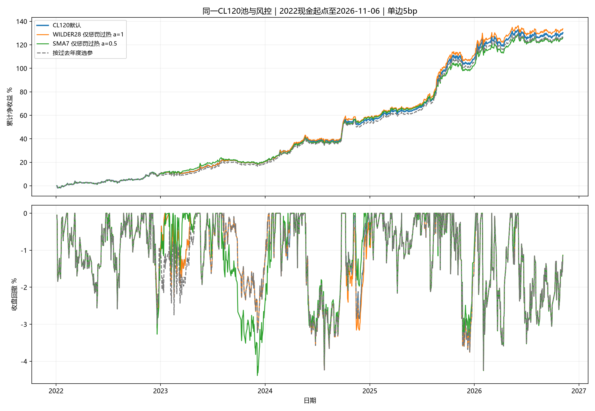
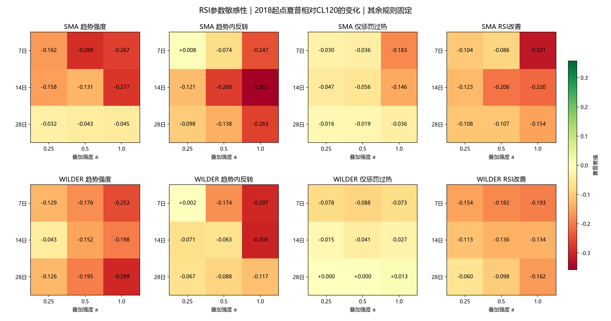
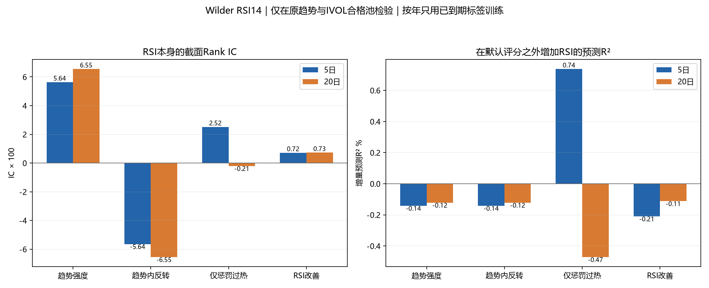

# RSI评分对CL120的增量研究

研究日期2026年11月20日。共有3种方案通过事先固定的跨区间和成本门槛，研究提名为WILDER28 仅惩罚过热 a=1。 但其中2种与默认逐日收益完全相同，不构成新增效果。2018历史夏普最高的新增方案是WILDER28 仅惩罚过热 a=1，变化集中在2024年；参数邻域、预测证据和年度选参未形成可靠的稳定增益证据，建议继续观察、保留当前默认。本轮不改变CL120实盘评分、调仓状态或已发布计划。

## 算法和研究范围

固定当前17只核心ETF及512890红利卫星，主比较截至2026年11月6日。84个场景包括默认、72个主网格、8个仅A股叠加及3个替换原MA反转的对照。窗口7/14/28日，SMA与Wilder两种算法，叠加强度0.25/0.5/1。所有参数在运行前记录在本地plan.json，没有按结果追加网格。

RSI=100×平均上涨价格变动/(平均上涨变动＋平均下跌变动)。简单均值版沿用原因子；Wilder版新增为`FactorSpec("rsi_wilder", N)`，以首个完整N日价格变动的简单均值初始化，其后用alpha=1/N递推。平盘取50；只涨取100、只跌取0；缺报价不填充，重新预热。`FactorStore.get`按名称和窗口缓存，两种定义不混用。

主评分为`S_new=S_CL120+a×D_t×U_t`，D是当日原动量评分在非国债核心池的截面样本标准差，与原MA反转的量纲一致。RSI缺值加0。U分别为：趋势强度clip((RSI−50)/25,−1,1)，趋势内反转取其相反数，仅惩罚过热为−clip((RSI−70)/30,0,1)，RSI改善为clip((RSI−RSI[t−5])/20,−1,1)。不新增RSI硬资格、不提高风险预算，国债和红利不参加评分。替换MA组先移除原0.5MA反转加分，其他组均保留它。

Wilder RSI的平滑计算和14日惯例见[TradingView官方定义](https://www.tradingview.com/support/solutions/43000502338-relative-strength-index-rsi/)。强趋势中RSI可长期保持高位，见[Fidelity指标说明](https://www.fidelity.com/learning-center/trading-investing/technical-analysis/technical-indicator-guide/RSI)；因此“高RSI加分”和“过热扣分”是两个需用数据分别检验的假设，资料本身不证明本策略有超额收益。

## 收益和成本对照

全部为当前池、红利及IVOL的全历史假设回放，保留原公共缓冲锚点；2018/2022各自从现金开始。周末端收盘信号、下一交易日收盘执行，新仓只参与此后的收益。费用是单边综合成本5或20bp，含每次实际调仓成本与仓位漂移，不作免费每日再平衡。下表换手为买卖绝对权重之和的年化，即双边口径。

| 现金起点 | 方案 | 单边成本bp | 年化 | 零利率夏普 | 最大收盘回撤 | 年化双边换手 |
| --- | --- | --- | --- | --- | --- | --- |
| 2018 | CL120默认 | 5 | 13.50% | 1.556 | -9.62% | 1788.25% |
| 2018 | CL120默认 | 20 | 10.49% | 1.236 | -11.83% | 1788.25% |
| 2018 | WILDER28 仅惩罚过热 a=1 | 5 | 13.69% | 1.570 | -9.62% | 1791.97% |
| 2018 | WILDER28 仅惩罚过热 a=1 | 20 | 10.67% | 1.250 | -11.83% | 1791.97% |
| 2018 | SMA7 仅惩罚过热 a=0.5 | 5 | 12.89% | 1.520 | -10.44% | 1796.70% |
| 2018 | SMA7 仅惩罚过热 a=0.5 | 20 | 9.89% | 1.191 | -12.64% | 1796.70% |
| 2018 | SMA28 趋势强度 a=0.25 | 5 | 13.16% | 1.524 | -9.62% | 1785.72% |
| 2018 | SMA28 趋势强度 a=0.25 | 20 | 10.17% | 1.203 | -11.83% | 1785.72% |
| 2018 | SMA7 趋势内反转 a=0.25 | 5 | 13.43% | 1.564 | -8.81% | 1794.20% |
| 2018 | SMA7 趋势内反转 a=0.25 | 20 | 10.41% | 1.239 | -9.60% | 1794.20% |
| 2018 | WILDER28 RSI改善 a=0.25 | 5 | 12.92% | 1.496 | -9.62% | 1804.02% |
| 2018 | WILDER28 RSI改善 a=0.25 | 20 | 9.90% | 1.172 | -11.83% | 1804.02% |
| 2022 | CL120默认 | 5 | 19.65% | 2.235 | -4.25% | 1691.50% |
| 2022 | CL120默认 | 20 | 16.65% | 1.927 | -4.67% | 1691.50% |
| 2022 | WILDER28 仅惩罚过热 a=1 | 5 | 20.02% | 2.254 | -4.25% | 1698.30% |
| 2022 | WILDER28 仅惩罚过热 a=1 | 20 | 17.00% | 1.948 | -4.67% | 1698.30% |
| 2022 | SMA7 仅惩罚过热 a=0.5 | 5 | 19.17% | 2.264 | -4.39% | 1643.86% |
| 2022 | SMA7 仅惩罚过热 a=0.5 | 20 | 16.26% | 1.953 | -5.27% | 1643.86% |
| 2022 | SMA28 趋势强度 a=0.25 | 5 | 18.74% | 2.143 | -4.79% | 1674.28% |
| 2022 | SMA28 趋势强度 a=0.25 | 20 | 15.79% | 1.838 | -5.27% | 1674.28% |
| 2022 | SMA7 趋势内反转 a=0.25 | 5 | 19.19% | 2.176 | -4.25% | 1733.69% |
| 2022 | SMA7 趋势内反转 a=0.25 | 20 | 16.13% | 1.863 | -5.07% | 1733.69% |
| 2022 | WILDER28 RSI改善 a=0.25 | 5 | 18.32% | 2.093 | -4.79% | 1703.85% |
| 2022 | WILDER28 RSI改善 a=0.25 | 20 | 15.34% | 1.784 | -5.27% | 1703.85% |



完整336行结果保留在本地`all_results.csv`。筛选门槛要求两个现金起点、两个费用下年化和夏普均不低于默认；5bp两个起点回撤不超过10%，且2022回撤最多恶化0.5个百分点。满足者只按2018夏普提名，不自动切换策略。

## 改善集中在哪些交易

历史最好者在2018以来453次可执行周目标中，仅5次与默认目标不同；让决策前旧仓缓冲相同时，当前RSI直接改变选仓2次，其余差异还包含缓冲延续。所有收益差异集中在2024年，两个回测起点都包含该年，不能将它们视为两个独立验证样本。2024年累计收益由29.46%提高至31.35%；其余年份逐日收益相同。

| 信号日 | 执行日 | 同旧仓下直接改变 | 原目标 | RSI目标 |
| --- | --- | --- | --- | --- |
| 2024-03-08 | 2024-03-11 | 是 | 纳指ETF 159941 17.1%、黄金ETF 518880 30.0%、十年国债ETF 511260 30.0%、银行ETF（华宝） 512800 22.9% | 沪深300ETF 510300 23.4%、纳指ETF 159941 19.9%、十年国债ETF 511260 30.0%、银行ETF（华宝） 512800 26.7% |
| 2024-03-15 | 2024-03-18 | 否 | 黄金ETF 518880 28.1%、十年国债ETF 511260 30.0%、银行ETF（华宝） 512800 14.5%、有色金属ETF 159980 27.5% | 沪深300ETF 510300 18.8%、黄金ETF 518880 30.0%、十年国债ETF 511260 30.0%、银行ETF（华宝） 512800 21.2% |
| 2024-03-22 | 2024-03-25 | 否 | 黄金ETF 518880 28.2%、十年国债ETF 511260 30.0%、豆粕期货ETF 159985 13.3%、有色金属ETF 159980 28.5% | 沪深300ETF 510300 20.6%、黄金ETF 518880 30.0%、十年国债ETF 511260 30.0%、豆粕期货ETF 159985 19.4% |
| 2024-09-27 | 2024-09-30 | 是 | 沪深300ETF 510300 13.0%、十年国债ETF 511260 68.1%、证券ETF 512880 9.3%、恒生科技ETF（华夏） 513180 9.6% | 创业板ETF 159915 8.8%、十年国债ETF 511260 72.2%、证券ETF 512880 9.4%、恒生科技ETF（华夏） 513180 9.6% |
| 2024-09-30 | 2024-10-08 | 否 | 沪深300ETF 510300 9.6%、十年国债ETF 511260 74.8%、证券ETF 512880 7.7%、恒生科技ETF（华夏） 513180 7.8% | 创业板ETF 159915 5.4%、十年国债ETF 511260 78.8%、证券ETF 512880 7.8%、恒生科技ETF（华夏） 513180 7.9% |

Wilder28过热惩罚的0.25和0.5两个版本与默认逐日收益完全相同；本样本只有强度1跨过选仓边界。它不是一片稳定改善的参数平台。上述事件及过热标的的RSI值保留在`behavior_events.csv`；未在看到这些年份后加入新参数。

两次直接变化分别是：3月8日黄金RSI28约71.85，轻微扣分使原边界发生变化，3月11日由黄金切换至沪深300；9月27日沪深300RSI28约73.52、创业板约70.35，两者均受惩罚，前者受罚更大，9月30日改选创业板。9月30日信号10月8日执行的后续差异来自缓冲路径，不能当成第三次独立RSI成功事件。过热扣分仍允许高RSI资产入选，没有“超过70必须卖出”的硬规则。

## 参数与行情阶段稳定性



热图每格是2018起点夏普相对默认的变化。周边窗口或强度同步改善，才比孤立最高点更值得观察；下列分段沿用2018完整路径，不能与2022独立现金起点混为同一账本。所有历史阶段已经参与前期研究，均不能声称全新盲测。

| 方案 | 区间 | 年化 | 夏普 | 最大回撤 |
| --- | --- | --- | --- | --- |
| CL120默认 | 2018-2021 | 6.36% | 0.763 | -9.62% |
| CL120默认 | 2022-2024 | 16.82% | 2.171 | -4.24% |
| CL120默认 | 2025+ | 24.77% | 2.386 | -4.25% |
| SMA7 趋势内反转 a=0.25 | 2018-2021 | 6.71% | 0.822 | -8.81% |
| SMA7 趋势内反转 a=0.25 | 2022-2024 | 16.60% | 2.125 | -4.24% |
| SMA7 趋势内反转 a=0.25 | 2025+ | 23.91% | 2.309 | -4.25% |
| SMA7 仅惩罚过热 a=0.5 | 2018-2021 | 5.63% | 0.684 | -10.44% |
| SMA7 仅惩罚过热 a=0.5 | 2022-2024 | 17.16% | 2.271 | -4.39% |
| SMA7 仅惩罚过热 a=0.5 | 2025+ | 22.87% | 2.322 | -4.25% |
| SMA28 趋势强度 a=0.25 | 2018-2021 | 6.65% | 0.797 | -9.62% |
| SMA28 趋势强度 a=0.25 | 2022-2024 | 16.40% | 2.130 | -4.24% |
| SMA28 趋势强度 a=0.25 | 2025+ | 23.01% | 2.230 | -4.79% |
| WILDER28 仅惩罚过热 a=1 | 2018-2021 | 6.36% | 0.763 | -9.62% |
| WILDER28 仅惩罚过热 a=1 | 2022-2024 | 17.41% | 2.202 | -4.24% |
| WILDER28 仅惩罚过热 a=1 | 2025+ | 24.77% | 2.386 | -4.25% |
| WILDER28 RSI改善 a=0.25 | 2018-2021 | 6.59% | 0.791 | -9.62% |
| WILDER28 RSI改善 a=0.25 | 2022-2024 | 15.67% | 2.031 | -4.24% |
| WILDER28 RSI改善 a=0.25 | 2025+ | 23.14% | 2.240 | -4.79% |

## IC和预测R方

未来收益从信号后的下一交易日收盘开始，分别观察其后5和20个交易日。IC是各周截面秩相关，合格池只含当时通过原趋势、动量、波动及IVOL资格的资产；至少4只且横截面有变化才取样。两种RSI方法、全部窗口、全池与合格池的96项统计均保留在本地，下面展示常用Wilder14。高IC表示排序关联，不等同于可实现组合收益。

| RSI用法 | 预测跨度 | 有效周数 | RSI Rank IC | 原评分IC | 叠加0.25后的IC | 原评分预测R² | 加RSI预测R² | 增量预测R² |
| --- | --- | --- | --- | --- | --- | --- | --- | --- |
| 趋势强度 | 5 | 283 | 0.0564 | 0.0434 | 0.0470 | -0.23% | -0.38% | -0.14% |
| 趋势强度 | 20 | 282 | 0.0655 | 0.0291 | 0.0360 | -0.16% | -0.28% | -0.12% |
| 趋势内反转 | 5 | 283 | -0.0564 | 0.0434 | 0.0353 | -0.23% | -0.38% | -0.14% |
| 趋势内反转 | 20 | 282 | -0.0655 | 0.0291 | 0.0185 | -0.16% | -0.28% | -0.12% |
| 仅惩罚过热 | 5 | 153 | 0.0252 | -0.0030 | -0.0037 | -0.55% | 0.20% | 0.74% |
| 仅惩罚过热 | 20 | 152 | -0.0021 | 0.0131 | 0.0126 | -0.03% | -0.51% | -0.47% |
| RSI改善 | 5 | 283 | 0.0072 | 0.0434 | 0.0526 | -0.23% | -0.45% | -0.21% |
| RSI改善 | 20 | 282 | 0.0073 | 0.0291 | 0.0276 | -0.16% | -0.27% | -0.11% |



预测模型对照`未来收益~常数+原评分`与`未来收益~常数+原评分+RSI效用`。每年只用此前已经到期的标签拟合OLS，标准化也只从训练集计算；下一年逐点预测。预测R²以训练集历史均值为基准；增量预测R²=1−SSE_加RSI/SSE_原评分。负数表示增添RSI反而增加预测误差。它不是同期价格拟合R²，也没有把未来收益或未来转折点用于交易。

Wilder14趋势分在合格池的5/20日IC约0.056/0.066，但在原评分外增加它后，预测误差略增。它与原评分的秩相关约0.54，与MA偏离反转方向约−0.78，信息有明显重叠。趋势和反转效用互为相反数，OLS可通过系数符号转换，所以这两者预测R²相同，固定方向交易的结果仍不同。过热与RSI改善的取样周数也不同，应按各自匹配样本评价。

历史最好者使用的Wilder28过热效用，在5/20日的增量预测R²分别为1.36%/2.44%，是值得留存的正面线索；但每个跨度只有58个具备截面差异的合格周，且其5日增广模型绝对预测R²仍为−0.80%。OLS可自行选择正负系数，正R²仅提示变量可能含有信息，并未验证固定“过热扣分”方向；该效用20日IC略负，约−0.0065。有限预测线索与仅两次直接改变的交易样本，尚不足以认定稳定新增优势。

## 按过去选参与多重比较

从2022起每年仅使用年初前20个交易日之前的历史20bp净收益；至少504日、回撤<=10%、年化不低于默认且夏普至少高0.05，才从既定84项中选择，否则继续默认。年度切换后统一重放评分及缓冲，保留上期状态，不拼接各候选自己的虚拟持仓。

| 使用年份 | 训练截止 | 采用方案 |
| --- | --- | --- |
| 2022 | 2021-12-03 | SMA7 趋势内反转 a=0.25 |
| 2023 | 2022-12-02 | CL120默认 |
| 2024 | 2023-12-01 | CL120默认 |
| 2025 | 2024-12-03 | CL120默认 |
| 2026 | 2025-12-03 | CL120默认 |

| 成本bp | 年化 | 夏普 | 最大回撤 |
| --- | --- | --- | --- |
| 5.0 | 19.29% | 2.196 | -4.25% |
| 20.0 | 16.24% | 1.884 | -4.67% |

本轮83个新增场景共同做配对循环块抽样，1500次，块长20/60/120交易日。下表p值检验家族内最大日均收益增益，不是夏普显著性，也未覆盖此前全部研究搜索。历史最好者的普通配对增量区间在挑选之后计算，仍有选择偏差。

| 块长交易日 | 抽样次数 | 本轮家族最大均值增益p |
| --- | --- | --- |
| 20 | 1500 | 0.996 |
| 60 | 1500 | 0.992 |
| 120 | 1500 | 0.988 |

| 块长 | 年化增量95%区间（百分点） | 夏普增量95%区间 |
| --- | --- | --- |
| 20 | 0.00 至 0.52 | -0.000 至 0.034 |
| 60 | 0.00 至 0.52 | 0.000 至 0.032 |
| 120 | 0.00 至 0.49 | 0.000 至 0.032 |

家族p值约0.988—0.996，本轮最大均值增益没有通过常见5%显著门槛；这不等于“无效概率99%”。普通区间的下界接近0，部分原因是可重抽的独立改善事件很少，很多抽样根本未覆盖它们；也不能把这一结果当作稳健的正向收益保证。年度选参版本的2022起点年化19.29%、夏普2.196，均低于默认19.65%、2.235。

## 资产依赖诊断

对历史夏普最高的新增方案WILDER28 仅惩罚过热 a=1与默认做相同删资产对照，评分离散度和IVOL比较也随剩余池重算；不据此再选参数。以下增量仅比较同一删减后的两个方案，不能直接当成原策略资产收益归因。

| 共同删减 | 现金起点 | RSI年化增量 | 夏普增量 | 删减后默认回撤 | 删减后RSI回撤 |
| --- | --- | --- | --- | --- | --- |
| drop_bank | 2018 | 0.12% | +0.005 | -8.81% | -8.81% |
| drop_bank | 2022 | 0.22% | +0.003 | -4.27% | -4.27% |
| drop_chip_AI | 2018 | 0.12% | +0.005 | -9.62% | -9.62% |
| drop_chip_AI | 2022 | 0.22% | +0.005 | -7.35% | -7.35% |
| drop_gold | 2018 | 0.12% | +0.005 | -8.41% | -8.41% |
| drop_gold | 2022 | 0.22% | +0.005 | -4.79% | -4.79% |
| drop_nasdaq | 2018 | 0.12% | +0.006 | -9.46% | -9.46% |
| drop_nasdaq | 2022 | 0.22% | +0.005 | -4.93% | -4.93% |
| no_satellite | 2018 | 0.19% | +0.015 | -9.62% | -9.62% |
| no_satellite | 2022 | 0.36% | +0.021 | -4.24% | -4.24% |

共同删去黄金、银行或纳指后，RSI仍留下少量增益，说明本样本改善并非完全由单一资产决定；这些对照仍共享2024年行情，不能补足独立事件和年度的数量。

## 主比较之外的追加行情

主区间代表已先写入冻结名单，再取11月9日至11月20日追加行情；延续2018账户真实模拟旧仓，不从11月9日清零、不据此改选参数。短窗不能证明稳定性。

| 方案 | 成本bp | 新增交易日 | 累计收益 | 局部最大回撤 |
| --- | --- | --- | --- | --- |
| CL120默认 | 5.0 | 10 | 0.80% | -0.51% |
| CL120默认 | 20.0 | 10 | 0.79% | -0.51% |
| WILDER28 仅惩罚过热 a=1 | 5.0 | 10 | 0.80% | -0.51% |
| WILDER28 仅惩罚过热 a=1 | 20.0 | 10 | 0.79% | -0.51% |
| SMA7 仅惩罚过热 a=0.5 | 5.0 | 10 | 0.80% | -0.51% |
| SMA7 仅惩罚过热 a=0.5 | 20.0 | 10 | 0.79% | -0.51% |
| SMA28 趋势强度 a=0.25 | 5.0 | 10 | 0.80% | -0.51% |
| SMA28 趋势强度 a=0.25 | 20.0 | 10 | 0.79% | -0.51% |
| SMA7 趋势内反转 a=0.25 | 5.0 | 10 | 0.80% | -0.51% |
| SMA7 趋势内反转 a=0.25 | 20.0 | 10 | 0.79% | -0.51% |
| WILDER28 RSI改善 a=0.25 | 5.0 | 10 | 0.80% | -0.51% |
| WILDER28 RSI改善 a=0.25 | 20.0 | 10 | 0.79% | -0.51% |
| WILDER14 趋势强度 a=0.25 | 5.0 | 10 | 0.80% | -0.51% |
| WILDER14 趋势强度 a=0.25 | 20.0 | 10 | 0.79% | -0.51% |
| WILDER14 趋势内反转 a=0.25 | 5.0 | 10 | 0.80% | -0.51% |
| WILDER14 趋势内反转 a=0.25 | 20.0 | 10 | 0.79% | -0.51% |
| WILDER14 仅惩罚过热 a=0.25 | 5.0 | 10 | 0.80% | -0.51% |
| WILDER14 仅惩罚过热 a=0.25 | 20.0 | 10 | 0.79% | -0.51% |
| WILDER14 RSI改善 a=0.25 | 5.0 | 10 | 0.80% | -0.51% |
| WILDER14 RSI改善 a=0.25 | 20.0 | 10 | 0.79% | -0.51% |

默认与Wilder28过热候选在这10日内的5bp净收益分别为0.8025%、0.8025%。11月20日收盘信号尚未在本观察窗口内执行，未将其未来收益计入。

## 实施与复现

本轮登记研究因子和结果，CL120仍使用原实盘评分。SMA RSI继续可用，Wilder RSI加入因子库便于后续调用。历史高收益、低回撤和一次参数搜索的胜者都不足以保证未来；当前池仍有存续与选池后视偏差。

数值与时序核对155项通过，包括原CL120目标完全重现、代表方案的生产选仓及正式回测收益对账、前缀截断与未来行情扰动、仓位上限、默认和实盘文件指纹不变。新增测试另覆盖Wilder手算种子、缺价重置、两种RSI缓存隔离、标签到期以及年度选择的未来收益隔离。

```powershell
python research_rsi.py
python research_rsi.py --download-latest
python research_rsi.py --report-only
```

第一条离线读取`data/factor_extensions_20261109/`既有18只行情，新环境先运行`research_factor_extensions.py --download-only`。第二条在冻结主比较后使用自己的Tushare权限增量下载至独立`data/rsi_20261120/`并做追加观察；第三条只重画已有结果。结果、因子缓存、所有场景和检查在`output/rsi_20261120/`，不共享Token、行情或账户资料；报告与三张图保留在`docs/`。
