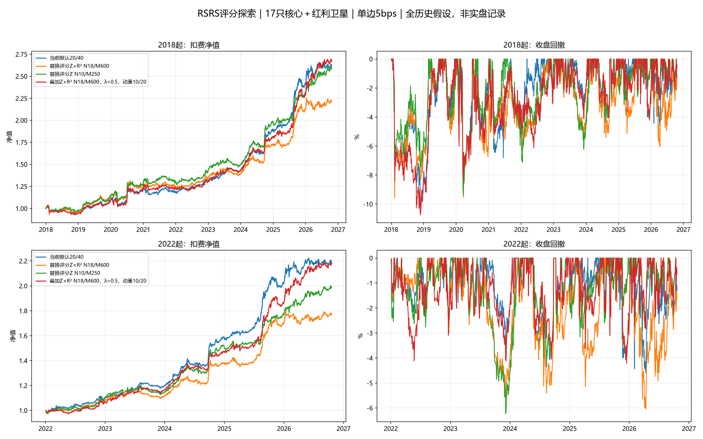
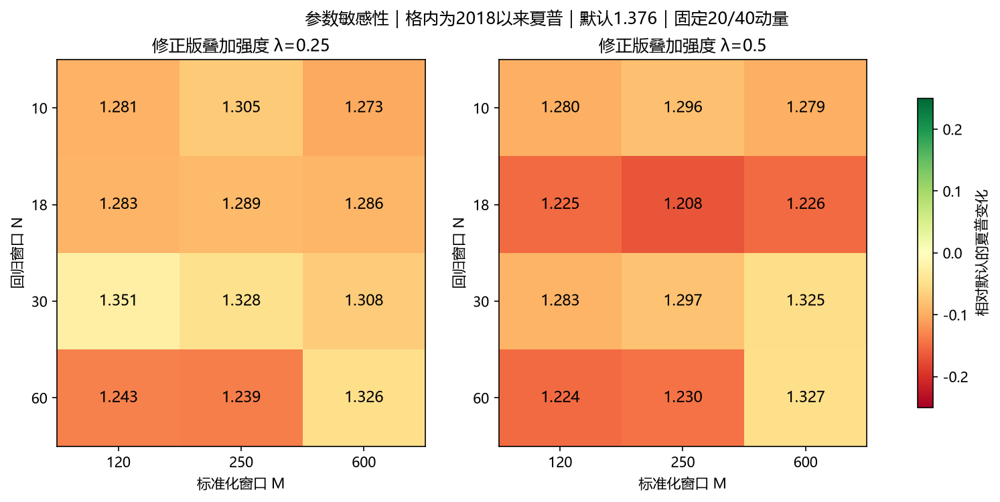

# RSRS评分、窗口与ETF轮动研究

研究日期2026-10-31，行情统一截止2026-10-20。当前默认17只核心（原16只＋513180恒科，不含513500标普）及512890红利卫星，全历史假设；默认配置、周状态、实盘计划与真实账户均未改变。

## 结论与建议

本轮保持默认。现有默认2018以来年化12.07%、夏普1.376、回撤-10.11%；事后最高夏普RSRS为替换评分Z N10/M250，年化11.93%、夏普1.455、回撤-9.37%，并未同时提高收益。该方案2022现金起点年化16.12%、夏普1.978，低于默认18.63%、2.117；20bps成本下2018年化7.65%，也低于默认9.02%。

经典N18/M600修正版直接替换仅年化9.87%、夏普1.171。保持20/40收益动量的24个叠加方案中，0个夏普超过默认；不同动量窗口联合试验的最好叠加为叠加Z×R² N18/M600，λ=0.5，动量10/20，年化12.36%、夏普1.388、回撤-10.74%，不是原20/40评分的普遍增益。正值过滤的事后最好方案降低长期回撤，但牺牲年化且近期较弱。因子可保留作观察与后续前向检验，当前证据不足以替换默认评分或增加实盘规则。

## 方法与来源

截图定义H=α+βL+ε，N日最高价对最低价做带截距OLS；β=Cov(L,H)/Var(L)。再取最近M个β（包含信号日、总体标准差ddof=0）计算Z=(β−mean_M)/std_M。本轮同时比较Z、修正版Z×R²、右偏版Z×R²×β。拟合R²是当期高低价的解释程度，不能视为未来收益预测R²，也不能把β较大直接等同未来一定上涨。

[光大证券研究团队对RSRS系列的原始介绍](https://www.sohu.com/a/246541595_195566)区分市场择时与横截面行业排序；历史报告不构成当前ETF池有效性的证明。[Tushare fund_daily文档](https://tushare.pro/document/2?doc_id=127)提供真实high/low/close，[fund_adj文档](https://tushare.pro/document/2?doc_id=199)提供同日基金复权因子。

原缓存仅收盘。本次为17只核心单独补高低价，每个交易日用既有同日因子计算H'=H×factor_t、L'=L×factor_t，并与冻结raw_close逐日一致核对。没有用今日因子统一复权历史，没有将close复制为高低价，没有拼接ETF上市前指数，没有向后填缺价。当前SDK的waditu下载地址连接失败，研究下载使用可达的官方api.tushare.pro HTTPS REST入口，不修改SDK或生产数据接口；TLS验证保留，Token仅在请求体中发送，不写入报告或日志。

## 事先固定的91场景

回归N=10/18/30/60，标准化M=120/250/600；36个三版本替换、24个修正版叠加强度0.25/0.5、6个正值过滤、12个相同预热原评分对照，另有4个收益动量周期对照及9个经典RSRS与其他动量周期组合。共91场景、两个现金起点×两档成本=364行结果，差方案全部保留。没有按结果继续细调阈值或切换默认。

- 替换：用RSRS代替最终排序评分，保留long期收益动量>0、MA40、vol60等绝对资格。它不是完全移除现有趋势防守的裸RSRS策略。缺RSRS时不入选。
- 叠加：score_new=score_old+λ×D_old×clip(RSRS_adjusted/3,−1,1)，D为原风险ETF基础评分当日离散度；缺RSRS回退原评分，国债不参与排名。
- 过滤：保持原评分，仅在RSRS_adjusted>0时允许入选；缺值不入选。阈值0事前固定，不搜索。
- 收益动量：10/20、20/40、40/80、60/120；只改变收益动量及对应long正值资格，MA40市场过滤、MA20反转、60日风险估计保持固定。
- 全部保留8%核心波动目标、70%核心风险上限、单只30%、最多3只核心风险、前4缓冲必选第1名。红利MA200入0出4、先现金再国债、最多30%不变；全账户并无8%/70%硬上限。

每交易周最后开市日收盘形成信号，下一交易日收盘成交。2018前只预热；每个起点从现金开始。单边5bps=3bps费用＋2bps滑点预算，另测20bps；252日年化、零无风险利率夏普、收盘回撤。分数复权单位及成交日参考价确定仓位仍是理想执行假设；未模拟整数手、盘口容量、QDII溢价或单独现金分红账簿。

## 2018年以来的结果

下列“最好”均是已观察全样本内的事后筛选，不能称为样本外最优。

| 方案 | 年化 | 零利率夏普 | 收盘最大回撤 | 年均双边名义换手/NAV |
| --- | --- | --- | --- | --- |
| 当前默认20/40 | 12.07% | 1.376 | -10.11% | 18.37 |
| 替换评分Z N18/M600 | 10.10% | 1.200 | -9.56% | 20.54 |
| 替换评分Z×R² N18/M600 | 9.87% | 1.171 | -9.56% | 20.70 |
| 替换评分Z N10/M250 | 11.93% | 1.455 | -9.37% | 25.95 |
| 叠加Z×R² N18/M600，λ=0.5，动量10/20 | 12.36% | 1.388 | -10.74% | 22.51 |
| 正值过滤Z×R² N18/M600 | 11.90% | 1.411 | -8.52% | 21.08 |

## 2022年独立现金起点

| 方案 | 年化 | 零利率夏普 | 收盘最大回撤 | 年均双边名义换手/NAV |
| --- | --- | --- | --- | --- |
| 当前默认20/40 | 18.63% | 2.117 | -4.60% | 17.33 |
| 替换评分Z N18/M600 | 13.73% | 1.671 | -5.47% | 22.13 |
| 替换评分Z×R² N18/M600 | 13.26% | 1.609 | -6.04% | 22.42 |
| 替换评分Z N10/M250 | 16.12% | 1.978 | -6.24% | 26.87 |
| 叠加Z×R² N18/M600，λ=0.5，动量10/20 | 18.43% | 2.055 | -4.22% | 21.53 |
| 正值过滤Z×R² N18/M600 | 15.92% | 1.916 | -5.18% | 21.82 |



## 交易成本压力

单边20bps，2018现金起点：

| 方案 | 年化 | 零利率夏普 | 收盘最大回撤 | 年均双边名义换手/NAV |
| --- | --- | --- | --- | --- |
| 当前默认20/40 | 9.02% | 1.054 | -12.27% | 18.37 |
| 替换评分Z N18/M600 | 6.76% | 0.830 | -10.32% | 20.54 |
| 替换评分Z×R² N18/M600 | 6.51% | 0.799 | -10.32% | 20.70 |
| 替换评分Z N10/M250 | 7.65% | 0.966 | -9.84% | 25.95 |
| 叠加Z×R² N18/M600，λ=0.5，动量10/20 | 8.62% | 0.999 | -13.33% | 22.51 |
| 正值过滤Z×R² N18/M600 | 8.41% | 1.025 | -9.05% | 21.08 |

## 参数敏感性与预热差异

收益动量本身的四组对照（不加RSRS）：

| 方案 | 年化 | 零利率夏普 | 收盘最大回撤 | 年均双边名义换手/NAV |
| --- | --- | --- | --- | --- |
| 收益动量10/20 | 11.27% | 1.262 | -10.94% | 22.87 |
| 当前默认20/40 | 12.07% | 1.376 | -10.11% | 18.37 |
| 收益动量40/80 | 7.55% | 0.927 | -10.76% | 17.65 |
| 收益动量60/120 | 8.64% | 1.074 | -9.62% | 17.62 |

最好叠加与其对应的原收益动量周期单独比较，避免把周期变化误归因于RSRS：

| 方案 | 年化 | 零利率夏普 | 收盘最大回撤 | 年均双边名义换手/NAV |
| --- | --- | --- | --- | --- |
| 收益动量10/20 | 11.27% | 1.262 | -10.94% | 22.87 |
| 叠加Z×R² N18/M600，λ=0.5，动量10/20 | 12.36% | 1.388 | -10.74% | 22.51 |



M=600要求至少N+599个完整交易日报价才能出现标准分，会明显延后新ETF参与。叠加缺值回退默认；替换/过滤必须与相同预热资格的默认评分比较，避免把临时缩小ETF池误当成RSRS能力：

| 方案 | 年化 | 零利率夏普 | 收盘最大回撤 | 年均双边名义换手/NAV |
| --- | --- | --- | --- | --- |
| 相同预热原评分Z×R² N18/M600 | 11.46% | 1.333 | -9.56% | 17.03 |
| 替换评分Z×R² N18/M600 | 9.87% | 1.171 | -9.56% | 20.70 |
| 相同预热原评分Z×R² N10/M250 | 11.76% | 1.336 | -9.74% | 18.24 |
| 替换评分Z N10/M250 | 11.93% | 1.455 | -9.37% | 25.95 |

首次可用日期及每个ETF样本长度见本地`factor_coverage.csv`。M窗口遇缺失β需重新积累完整窗口，没有缩短min_periods来提高样本量。

## 因子预测性：IC与R²

每个周信号只用当时已有因子，标签从下一交易日收盘到其后5/20个交易日收盘；末端不完整标签丢弃。每期至少5只有效风险ETF，计算横截面Spearman RankIC，并列同一标的/日期样本上的原评分IC。此表不依赖事后持有名单；原收益动量资格不用于预筛该IC样本。

预测R²使用按年扩展训练的一元OLS：只纳入标签结束日在测试年开始前的训练样本，至少200个ETF-周样本，预测测试年未来收益，以各年训练均值为基准计算合并OOS R²。它是时间顺序诊断，年份早已被看过，不是真正盲测。20日标签重叠且ETF相关，不能把全部样本视为独立显著性观察。

| 因子 | 未来交易日 | 有效周 | RankIC | 同样本默认IC | 预测OOS R² | 高低价拟合R² |
| --- | --- | --- | --- | --- | --- | --- |
| zscore N18/M600 | 5 | 447 | -0.0212 | -0.0137 | -0.238% | 0.868 |
| zscore N18/M600 | 20 | 443 | -0.0139 | -0.0288 | -0.198% | 0.868 |
| adjusted N18/M600 | 5 | 447 | -0.0176 | -0.0137 | -0.191% | 0.868 |
| adjusted N18/M600 | 20 | 443 | -0.0109 | -0.0288 | -0.102% | 0.868 |
| adjusted N60/M250 | 5 | 449 | -0.0261 | -0.0081 | -0.197% | 0.944 |
| adjusted N60/M250 | 20 | 445 | -0.0471 | -0.0192 | -0.541% | 0.944 |
| zscore N10/M250 | 5 | 449 | -0.0146 | -0.0081 | -0.230% | 0.805 |
| zscore N10/M250 | 20 | 445 | -0.0109 | -0.0145 | -0.068% | 0.805 |

完整72组因子×标签诊断、逐周IC及逐ETF时序IC均保留。若高低价拟合R²很高而预测R²接近零或为负，说明高低价可以相互解释，不代表能预测未来盈利。

## 时间顺序与多重比较

分别仅使用截至2021年和2024年的历史夏普，从非预热对照场景中选参数，再看下一段；下一段均已在项目中观察过。各候选缓冲状态作为虚拟子策略从历史持续计算，只在训练段结束后选择；将所选候选在后段的周目标接入同一账户，从账户当前权重真实模拟下一交易日换仓及费用，未直接拼接不同策略收益。区间统计来自该连续交易路径，区别于上面的2022现金起点；这是候选策略切换诊断，并非已部署规则。

| 训练截止 | 后段 | 所选方案 | 后段年化/夏普 | 默认年化/夏普 |
| --- | --- | --- | --- | --- |
| 2021 | 2022—2024 | 替换评分Z×R²×β N60/M120 | 12.36% / 1.686 | 17.35% / 2.207 |
| 2024 | 2025—2026-10-20 | 替换评分Z×R² N10/M250 | 12.44% / 1.483 | 21.19% / 2.068 |

非预热对照79方案的配对循环块抽样，每档1000次；零假设为本研究家族内没有平均日收益增益，块长20/60/120，家族校正p分别为0.976, 0.980, 0.959。检验的是日均增益、不是夏普差异；只覆盖本轮，不能消除此前多轮选池和调参偏差。所有已观察区间都不是独立盲测。

## 持仓集中度

默认与事后最高夏普RSRS方案，各列平均权重最大的5只风险资产。平均权重按所有交易日计算，不只在持有日计算；缺省包含卫星，国债另作防守不列此表。

| 方案 | 代码 | ETF | 平均权重 | 持有日占比 |
| --- | --- | --- | --- | --- |
| 当前默认20/40 | 512890 | 红利低波卫星 | 7.2% | 24.1% |
| 当前默认20/40 | 518880 | 黄金ETF | 7.1% | 34.4% |
| 当前默认20/40 | 159941 | 纳指ETF | 5.6% | 37.5% |
| 当前默认20/40 | 512800 | 银行ETF（华宝） | 3.8% | 22.2% |
| 当前默认20/40 | 513520 | 日经ETF | 3.0% | 20.7% |
| 替换评分Z N10/M250 | 518880 | 黄金ETF | 7.7% | 36.7% |
| 替换评分Z N10/M250 | 512890 | 红利低波卫星 | 7.2% | 24.1% |
| 替换评分Z N10/M250 | 159941 | 纳指ETF | 5.2% | 33.4% |
| 替换评分Z N10/M250 | 512800 | 银行ETF（华宝） | 3.9% | 23.8% |
| 替换评分Z N10/M250 | 510300 | 沪深300ETF | 2.9% | 16.1% |

## 验证与本地复现

119项研究检查全部通过：默认与生产组合及前轮17只目标对账、代表性评分与生产选仓对账、费用/收益逐日对账、仓位限制，以及三类用途在三个截点的原始高低价截断/未来扰动检查。因子回归另与直接OLS核对，SQLite键包含两份高低价、窗口与版本。生产配置/状态/实盘计划指纹未变；真实账户数据库未读写。

```powershell
python research_rsrs.py --download
python research_rsrs.py
python research_rsrs.py --report-only
```

高低价缓存`data/rsrs_20261031/`，输入收盘快照`data/overseas_expansion_20261031/`，完整结果`output/rsrs_20261031/`；均本地保存且被Git排除，不分发授权行情。因子库调用`compute_rsrs(high,low,RSRSSpec(N,M))`返回斜率、拟合R²、Z、修正、右偏五个矩阵；`FactorStore.get_rsrs`可缓存单一版本。原close因子接口及默认实盘评分保持不变。
