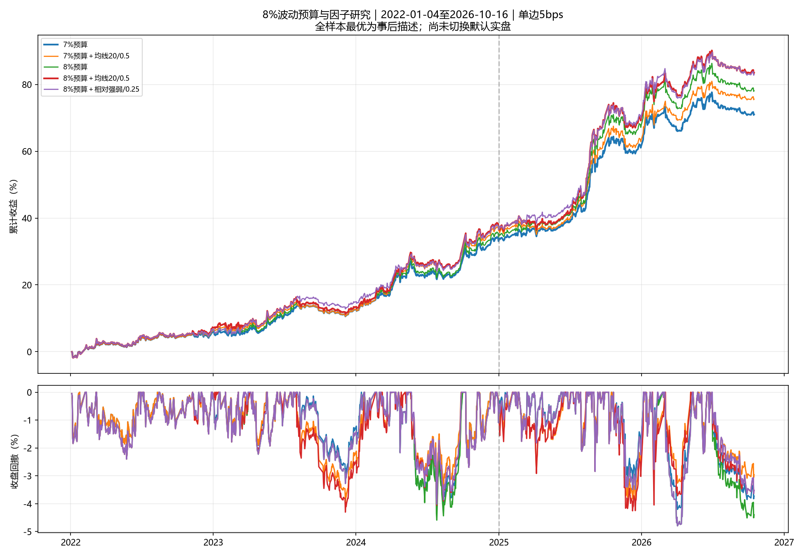

# 8%波动预算与因子叠加研究

> 历史研究快照：本报告中的默认为当时7%版本；2026-10-18已选择8%＋20日均线反转0.5，现行参数见[README](../README.md)。

研究日期2026-10-17；行情截止2026-10-16。

## 研究范围

当前默认仍为7%预算＋前4名缓冲＋必选第1名。所有候选均为离线研究，未切换实盘。
7%/8%表示风险篮子的年化波动预算，非最大波动或回撤上限，也非包含国债后的组合波动保证。固定风险ETF目标总仓位上限70%、单只30%、最多3只；弱市减半和国债60日动量规则不变。

本轮在读取结果前固定35组参数：10组预算对照、5组均线邻参、20组其他因子单独/与均线组合。8%＋20日均线反转0.5为主检验；历史最优均线参数来自上一轮研究，不能当成本轮新发现。2022–2024为设计段，2025以后为时间分段复核。全部历史年份已参与既往研究，没有独立盲测样本。

## 本轮判断

- 单独提高预算：年化由12.40%升至13.40%，夏普由1.760降至1.705；风险增加有收益回报，但效率下降。
- 主方案8%＋均线反转：年化14.13%、夏普1.768、回撤-4.30%；相对8%原评分改善，但7%均线候选的全期夏普仍较高。
- 8%中最高历史夏普为8%预算＋相对强弱/0.25。相对强弱0.25仅改变6次周选仓，均线主方案改变40次；少量事件、邻参不稳定及多轮搜索削弱了证据强度。
- 保留8%均线反转和8%相对强弱为前瞻跟踪候选；不继续增加组合复杂度，也不因8.5%/9%更高年化而升级预算。当前7%实盘保持既有规则，不能承诺历史4%～5%回撤能够延续。

## 数据、成本和时序

16只ETF，收益区间2022-01-04至2026-10-16，约400个自然日预热；沿用本地Tushare后复权收盘价与真实缺价，不下载或覆盖行情。每周最后一个开市日盘后信号于下一交易日收盘执行，执行前仍计旧仓收益，按实际漂移仓位计买卖双向换手。单边手续费3bps＋滑点2bps，并检验20bps总成本。复权连续价格不等于实际成交价；不模拟最低佣金、整手、跨境溢价和盘中回撤。周目标沿用同一已保存切换锚点，历史假设持仓不代表真实账户交易。

## 因子构造

原评分为20/40日动量各半，除60日日收益年化波动（下限5%）。所有新增因子先限制于[-1,1]，再乘当日15只风险ETF原评分截面标准差D和强度a，叠加至原评分。截面只使用当日已知数据；仍需40日动量与40日均线资格。国债不参与评分。

| 因子 | 本地构造与假说 |
| --- | --- |
| 均线反转 | −(价格−N日均价)/价格标准差/3；N=10/20/40。偏离过大扣分、趋势内回调加分。 |
| 趋势效率 | 40日价格净变化/40日绝对日变动之和；奖励更连续的上行。 |
| 涨跌波动平衡 | 1−2×近60日负收益平方和/全部收益平方和；奖励上涨贡献更大的路径，不是基本面质量。 |
| 相对强弱 | 自身20日对数收益减沪深300同期对数收益，除自身60日对数波动×√20，再除3。 |
| 突破 | 价格/此前20日最高价−1，除60日年化波动×√(20/252)，再除3；奖励已确认突破。 |
| 波动稳定性 | −log(20日波动/60日波动)/log(2)；惩罚短期波动抬升。 |

额外因子强度固定0.25/0.5，分别单独加入或叠加于20日均线反转0.5。合格标的不超过3只时评分通常不改变入选集合；组合权重仍由逆波动、协方差与仓位约束决定。

## 主要结果

夏普按零无风险利率；回撤按日收盘净值。全样本最优仅为事后描述。

| 方案 | 年化 | 夏普 | 回撤 | 实现波动 | 平均风险仓 | 20bps年化 | 20bps回撤 |
| --- | ---: | ---: | ---: | ---: | ---: | ---: | ---: |
| 7%预算 | 12.40% | 1.760 | -4.22% | 6.77% | 34.90% | 9.78% | -4.85% |
| 7%预算＋均线20/0.5 | 13.05% | 1.824 | -3.96% | 6.85% | 34.80% | 10.39% | -4.91% |
| 8%预算 | 13.40% | 1.705 | -4.80% | 7.54% | 38.36% | 10.59% | -5.16% |
| 8%预算＋均线20/0.5 | 14.13% | 1.768 | -4.30% | 7.64% | 38.30% | 11.30% | -5.30% |
| 8%预算＋相对强弱/0.25 | 14.06% | 1.792 | -4.80% | 7.50% | 38.43% | 11.25% | -4.98% |
| 8%预算＋均线20/0.5＋波动稳定性/0.25 | 14.06% | 1.778 | -5.23% | 7.56% | 38.33% | 11.22% | -5.43% |
| 逐年仅按过去选参数 | 13.29% | 1.728 | -5.23% | 7.38% | 36.68% | 10.52% | -5.43% |



## 尾部风险与熊市日

最大回撤较低也可能伴随更大的单日损失。以下弱市按前一交易日沪深300低于40日均线界定，不使用当日收盘反向划分交易时已知的市场状态。

| 方案 | 最差单日 | 弱市日收益5%分位 | 弱市平均风险仓 |
| --- | ---: | ---: | ---: |
| 7%预算 | -1.72% | -0.46% | 27.81% |
| 8%预算 | -1.97% | -0.52% | 30.39% |
| 8%预算＋均线20/0.5 | -2.58% | -0.52% | 30.52% |
| 8%预算＋相对强弱/0.25 | -1.97% | -0.52% | 30.46% |

主方案最差日为2026-02-02，前一期已持有的有色金属ETF贡献-1.29%、石油产业ETF贡献-1.11%。归因重建执行前旧仓并计入当日收盘换手费用，与正式净收益逐项核对通过；详见tail_event.csv。

## 时间分段与逐年

设计段仅允许8%候选或7%默认回退：回撤≤10%、年化不比默认低0.5个百分点以上、至少2/3训练年份收益不低于默认，再选夏普最高。滚动路径2022–2023用默认，2024起每年仅依据此前已实现收益重选，训练末端空出5个交易日。各年在同一评分历史及缓冲状态中重放并支付切换成本，不拼接不同旧仓的收益。

| 方案 | 设计段年化 | 设计段夏普 | 后段年化 | 后段夏普 | 后段回撤 |
| --- | ---: | ---: | ---: | ---: | ---: |
| 7%预算 | 10.43% | 1.661 | 15.80% | 1.920 | -4.20% |
| 7%预算＋均线20/0.5 | 11.35% | 1.808 | 15.97% | 1.885 | -3.84% |
| 8%预算 | 10.79% | 1.581 | 17.93% | 1.901 | -4.80% |
| 8%预算＋均线20/0.5 | 11.64% | 1.703 | 18.46% | 1.898 | -4.26% |
| 8%预算＋相对强弱/0.25 | 11.41% | 1.678 | 18.67% | 1.978 | -4.80% |
| 8%预算＋均线20/0.5＋波动稳定性/0.25 | 11.91% | 1.742 | 17.77% | 1.869 | -5.23% |
| 逐年仅按过去选参数 | 10.64% | 1.648 | 17.91% | 1.881 | -5.23% |

| 方案 | 2022 | 2023 | 2024 | 2025 | 2026至今 |
| --- | ---: | ---: | ---: | ---: | ---: |
| 7%预算 | 6.14% | 6.04% | 18.23% | 21.40% | 5.87% |
| 7%预算＋均线20/0.5 | 6.56% | 5.64% | 21.06% | 19.86% | 7.49% |
| 8%预算 | 6.90% | 6.04% | 18.51% | 24.86% | 6.19% |
| 8%预算＋均线20/0.5 | 7.32% | 5.58% | 21.19% | 23.63% | 8.06% |
| 8%预算＋相对强弱/0.25 | 6.90% | 7.43% | 18.88% | 24.86% | 7.33% |
| 8%预算＋均线20/0.5＋波动稳定性/0.25 | 7.24% | 4.80% | 23.04% | 24.87% | 5.92% |
| 逐年仅按过去选参数 | 6.14% | 6.04% | 18.88% | 25.13% | 5.92% |

滚动选择记录：

- 2024：8%预算＋相对强弱/0.25；训练收益截至2023-12-22。
- 2025：8%预算＋均线20/0.5＋波动稳定性/0.25；训练收益截至2024-12-24。
- 2026：8%预算＋均线20/0.5＋波动稳定性/0.25；训练收益截至2025-12-24。

## 预算及均线参数稳定性

| 方案 | 年化 | 夏普 | 回撤 | 后段夏普 |
| --- | ---: | ---: | ---: | ---: |
| 7%预算 | 12.40% | 1.760 | -4.22% | 1.920 |
| 7%预算＋均线20/0.5 | 13.05% | 1.824 | -3.96% | 1.885 |
| 7.5%预算 | 12.92% | 1.733 | -4.50% | 1.913 |
| 7.5%预算＋均线20/0.5 | 13.63% | 1.799 | -4.14% | 1.899 |
| 8%预算 | 13.40% | 1.705 | -4.80% | 1.901 |
| 8%预算＋均线20/0.5 | 14.13% | 1.768 | -4.30% | 1.898 |
| 8.5%预算 | 13.73% | 1.669 | -5.09% | 1.879 |
| 8.5%预算＋均线20/0.5 | 14.47% | 1.729 | -4.51% | 1.881 |
| 9%预算 | 13.97% | 1.631 | -5.38% | 1.858 |
| 9%预算＋均线20/0.5 | 14.74% | 1.692 | -4.73% | 1.864 |
| 8%预算＋均线10/0.25 | 13.09% | 1.643 | -4.80% | 1.739 |
| 8%预算＋均线10/0.5 | 13.76% | 1.732 | -5.23% | 1.841 |
| 8%预算＋均线20/0.25 | 13.10% | 1.636 | -4.95% | 1.706 |
| 8%预算＋均线40/0.25 | 13.59% | 1.693 | -4.95% | 1.825 |
| 8%预算＋均线40/0.5 | 13.65% | 1.703 | -4.95% | 1.923 |

## 新因子增量

每家族的历史最高夏普项，含未改善项；不可把事后赢家解释为已知有效。

| 家族 | 全样本最佳配置 | 年化 | 夏普 | 回撤 | 后段夏普 |
| --- | --- | ---: | ---: | ---: | ---: |
| 趋势效率 | 8%预算＋均线20/0.5＋趋势效率/0.5 | 13.77% | 1.730 | -4.45% | 1.837 |
| 涨跌波动平衡 | 8%预算＋均线20/0.5＋涨跌波动平衡/0.25 | 13.78% | 1.728 | -4.30% | 1.798 |
| 相对强弱 | 8%预算＋相对强弱/0.25 | 14.06% | 1.792 | -4.80% | 1.978 |
| 突破 | 8%预算＋均线20/0.5＋突破/0.25 | 13.82% | 1.739 | -4.45% | 1.882 |
| 波动稳定性 | 8%预算＋均线20/0.5＋波动稳定性/0.25 | 14.06% | 1.778 | -5.23% | 1.869 |

单因子诊断：合格标的≥5只的周截面，预测下一执行收盘至再下一执行收盘收益。滚动R²仅用过去2年且标签已结束的≥52周拟合，基准为训练标签均值。

| 因子 | 周数 | 平均秩IC | 后段IC | 滚动R² |
| --- | ---: | ---: | ---: | ---: |
| original_score | 148 | 0.034 | 0.066 | -0.0059 |
| ma20 | 148 | -0.076 | -0.062 | -0.0052 |
| trend_efficiency | 148 | 0.024 | 0.026 | -0.0099 |
| downside_balance | 148 | -0.058 | -0.031 | -0.0047 |
| relative_strength | 148 | 0.067 | 0.099 | -0.0001 |
| breakout | 148 | 0.031 | 0.028 | -0.0066 |
| volatility_ratio | 148 | 0.037 | 0.010 | -0.0016 |

## 资产依赖与统计不确定性

逐一禁止交易同一只风险ETF，所有方案保持共同信息集；比较15次，不重新选择参数。

| 比较 | 年化更高次数 | 夏普更高次数 |
| --- | ---: | ---: |
| 8%预算 对 7%预算 | 15/15 | 0/15 |
| 8%预算＋均线20/0.5 对 8%预算 | 13/15 | 11/15 |
| 8%预算＋相对强弱/0.25 对 8%预算 | 15/15 | 15/15 |
| 8%预算＋相对强弱/0.25 对 8%预算＋均线20/0.5 | 5/15 | 8/15 |

联合剔除与防守依赖：

| 方案 | 同时禁选黄金/纳指年化 | 同时禁选黄金/纳指夏普 | 国债改现金年化 | 国债改现金夏普 |
| --- | ---: | ---: | ---: | ---: |
| 7%预算 | 9.34% | 1.383 | 9.83% | 1.429 |
| 8%预算 | 10.05% | 1.322 | 10.91% | 1.417 |
| 8%预算＋均线20/0.5 | 10.24% | 1.335 | 11.63% | 1.484 |
| 8%预算＋相对强弱/0.25 | 9.77% | 1.283 | 11.56% | 1.503 |

相对强弱逐只剔除的优势在联合剔除黄金与纳指时未保留；这说明15次单标的通过仍不足以证明资产依赖已消除。国债改现金会改变防守经济含义，比较目的为识别依赖，不能要求收益完全不受影响。

- 相对7%默认的本轮搜索：20日循环块、2000次成对抽样；校正34项的最大均值收益差探索性p=0.054。
- 同为8%时因子增量：20日循环块、2000次成对抽样；校正26项的最大均值收益差探索性p=0.628。
- 8%均线反转相对8%原评分：年化算术均值收益差的未校正95%区间为[-0.71%, 2.02%]，夏普差区间[-0.130, 0.266]。
- 上述检验不是夏普选优校正，也不覆盖之前多轮研究与非平稳市场。提高预算带来的收益不能直接解释为新增alpha。

## 当前目标及后续使用

`latest_targets.csv`列出同一最新信号日的各方案目标，作为研究对照。实际实盘继续调用默认7%方案；本研究没有修改调仓建议文件、账户数据库或标的池。

## 检查、完整记录及复现

通过24项历史截断/未来行情扰动检查，默认实盘文件指纹保持一致。因子资格、排名状态与权重只读信号日及以前的数据。因子通过检查仍不等于消除了历史调参偏差。

保留一个统一研究入口、因子库新增`downside_balance`以及完整汇总；没有逐候选脚本或逐候选目录。输出包含comparison/yearly/daily_returns/target_weights/holdings/regimes/ablation/factor_diagnostics/time_audit/selection_changes/tail_event等汇总文件，以及固定参数、代码/数据指纹和选择记录；保留失败项统计供审计。

```powershell
.\.venv\Scripts\python.exe research_vol8.py --end 2026-10-16
.\.venv\Scripts\python.exe research_vol8.py --report-only
```

## 资料依据

波动管理、跨资产趋势及连续信息动量研究支持检验风险缩放与趋势路径；本文额外因子及窗口是本地假说，不是论文策略复刻，论文也不能证明本ETF池采用8%预算一定优于7%。

- [Moreira与Muir：Volatility Managed Portfolios](https://www.nber.org/papers/w22208)
- [Hurst等：A Century of Evidence on Trend-Following Investing](https://www.aqr.com/Insights/Research/Journal-Article/A-Century-of-Evidence-on-Trend-Following-Investing)
- [Da等：Frog in the Pan: Continuous Information and Momentum](https://papers.ssrn.com/sol3/papers.cfm?abstract_id=2370931)
- [Bailey等：The Probability of Backtest Overfitting](https://www.davidhbailey.com/dhbpapers/backtest-prob.pdf)

数据指纹：`f0f376437c4a18111e6b38acfe4329d9fcbfa049c1effb4e90c9f802c5a097af`。
